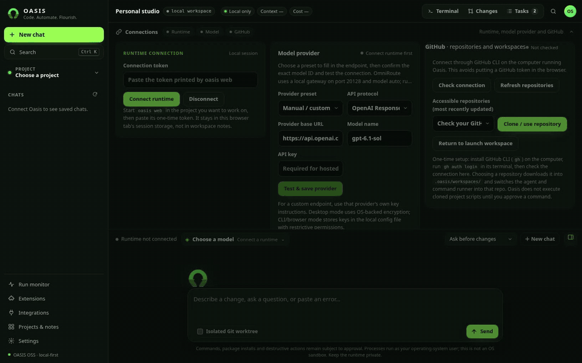
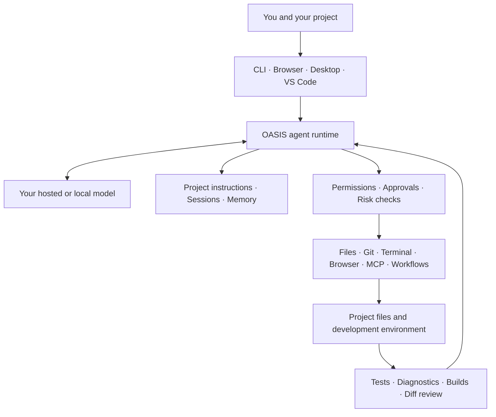

<!-- OASIS README: concise product overview and navigation -->

<p align="center">
  
</p>

<h1 align="center">OASIS</h1>
<p align="center"><strong>Code. Automate. Flourish.</strong></p>
<p align="center">An open-source, local-first AI coding agent and developer workspace.</p>

<p align="center">
  <a href="https://github.com/FAHTHIZ/oasis/actions/workflows/quality.yml"></a>
  
  <a href="LICENSE"></a>
</p>

**Bring your model. Get a real workspace.** OASIS connects the AI model you choose to your project so it can explore code, plan changes, edit files, run approved commands, use developer tools, coordinate bounded agent tasks, and help verify the result.

OASIS is not a model of its own or a hosted AI service. **You bring the model; OASIS provides the agent runtime, workspace, tools, controls, integrations, and interfaces.**

> **Beta status:** OASIS is in Beta. The source package is version `0.4.0`, but it has not been tagged or published. The only version tag currently present is `v0.3.0`; no public GitHub Release assets are available to download. See [current limits](#beta-status).

<p align="center">
  <a href="#getting-started"><strong>Get started</strong></a>
  &nbsp;·&nbsp;
  <a href="docs/USER_GUIDE.md">User guide</a>
  &nbsp;·&nbsp;
  <a href="docs/PROJECT_PLAN.md">Project status</a>
  &nbsp;·&nbsp;
  <a href="https://github.com/FAHTHIZ/oasis/releases">Releases</a>
</p>

---

<p align="center">
  
  <br/><sub>Real recording of the browser workspace (<a href="assets/demo/oasis-demo.mp4">MP4</a>). The model is a scripted local stub so the run is reproducible; the tools, approval prompt, verification gate and Changes panel are the real OASIS runtime.</sub>
</p>

## On this page

[Quick start](#quick-start) · [Overview](#what-is-oasis) · [Why OASIS](#why-oasis) · [Capabilities](#capabilities) · [Architecture](#how-it-works) · [Interfaces](#ways-to-use-oasis) · [Models](#models-and-providers) · [Safety](#control-and-safety) · [Beta status](#beta-status) · [Documentation](#documentation)

## Quick start

Requires **Node.js 22+** and Git.

```bash
# Latest main (recommended while 0.4.0 is unreleased)
git clone https://github.com/FAHTHIZ/oasis.git
cd oasis && npm install && npm install -g .

oasis setup              # pick a provider: OpenAI, Anthropic, Gemini, OpenRouter, Ollama, or any OpenAI-compatible URL
cd ~/your-project
oasis                    # interactive terminal agent
oasis web                # browser workspace (prints a local URL and access token)
oasis -p "fix the failing tests" --output-format json   # one-shot, for scripts and CI
oasis doctor --test-provider                           # check the environment and live tool calling
```

The [checksum-verified installers](docs/INSTALL.md#command-line-installation) install the latest **tagged** release (`v0.3.0`), which predates most of the work below. Use the source install above to get current `main`.

## What is OASIS?

OASIS is a coding-agent runtime connected to your actual project, not just a chat window that suggests code. You describe a task; the selected model reasons about it and requests tools; OASIS applies its execution rules, works within the configured workspace, returns results, and helps you inspect the changes.

One runtime supports multiple ways to work. You can change model providers without rebuilding your workflow around a single vendor.

## Why OASIS

OASIS follows the familiar agent-harness design (tools, subagents, hooks, MCP, skills, CLAUDE.md/AGENTS.md instructions, Claude Code style tool names) and adds guards aimed at the most common complaints about coding agents. Each guard below is implemented and covered by tests in `test/`:

| Complaint | What OASIS does |
|---|---|
| "It replaced my code with `// ... rest unchanged`" | **Change guard** refuses elision placeholders in `edit_file`, `write_file` and `notebook_edit`, and warns on large unexplained shrinkage. |
| "It said tests pass when they didn't" | **Verification gate** + **claim check**: a code edit is only reported verified after a real check passes and the diff was reviewed; pipe-masked exit codes (`npm test \| tail`) don't count. |
| "It deleted or skipped my tests" | **Test-weakening check** flags removed assertions and new `skip`/`xit` markers. |
| "It committed my API key" | **Commit secret scan** builds the commit in a throwaway index and refuses credential hits; **secret shield** masks secrets in tool output before they reach the model. |
| "It forgot my CLAUDE.md rules" | **Rule refresh** restates `NEVER`/`ALWAYS`/`MUST` rules after compaction and every ~60k characters; oversized instruction files are truncated **visibly**, never silently. |
| "Compaction lost my context" | **`/compact undo`** restores the pre-compaction history; context-overflow errors trigger recovery instead of a dead session. |
| "It hung on a pager / prompt" | Commands run non-interactively (`PAGER=cat`, `GIT_TERMINAL_PROMPT=0`, SSH batch mode); idle streams and stuck background jobs are detected. |
| "It killed my app / wiped my changes" | `kill`, `taskkill`, `Stop-Process` and similar need approval; **git safety snapshots** are taken before `git checkout .`, `git restore`, `rm` and friends. |
| "It installed a hallucinated package" | **Package vetting** looks names up on npm, PyPI or crates.io before installing. |
| "It burns tokens" | **Lean tool loading** defers rarely used tool schemas (~2.7k tokens per request), **read dedup** skips unchanged re-reads, and a compact subagent schema keeps big agent lists cheap. |
| "It reads the whole repo and still gets lost" | **`repo_map`** / `/map` gives a ranked outline of files and their top-level symbols, so the agent opens the right file at the right line first. |
| "I have to leave my editor to ask for every small change" | **`oasis watch`** acts on comments ending in `AI!` (change) or `AI?` (question) as you save files, with normal approvals. |
| "It retries the same failing command forever" | **Retry guard** stops repeated identical failures and asks for a different approach. |

The complete list is in the [changelog](CHANGELOG.md). These guards reduce common failure modes; they do not make any model infallible.

## Capabilities

| Area | What it does |
|---|---|
| **Codebase work** | Explore repositories, search and read files, plan tasks, edit code, and review diffs. |
| **Execution and verification** | Run approved commands, capture bounded output, run project checks, and collect configured diagnostics. |
| **Agent coordination** | Delegate bounded sub-tasks, request specialist read-only reviews, and track dependencies on a task board. |
| **Context and recovery** | Save sessions, load project instructions and memory, compact older history, and use supported checkpoints and rewind. |
| **Automation and integrations** | Run sandboxed JavaScript workflows; connect MCP servers, hooks, Agent Skills, supported extension imports, local plugins, and web-search integrations. |
| **Developer surfaces** | Work through the terminal CLI, local browser workspace, desktop packaging, VS Code-compatible integration, SDK, or GitHub Action. |

These are implemented product areas, not a claim that every provider, integration, platform, or end-to-end workflow has identical coverage. See the [implementation inventory](docs/PROJECT_PLAN.md).

## How it works

OASIS is the orchestration and control layer between your project and the model you select. The [architecture guide](docs/ARCHITECTURE.md) maps the actual runtime, entry points, execution boundaries, data stores, and integrations.



The model reasons and proposes tool calls. OASIS manages execution, tool contracts, permissions, workspace boundaries, session state, and tool results.

## Ways to use OASIS

| Surface | Purpose and current boundary |
|---|---|
| **Terminal CLI** | Interactive coding, one-shot tasks, setup, diagnostics, and automation. Requires Node.js 22+; native PTY support is optional and platform-dependent. |
| **Local browser workspace** | Visual workspace with project tools, approvals, terminal, changes, and run monitoring. Connects to a local runtime; it is not a hosted cloud workspace, and browser state does not fully sync with CLI state. |
| **Desktop app** | Electron app with a project-folder picker and local backend. Windows, macOS, and Linux packaging is configured, but builds are unsigned and public installers are not yet published. |
| **VS Code integration** | Brings the OASIS runtime into a supported editor workflow; it is not a full IDE suite. |
| **SDK and GitHub Action** | Use OASIS from scripts and repository automation. Unattended use still needs careful configuration and isolation. |

## Models and providers

OASIS does not include an AI model, API subscription, or hosted inference service. Connect a supported provider or compatible endpoint, or use a local model service.

**Setup paths:** OpenAI · Anthropic · Google Gemini · OpenRouter · local Ollama · compatible gateways such as OmniRoute.

Tool calling, streaming, context size, and pricing depend on the selected model and endpoint. Optional easy/strong model routing uses configured models and estimated costs; it does not guarantee savings or equivalent answer quality.

See [provider setup](docs/INSTALL.md) and the [configuration guide](docs/USER_GUIDE.md).

## Control and safety

OASIS makes consequential actions visible through permission modes, approval rules, command-risk checks, workspace safeguards, bounded tool output, verification records, diffs, checkpoints, and recovery tools.

> **Important:** OASIS runs approved commands with the operating-system permissions of the user who launched it. Approval prompts and workspace checks are useful controls, but they are **not an operating-system sandbox**.

The optional OS sandbox targets Linux and macOS, is disabled by default, and does not provide full filesystem-read isolation. Native Windows OS sandboxing is not implemented. MCP servers, hooks, plugins, executable skills, and other third-party tools may operate beyond OASIS file-tool protections. Treat Beta software accordingly.

Read the [security policy](SECURITY.md), [security and reliability audit](docs/SECURITY_RELIABILITY_AUDIT.md), and [privacy notes](docs/PRIVACY.md).

## Getting started

| Goal | Guide |
|---|---|
| Install the CLI | [CLI installation](docs/INSTALL.md#command-line-installation) |
| Try OASIS on Android | [Termux guide](docs/TERMUX.md) |
| Check desktop availability | [Desktop app guide](docs/INSTALL.md#desktop-app--no-terminal-required) |
| Learn commands, tools, and settings | [User guide](docs/USER_GUIDE.md) |

**Desktop downloads:** CI builds packages, but public desktop installers are not available yet. Check the [Releases page](https://github.com/FAHTHIZ/oasis/releases); until assets are published, use the CLI installation path. The prepared 0.4.0 notes are not a downloadable release.

For a safe first task, open a project you understand and ask:

> Read this repository. Explain its main parts and how they connect. Do not change any files yet.

Review proposed file changes and commands before approving them.

## Beta status

OASIS is in **Beta**, not production-certified. The main known limits are:

- **Distribution:** 0.4.0 is prepared in source but not tagged or published; no public release assets are available.
- **Desktop:** Builds are unsigned; automatic updates and publisher signing/provenance are not configured. Clean-machine install and first-run checks remain release gates.
- **Isolation:** Linux/macOS sandboxing is optional, off by default, and not full filesystem-read isolation. Native Windows sandboxing is not implemented.
- **Android:** No native Android APK is published. Termux is the CLI route; PTY and background execution are not guaranteed.
- **State and recovery:** Browser state does not fully synchronize with CLI state. Restarting a process does not resurrect killed workers or pending approvals.
- **Compatibility:** Extension and plugin support is specific, not universal drop-in compatibility with every marketplace or manifest.
- **Benchmarks:** The 33-task evaluator is a smoke/regression suite, not a representative repository-scale benchmark. No matched live-model head-to-head result or parity, speed, accuracy, or token-savings claim is published.

The next milestone is a production-oriented release gated on same-commit CI, platform installer checks, clean-machine first-run testing, critical browser workflows, security-boundary validation, and documentation matching the shipped build. Track the work in the [project plan](docs/PROJECT_PLAN.md).

## Documentation

The [documentation index](docs/README.md) maps every canonical guide, integration reference, release note, and research archive. Open the guide for the level of detail you need:

| Topic | Reference |
|---|---|
| Product status and architecture | [Project plan](docs/PROJECT_PLAN.md) · [Architecture](docs/ARCHITECTURE.md) |
| Setup and daily use | [Installation](docs/INSTALL.md) · [User guide](docs/USER_GUIDE.md) · [Termux](docs/TERMUX.md) |
| Trust and evaluation | [Security audit](docs/SECURITY_RELIABILITY_AUDIT.md) · [Security policy](SECURITY.md) · [Privacy](docs/PRIVACY.md) · [Benchmarks](docs/BENCHMARKS.md) |
| Extensibility and experience | [Workflows and skills](docs/WORKFLOWS_AND_SKILLS.md) · [Shortcuts](docs/KEYS.md) · [Brand guide](docs/BRAND.md) |
| Project upkeep and research | [Repository maintenance](docs/REPOSITORY_MAINTENANCE.md) · [Research notes](docs/research/README.md) |
| Automation on GitHub | [GitHub Action guide](docs/github-action.md) · [workflow example](docs/examples/oasis-github.yml) |
| Release history | [Changelog](CHANGELOG.md) · [prepared 0.4.0 notes](docs/releases/v0.4.0.md) |
| Contributions | [Contributing guide](CONTRIBUTING.md) |

## Development

Requirements: **Node.js 22 or newer**.

```bash
git clone https://github.com/FAHTHIZ/oasis.git
cd oasis
npm install
npm run check
```

The check pipeline validates the site, public metadata, evaluation controls, test suite, and evaluation fixtures. GitHub Actions adds version-matrix, browser, installer, and desktop-package checks. Check results for the exact commit being reviewed.

## Contributing

Contributions are welcome. Read [CONTRIBUTING.md](CONTRIBUTING.md) and the [project plan](docs/PROJECT_PLAN.md) before changing behavior. Keep changes focused, add tests, and document what you could and could not verify.

## License

Apache License 2.0 — see [LICENSE](LICENSE).
