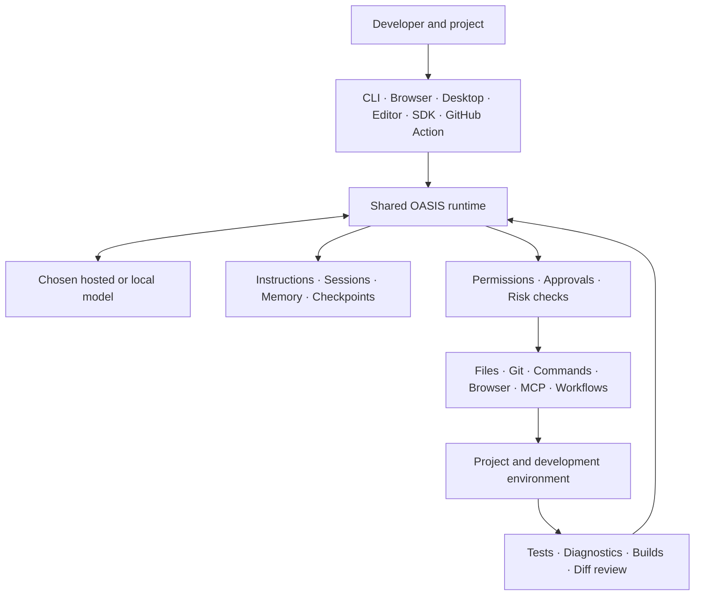

<!-- OASIS product overview. Current lifecycle and release qualification: docs/PROJECT_PLAN.md -->

<p align="center">
  
</p>

<h1 align="center">OASIS</h1>
<p align="center"><strong>Code. Automate. Flourish.</strong></p>
<p align="center">An open-source, local-first agentic development workspace.</p>

<p align="center">
  <a href="https://github.com/FAHTHIZ/oasis/actions/workflows/quality.yml"></a>
  
  
  <a href="LICENSE"></a>
</p>

**OASIS connects the model you choose to the software you build.** It brings codebase understanding, planning, file changes, controlled command execution, agent coordination, integrations, and verification into one inspectable local runtime.

OASIS is not a model, hosted inference service, or vendor-locked IDE. You choose the model/provider—including a local endpoint—and OASIS supplies the agent runtime, workspace tools, policy controls, memory, automation, and developer surfaces.

> **Current lifecycle — Feature-complete 1.0 Release Candidate.** The planned product scope is established; OASIS is no longer in Beta or an early feature-building phase. Work on `main` is focused on making the existing agents and product surfaces more capable, robust, consistent, accessible, and production-ready. Remaining qualification covers reliability, lifecycle correctness, security boundaries, platform verification, accessibility, packaging, and documentation. The development package on `main` is `1.0.0`, with `oasisRelease` metadata marking it as Release Candidate 1; it is not a published stable release. The last published stable desktop/CLI release remains [`v0.4.0`](https://github.com/FAHTHIZ/oasis/releases/tag/v0.4.0) until the 1.0.0 release gates are satisfied.

<p align="center">
  <a href="#quick-start"><strong>Get started</strong></a>
  &nbsp;·&nbsp;
  <a href="docs/USER_GUIDE_MAP.md">User guide</a>
  &nbsp;·&nbsp;
  <a href="docs/PROJECT_PLAN.md">Release qualification</a>
  &nbsp;·&nbsp;
  <a href="https://github.com/FAHTHIZ/oasis/releases">Downloads</a>
</p>

---

<p align="center">
  
  <br/><sub>Reproducible browser-workspace demo. The model response is a scripted local fixture; the workspace, tools, approval flow, verification gate, and Changes panel are the actual OASIS runtime.</sub>
</p>

## Quick start

**Requirements:** Node.js 22 or newer and Git.

### Run the current release-candidate source

```bash
git clone https://github.com/FAHTHIZ/oasis.git
cd oasis
npm install
npm install -g .

oasis setup
cd ~/your-project
oasis
```

This installs the current `main` source package (`1.0.0`, Release Candidate 1). It is the release-candidate development build, not the stable desktop download channel.

### Install the latest stable CLI release

Use the [checksum-verified installer](docs/INSTALL.md#command-line-installation). It resolves the latest stable semantic-version tag to an immutable commit and does not install the moving `main` branch. At this snapshot, that stable tag is `v0.4.0`.

### Download the desktop app

The [published v0.4.0 release](https://github.com/FAHTHIZ/oasis/releases/tag/v0.4.0) contains Windows x64, macOS arm64, and Linux x86_64 installers. These artifacts are unsigned. The 1.0.0 release-candidate source has not yet been published as a desktop installer.

After connecting a provider, start with a repository you understand and ask OASIS to explain the project before approving changes.

## Why OASIS

Most coding-agent frustration is not about raw model intelligence. It is about the harness: agents that loop, give up, claim success without running anything, mangle files, lose work, or ignore the rules you set. OASIS puts guardrails for each of those in the runtime, so they hold no matter which model you connect.

| Common frustration with coding agents | What OASIS does |
|---|---|
| "It said it was done, but never ran the tests." | A post-edit verification gate. The agent must review its diff and run a relevant check before it can finish, and any later edit resets that state. |
| "Ten patches, and the same error every time." | Fix-thrash detection. The agent is told to step back and diagnose on the 3rd identical failure after edits, and to summarize and change approach (or ask you) on the 5th. Unchanged retries stop after 5. |
| "It changed the test to match the broken code." | Weakened-test detection, plus reminders never to weaken or delete a test to make it pass. |
| "It replaced my function with `// ... rest unchanged`." | A change guard blocks placeholder edits and flags large, unexplained deletions. |
| "It ran a destructive git command." | Force-push, `reset --hard` and `clean -f` are blocked by default. Other commands that throw away work (`checkout .`, `restore`, `stash drop`, `rm`) need your explicit approval, and the working tree is saved under `refs/oasis/safety/` before they run. |
| "It edited files in plan mode." | Plan mode is enforced in the runtime: only read-only tools run. |
| "It committed my API key." | Commit secret scanning, including raw `git commit` typed through the shell. |
| "The connection dropped and it ran my tool twice." | Dropped streams restart the reply. Tools run only after a reply completes, so a restart can never run a tool twice. |
| "Cancelling erased the conversation." | Cancelling keeps your request and the partial reply in history. |
| "CI killed the job, but the command kept running and the job passed." | Headless mode stops running commands on SIGTERM, SIGINT or SIGHUP and exits with `128 + signal`. |
| "Tool definitions eat my context." | Lean tool loading defers rarely used tool schemas and MCP tools until they are needed. |
| "It switched to English halfway through." | When you set a reply language, a short reminder follows each tool batch to keep replies in that language. |

Each row describes implemented, tested runtime behavior. It is not a benchmark claim; see [Benchmarks](docs/BENCHMARKS.md) for what has and has not been measured.

## Built for small and local models

OASIS assumes the model might be small, quantized, or running on your laptop:

- **Real context windows.** OASIS reads the window that is actually loaded from Ollama, LM Studio and llama.cpp `llama-server`. For unknown hosted or self-hosted models, it reads the provider's `/models` listing (DeepSeek, OpenRouter, vLLM). If the window is too small, OASIS prints the exact command to fix it.
- **Small-context profile.** At 16K or less, OASIS uses a compact system prompt (about 1.6K tokens), sends only 13 essential tools, starts compaction earlier, and trims long tool results to fit.
- **Tool-call repair.** Almost-valid JSON (code fences, trailing commas, Python literals, missing braces) is repaired, and tool calls written as text (Hermes, Qwen and Llama formats) are executed. Unrepairable calls return an error that explains how to resend them, instead of ending the turn.
- **Forgiving edits.** Edit matching tolerates whitespace and indentation drift while preserving CRLF line endings, BOMs, curly quotes and your indentation style.

See [local context windows](docs/USER_GUIDE.md#local-models-and-small-context-windows) and [tool-call repair](docs/USER_GUIDE.md#tool-call-repair-for-smaller-models) in the user guide.

## What OASIS provides

| Capability area | What is included |
|---|---|
| **Agent runtime** | Multi-step model/tool orchestration, planning, codebase exploration, edits, tool-result handling, and task completion reporting. |
| **Workspace operations** | File search/read/write/edit/delete, Git inspection, scoped work, snapshots, diffs, and optional isolated worktrees. |
| **Execution policy** | Permission modes, command-risk checks, approval rules, protected paths, bounded output, process cleanup, and optional OS sandbox integration. |
| **Verification** | Project checks, diagnostics, language-server integration where configured, diff review, weakened-test detection, automatic test runs, and claim checks. |
| **Context and continuity** | Saved sessions, project instructions, memory, context estimates, compaction, checkpoints, rewind, and recovery records. |
| **Agent coordination** | Bounded subagents, specialist reviews, task boards, dependency-aware dispatch, monitoring, and workflow automation. |
| **Integrations** | MCP, hooks, Agent Skills, local plugins, extension import/export, search integrations, GitHub automation, and editor bridges. |
| **Developer surfaces** | Terminal CLI, authenticated local browser workspace, Electron desktop shell, VS Code-family integration, SDK, and GitHub Action. |
| **Local-first operation** | Local runtime and workspace; connect hosted or local models under the provider and endpoint policies you choose. |

Capabilities are shared across the product but are not identical on every operating system, provider, editor, or integration. Read the [support and qualification matrix](docs/PROJECT_PLAN.md#support-and-qualification-matrix) before relying on a platform-specific path.

## Product architecture

OASIS separates the user-facing surfaces from the shared runtime and the model provider:



The model reasons and requests tools. OASIS owns tool contracts, workspace checks, permission decisions, process execution, state handling, and the evidence returned to the model and user.

See [Architecture](docs/ARCHITECTURE.md) and the [runtime source map](src/README.md).

## Supported surfaces and boundaries

| Surface | Current position |
|---|---|
| **CLI** | Primary supported developer workflow; Node.js 22+. |
| **Local browser workspace** | Local authenticated interface backed by the shared runtime. It is not a hosted cloud service. Some browser-side project/task/note state remains separate from CLI state. |
| **Desktop** | Published v0.4.0 installers for Windows x64, macOS arm64, and Linux x86_64. Packages are unsigned; clean-machine install/update/uninstall qualification remains open. |
| **VS Code-family integration** | Supported integration path; compatibility is not universal across every editor extension ecosystem. |
| **SDK and GitHub Action** | Programmatic and repository-automation surfaces; unattended use still requires deliberate permissions and isolation. |
| **Android / Termux** | CLI can be tried in Termux, but Android is not a fully qualified platform. There is no native Android APK and native PTY/background behavior is not guaranteed. |

## Security and operating boundaries

OASIS provides layered controls, not a guarantee that arbitrary model output, repository code, commands, packages, MCP servers, hooks, skills, or plugins are safe.

- Approved commands execute with the operating-system permissions of the user who launched OASIS.
- Optional Linux/macOS sandboxing is disabled by default and does not provide full filesystem-read isolation. Native Windows OS sandboxing is not implemented.
- Approval prompts and workspace checks are not equivalent to operating-system isolation.
- Third-party integrations can execute code with the user's permissions. Enable only sources you trust.
- The browser workspace stores some local data in browser storage; that content is not encrypted by OASIS.
- The runtime should remain loopback-only unless TLS, authentication, trusted-device controls, and the deployment threat model have been deliberately reviewed.

Read [SECURITY.md](SECURITY.md), [Privacy](docs/PRIVACY.md), and the dated [security/reliability audit](docs/SECURITY_RELIABILITY_AUDIT.md).

## Release-candidate qualification

The product is in the 1.0 release-candidate phase—not a feature-preview phase. The central scope is established; remaining work is concentrated on proving and refining the complete product journey.

Open release gates include same-candidate full CI (including the corrected browser verification fixture), clean-machine desktop journeys, an explicit unsigned-package distribution decision, and security-boundary review. The 33-task evaluator is a regression/smoke suite, not a representative repository-scale benchmark. No broad model-parity, speed, accuracy, or token-savings claim is made.

The [release-qualification plan](docs/PROJECT_PLAN.md) is the authoritative status and evidence record. A release candidate must not be described as stable or production-ready until its acceptance gates have been demonstrated on the same immutable candidate.

## Documentation

| Need | Reference |
|---|---|
| Product scope, maturity, support matrix, and release gates | [Project and qualification plan](docs/PROJECT_PLAN.md) |
| System boundaries, execution flow, and data ownership | [Architecture](docs/ARCHITECTURE.md) |
| Installation, downloads, update, and uninstall | [Installation](docs/INSTALL.md) |
| Android / Termux | [Termux guide](docs/TERMUX.md) |
| Task-oriented usage navigation | [User-guide map](docs/USER_GUIDE_MAP.md) |
| Full commands, settings, tools, integrations, and workflows | [Complete user guide](docs/USER_GUIDE.md) |
| Security, privacy, and evaluation | [Security policy](SECURITY.md) · [Privacy](docs/PRIVACY.md) · [Benchmarks](docs/BENCHMARKS.md) |
| Workflows, skills, plugins, and shortcuts | [Workflows and skills](docs/WORKFLOWS_AND_SKILLS.md) · [Keys](docs/KEYS.md) |
| Runtime module map and extraction policy | [src/README.md](src/README.md) |
| Test domains and runner conventions | [test/README.md](test/README.md) |
| Repository ownership and maintenance | [Maintenance guide](docs/REPOSITORY_MAINTENANCE.md) |
| Release history | [Changelog](CHANGELOG.md) · [published v0.4.0 notes](docs/releases/v0.4.0.md) · [current 1.0.0 candidate notes](docs/releases/v1.0.0-candidate.md) |

## Development

```bash
npm install
npm test
npm run check
```

Use the explicit `npm test` command; bare `node --test` can discover helper servers and archived fixtures. See [CONTRIBUTING.md](CONTRIBUTING.md) and the [test map](test/README.md).

## License

Apache License 2.0 — see [LICENSE](LICENSE).
