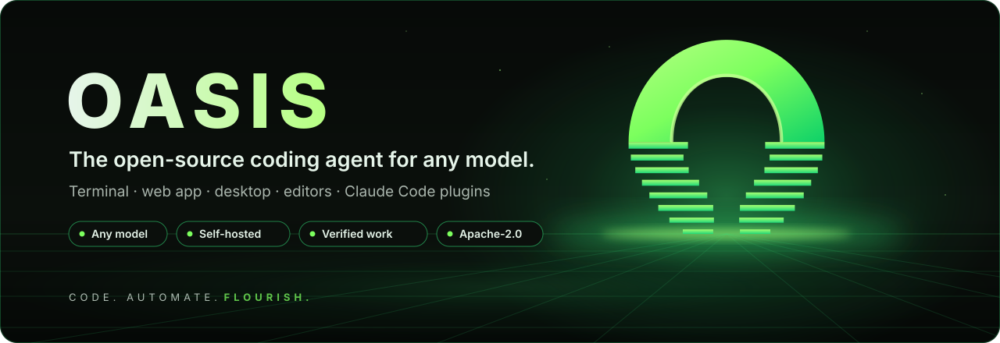
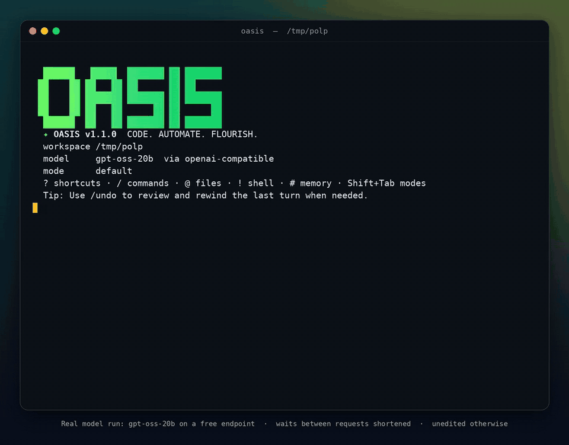
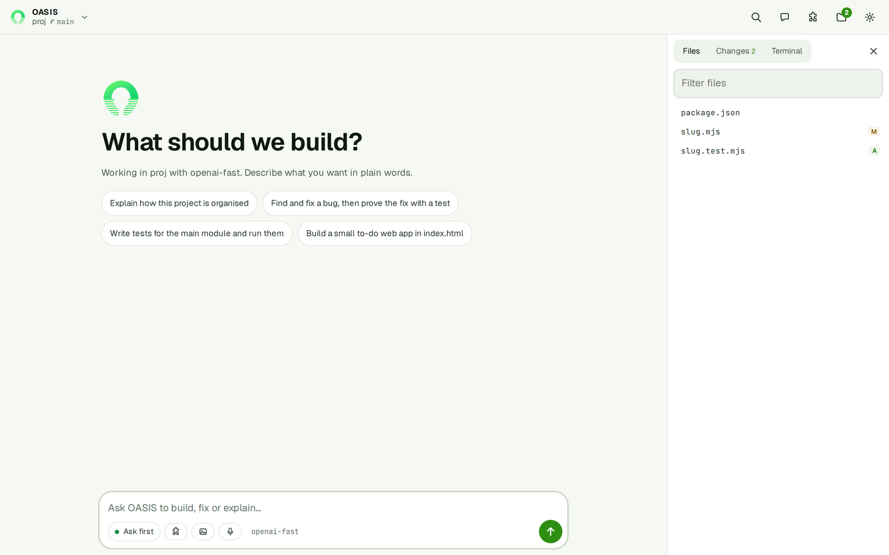

<p align="center">
  <a href="https://github.com/FAHTHIZ/oasis">
    
  </a>
</p>

<p align="center">
  <a href="https://github.com/FAHTHIZ/oasis/actions/workflows/quality.yml"></a>
  <a href="https://github.com/FAHTHIZ/oasis/releases/latest"></a>
  
  
  
  <a href="LICENSE"></a>
</p>

<h3 align="center">The open-source coding agent for any model.</h3>

<p align="center">
  Bring any model, keep your Claude Code setup, and get work that is actually checked.<br>
  OASIS runs on your own computer or server and supplies the tools, subagents, permissions and memory<br>
  around whichever model you connect. It won't say "tests pass" unless it saw them pass.
</p>

<p align="center">
  <a href="#install"><b>Install</b></a> ·
  <a href="#quick-start"><b>Quick start</b></a> ·
  <a href="#two-ways-to-work">Terminal and web</a> ·
  <a href="#connect-it-to-your-tools">Editors and protocols</a> ·
  <a href="#plugins-mcp-and-models">Plugins and models</a> ·
  <a href="#how-it-compares">Comparison</a> ·
  <a href="docs/README.md">Docs</a>
</p>

<br>

<p align="center">
  
  <br><sub>A finished task in the web app. Captured by the browser end-to-end test: the real OASIS runtime editing real files and running real tests, with a scripted model so the run is reproducible. Unscripted real-model runs are under <a href="#tested-like-a-real-user">Tested like a real user</a>.</sub>
</p>

## Why OASIS

<table>
  <tr>
    <td width="33%" valign="top">
      <h3>Any model, no lock-in</h3>
      OpenAI, Anthropic, Gemini, Bedrock, Vertex AI, Foundry, OpenRouter, Groq, DeepSeek, Mistral, xAI, any OpenAI-compatible endpoint, or a local server such as Ollama, LM Studio, llama.cpp or vLLM. <code>oasis connect</code> finds a model that can call tools and saves backups for failover.
    </td>
    <td width="33%" valign="top">
      <h3>Your Claude Code setup, as is</h3>
      <code>CLAUDE.md</code>, <code>.claude/agents</code>, skills, slash commands, hooks, settings, <code>.mcp.json</code> and Claude Code plugins from any marketplace load without conversion. Codex plugins and Gemini CLI extensions are converted on install.
    </td>
    <td width="33%" valign="top">
      <h3>It checks its own work</h3>
      After edits, a verification gate sends the agent back if it skipped the diff review or the checks. A "tests pass" claim that no check backed up is sent back too, and if a check couldn't run, the answer says so. Every edit is checkpointed, so a turn can be undone.
    </td>
  </tr>
  <tr>
    <td valign="top">
      <h3>Self-hosted, remote-ready</h3>
      The web app is served by OASIS on your workstation or server. Files, shell and model keys stay there. Browsers sign in with a 256-bit access key, behind DNS-rebinding protection and brute-force lockout. Close the tab mid-task and it picks up where it was.
    </td>
    <td valign="top">
      <h3>A real agent system</h3>
      Parallel, background and resumable subagents, agent teams with a shared task board, a git worktree per agent, <code>/goal</code> to keep going until a condition holds, durable routines on a schedule or webhook, and cross-session memory and search.
    </td>
    <td valign="top">
      <h3>Safety you can read</h3>
      Clear permission modes, shell-command risk analysis, protected paths, secret scanning, guarded network tools and optional OS or container sandboxes. Project settings that loosen anything wait until you trust the workspace.
    </td>
  </tr>
</table>

## Install

One package gives you the terminal agent and the web app. It needs Node.js 22.15+ and Git.

| Method | Command |
| --- | --- |
| macOS, Linux | `curl -fsSL https://raw.githubusercontent.com/FAHTHIZ/oasis/main/scripts/install.sh \| sh` |
| Windows (PowerShell) | `irm https://raw.githubusercontent.com/FAHTHIZ/oasis/main/scripts/install.ps1 \| iex` |
| Homebrew | `brew tap fahthiz/oasis https://github.com/FAHTHIZ/oasis && brew install fahthiz/oasis/oasis-cli` |
| From source | `git clone https://github.com/FAHTHIZ/oasis.git && cd oasis && npm install && npm install --global .` |
| Desktop app | Installers for Windows, macOS and Linux on [GitHub Releases](https://github.com/FAHTHIZ/oasis/releases) (not yet code-signed, see [Desktop](docs/DESKTOP.md)) |

The install scripts take the latest stable release, ask before changing anything, and finish with `oasis doctor`. Every release ships the npm tarball, the desktop installers and a `SHA256SUMS` file. See [Downloads and releases](docs/RELEASES.md).

## Quick start

```sh
cd your-project
oasis connect        # paste an API key, a model link or a local server address
oasis                # work in the terminal
oasis web --open     # or open the web app on this folder
```

Then ask in plain words: "find out why the login test fails and fix it". OASIS reads the code, edits the files, runs the checks and shows you the diff. `/rewind` (or <kbd>Esc</kbd> <kbd>Esc</kbd>) undoes a turn.

<details>
<summary><b>Scripts and CI</b></summary>

```sh
oasis -p "summarize the open TODOs"                                   # one-shot
oasis exec --output-format stream-json "fix the lint errors" > run.jsonl
oasis -p --permission-mode dont-ask "review this diff"                # never waits on an approval
oasis -p --permission-mode auto --goal "npm test passes"              # keeps going until the check says it holds
```

`--output-schema` gives structured JSON, a goal that is never met exits with code 1, and a run stopped part-way is saved so `oasis --resume ID` can continue it.

</details>

## Two ways to work

OASIS has two interfaces, the terminal and the web app, on the same runtime, sessions and settings. Start a task in the terminal and continue it in the browser under **Chats → Earlier on this computer**.

<table>
  <tr>
    <th width="50%">Terminal — <code>oasis</code></th>
    <th width="50%">Web app — <code>oasis web --open</code></th>
  </tr>
  <tr>
    <td><a href="assets/demo/oasis-real-model-demo.mp4"></a></td>
    <td></td>
  </tr>
  <tr>
    <td valign="top">Streaming diffs with word highlights, inline images, <code>/tasks</code>, <code>/rewind</code>, <code>/export</code> to Markdown or HTML. <code>oasis -p</code> and <code>oasis exec</code> for scripts.</td>
    <td valign="top">Live timeline with expandable steps, a task sidebar, Files and Changes panels, a real terminal (<kbd>Ctrl</kbd>+<kbd>&#96;</kbd>), plan mode, Undo, cost and context meters, <code>/</code> and <code>@</code> autocomplete, and one-click Claude Code plugins.</td>
  </tr>
</table>

The web app runs on a computer or server you control, not a hosted service, and opens in any modern desktop browser. An optional [desktop app](docs/DESKTOP.md) for Windows, macOS and Linux shows the same workspace in its own window, keeps the model key in the operating system's key store and updates itself; there is no separate mobile app.

<details>
<summary><b>Run the web app on a server</b></summary>

```sh
oasis web --public-url https://oasis.example.com --trust-proxy   # behind Caddy, nginx, Tailscale Serve or Cloudflare Tunnel
oasis web key                                                    # show the access key; --rotate replaces it
```

Open the address from your workstation, paste the link once and tick **Remember this device**. Tasks run on the server, so a reload or dropped connection reattaches to the running task and asks any open approval again. Recipes and the full security model: [Remote access](docs/REMOTE-ACCESS.md).

<table>
  <tr>
    <td width="55%"></td>
    <td width="45%"></td>
  </tr>
  <tr>
    <td><sub>Light theme</sub></td>
    <td><sub>Signing in to a remote OASIS server</sub></td>
  </tr>
</table>

</details>

## Connect it to your tools

Beyond the two interfaces, OASIS speaks the protocols other tools already use, so the same runtime can sit behind your editor, an existing Codex client or your own code.

| From | Start it with | What you get |
| --- | --- | --- |
| Zed, JetBrains and other ACP editors | `oasis acp` | The Agent Client Protocol over stdio: sessions you can list, load, resume, close and delete, Mode and Model pickers, a context meter, questions shown as editor forms, and `$/cancel_request` that really stops the turn |
| Codex App Server clients | `oasis app-server` | Clients built for `codex app-server` drive OASIS with any model: threads, turns, steering, approvals, inline review, files, commands and fuzzy file search |
| VS Code, Cursor, Windsurf | `oasis ide install` | The VS Code-family extension, connected to an OASIS runtime |
| Your own code | `import` from `src/sdk.mjs` | The Node.js SDK: session, headless, tool and hook APIs in your process |
| CI | `action.yml` | A GitHub Action that runs OASIS in a workflow with its credentials and permissions |
| Chat | `oasis gateway` | Telegram, Slack or Discord gateways, configured explicitly |

<details>
<summary><b>Codex App Server details</b></summary>

- Transports: JSONL on stdio; `--listen ws://IP:PORT` for WebSocket (one message per frame, `/readyz` and `/healthz` probes, any request with an `Origin` header refused); `--listen unix://[PATH]` for a private Unix socket (folder mode 700, socket mode 600, no token needed).
- WebSocket auth: `--ws-auth capability-token` with a mode-600 token file or SHA-256 hash, or `--ws-auth signed-bearer-token` for HS256 JWTs with `exp`, `nbf`, issuer, audience and clock-skew checks. A non-loopback listener without auth is refused.
- Threads: start, resume, fork, read, list and search, rename, archive and unarchive, delete, unsubscribe, list loaded, and compact. Turns: start, steer, interrupt, and `review/start` for inline code review.
- Discovery: `model/list`, `skills/list` (system, repo and user scopes), `mcpServerStatus/list` for a loaded thread, `hooks/list`, `config/read` (read-only, secrets redacted) and `account/read`.
- Also: `thread/turns/list`, `thread/shellCommand` and `gitDiffToRemote`.
- Files and commands: `fs/*` (read, write, list, copy, remove, watch) and `command/exec` with stdin, resize, terminate and streamed output, including PTY mode. Paths stay inside the workspace folders, commands go through OASIS's sandbox, and a plan-mode server refuses writes and commands.
- `fuzzyFileSearch` ranks files and folders for @-file pickers, with match positions and cancellation tokens.
- Not implemented: account login, rate-limit and usage methods (OASIS needs no OpenAI account), config writes, plugin, marketplace and app methods, realtime sessions, and MCP methods other than the status list. Field names follow the Apache-2.0 protocol definitions in `openai/codex`; no Codex code is included.

</details>

Full method lists for both protocols are in [Interfaces](docs/INTERFACES.md).

## How it fits together

<p align="center">
  
</p>

The model proposes replies and tool calls. OASIS decides which tools exist, which calls need approval, what goes back to the model and what counts as verified. See [Architecture](docs/ARCHITECTURE.md).

## Plugins, MCP and models

**Claude Code plugins.** Open **Plugins** in the web app, add Anthropic's official marketplace and install with one click, or use the terminal. Commands, agents, skills, hooks, MCP servers and language servers load the way they do in Claude Code.

```sh
oasis plugin marketplace add anthropics/claude-plugins-official
oasis plugin install superpowers@claude-plugins-official
oasis add BuilderIO/skills            # Codex plugins and Gemini CLI extensions, converted on install
```

**Apps in one step.** Say "connect GitHub" or type `/connect linear` and a Connect card appears in the conversation. Approve access on the service's own page and its tools are ready in the same turn. 48 apps are built in, most signing in with OAuth and a few needing no sign-in, and any other remote MCP server works by name from the official MCP Registry or by URL.

**MCP servers.** Stdio, HTTP and SSE, with OAuth, elicitation and MCP Tasks. `oasis mcp serve` exposes OASIS's own tools to other MCP clients.

**Models.** `oasis connect` takes an API key, a model page link or a server address, works out the provider, tests the best models with a real tool call and saves the first that works plus backups. OpenAI Responses, Chat Completions and Anthropic Messages, prompt caching, automatic compaction and spend limits. See [Model providers](docs/CONFIGURATION.md#model-providers).

<details>
<summary><b>Plugins checked in OASIS</b></summary>

These plugins were installed and used in OASIS on 8 November 2026:

| Plugin | What it adds | Checked in OASIS |
| --- | --- | --- |
| superpowers | Planning, TDD and debugging skills, session-start hook | Skills listed and used; hook ran |
| frontend-design, feature-dev, code-review, pr-review-toolkit, code-simplifier | Agents, skills and commands | Loaded |
| security-guidance | Security hooks | Session-start hook ran (about 10 s) |
| hookify | Your own hooks from plain language | PreToolUse and PostToolUse ran |
| commit-commands | `/commit`, `/commit-push-pr` | Committed in a live run |
| context7, playwright, github, figma | MCP servers | Installed; playwright starts. context7 and figma ask you to sign in (`oasis mcp login context7`); github needs `GITHUB_PERSONAL_ACCESS_TOKEN` |
| typescript-lsp | TypeScript language server | Loaded |
| claude-md-management, ralph-loop | Commands and hooks | Loaded |

On 9 November 2026, BuilderIO/skills, n8n-io/skills, DataDog/pup and NVIDIA/nvidia-kaggle installed through `oasis add` with all 78 of their skills. Some Codex plugins still need their own setup first: nexu-io/codex-slides needs `pnpm install` inside the plugin, and Storybloq needs the `storybloq` program on your PATH.

Plugins are not free. With 16 plugins on, each request used to carry 46 tools and 36.5k characters of tool schemas. OASIS now keeps large MCP servers behind `tool_search` until the model asks for them, which cuts that to 21 tools and 16.5k characters (about 5,000 fewer tokens per request). Plugin prompt text and skills still add up, so turn off the ones you don't use.

</details>

<details>
<summary><b>MCP and model commands</b></summary>

```sh
oasis mcp search filesystem                            # the official MCP Registry
oasis mcp add everything -- npx -y @modelcontextprotocol/server-everything
oasis mcp add --transport http docs https://example.com/mcp
oasis mcp connect linear                               # the Connect card flow from a shell

oasis connect                              # paste a key (kept out of shell history)
oasis connect --from-env gemini            # use GEMINI_API_KEY
oasis connect http://localhost:11434       # Ollama, LM Studio, llama.cpp or vLLM
oasis connect http://127.0.0.1:20128/v1    # an OpenAI-compatible gateway such as OmniRoute
```

GitHub uses your existing `gh` sign-in, or runs `gh auth login --web` and shows the one-time code on the card. The web app manages servers under **Settings → Tools** and apps under **Settings → Apps**. Project `.mcp.json` servers wait until you trust the workspace.

</details>

## Tested like a real user

These runs used OASIS the way a person would: type a request, approve steps, read the answer. Real providers, no scripted model, recorded 5–8 November 2026.

| What we asked | Where | Model | Result |
| --- | --- | --- | --- |
| "Build a small to-do web app in index.html" | Web app | gpt-oss-20b (free) | Working app in about 6 minutes |
| "slugify() only replaces the first space. Fix it, add a test, run the tests." | Web app, Ask first | gpt-oss-20b | Fixed, test added and passing; 409 s, 2 approvals ([screenshot](assets/screenshots/real-model-approval-dark.png)) |
| "math.mjs add() is wrong. Fix it and add a test, then run it." | `oasis -p` | gpt-oss-20b | Fixed, test passing, exit 0; about 10 minutes, mostly provider wait |
| Read an uploaded PDF | Web app | gpt-oss-20b | Passed in 49 s ([screenshot](assets/screenshots/real-model-pdf.png)) |
| Install 16 Claude Code plugins and use them | Web app and terminal | gpt-oss-20b | All installed; hooks, skills and MCP servers ran |

<details>
<summary><b>More runs and known rough edges</b></summary>

| What we asked | Where | Model | Result |
| --- | --- | --- | --- |
| Fix a bug and run the tests after approval | Terminal | gpt-oss-20b | Passed |
| Call an MCP tool in auto mode | Terminal | gpt-oss-20b | Passed |
| Delegate to an `explore` subagent in a worktree | Terminal | gpt-oss-20b | Passed; worktree removed afterwards |
| Continue a terminal session in the browser | Web app | gpt-oss-20b | Passed |

Everything that went wrong in these runs became a fix with a regression test: a streamed reply glued onto the next one, the agent telling the user about its internal checks, a keyless endpoint that kept asking for a key, activity cards that all said "Completed a project step". See the [Changelog](CHANGELOG.md).

Known rough edges: free endpoints are slow (35–140 s per request), and with small models the verification step sometimes produces a second, longer summary after the first.

</details>

## Benchmarks

There are no head-to-head benchmark results yet. A proper same-model comparison against other agents has not been run, because it needs a paid model key. What exists is one smoke run of `scripts/bench-live.mjs` through OmniRoute with a free `nemotron-3-ultra-550b` tier: two tasks, one trial each, with OASIS and Claude Code both passing the small task and both failing the medium one. That cannot rank agents, and OASIS does not guarantee that every model will solve every task: results depend heavily on the model. Raw results: [bench/results/live-2026-11-08-omniroute](bench/results/live-2026-11-08-omniroute/README.md). Method: [docs/BENCHMARKS.md](docs/BENCHMARKS.md).

## How it compares

This compares harness features from public documentation, not results. On a given task the model usually matters more than the harness.

| | OASIS | Claude Code | Codex | Gemini CLI | OpenCode | Goose |
| --- | --- | --- | --- | --- | --- | --- |
| License | Apache-2.0 | Proprietary | Apache-2.0 | Apache-2.0 | Open source | Apache-2.0 |
| Models | Any provider or local server | Anthropic | ChatGPT plan or API key | Gemini | Many providers | 15+ providers |
| Web interface | Self-hosted, remote-ready | Cloud sessions | Codex Web (cloud) | No | Local | No |
| Desktop app | Yes (unsigned builds) | Yes | Yes | No | Beta | Yes |
| Claude Code plugins | Yes, plus Codex plugins and Gemini extensions | Yes | No (own format) | No (own extensions) | No (own plugins) | No |
| Subagents | Parallel, background, resumable, teams, worktrees | Yes | Agent command center | Yes | `general` subagent | No |

OASIS trails in model-specific tuning, hosted cloud runs, community size and real-world hours. The full comparison, with sources and dates, is in [docs/COMPARISON.md](docs/COMPARISON.md).

## Security

OASIS can read and change files, run commands and send context to your model provider, with your account's permissions.

- Permission modes go from `plan` (read-only) to `dont-ask` (never waits, denies anything not allowed). The default runs read-only commands freely and asks before other commands, installs, deletions and new websites.
- The OS sandbox (bubblewrap, macOS Seatbelt, Docker or Podman) is optional. `oasis doctor` tells you whether it's on.
- Project settings that loosen permissions, run hooks or start MCP servers apply only after you trust the workspace.
- Plugins, hooks and MCP servers can run third-party code. Review them before turning them on.
- Approval prompts are not a replacement for operating-system isolation. Use the sandbox, a container or a throwaway machine for untrusted code.

Read the [security policy](SECURITY.md) before using OASIS on sensitive code.

## Development

```sh
npm install
npm test           # 2,500+ tests
npm run check      # tests, benchmark regressions, eval validation
npm run lint
```

CI also runs platform security tests, a live Docker sandbox test, native PTY tests and a browser test that drives the web app like a person: a task with an approval, a reload mid-task that must reattach, an approval answered from a second browser, reopening a finished task in a fresh browser, signing in with Remember this device, and WCAG contrast checks. Contributions are welcome: start with the [Contributing guide](CONTRIBUTING.md).

## Documentation

| Get started | Go deeper | Project |
| --- | --- | --- |
| [User guide](docs/USER-GUIDE.md) | [Architecture](docs/ARCHITECTURE.md) | [Changelog](CHANGELOG.md) |
| [First run](docs/FIRST-RUN.md) | [Configuration](docs/CONFIGURATION.md) | [Contributing](CONTRIBUTING.md) |
| [Interfaces](docs/INTERFACES.md) | [Subagents](docs/SUBAGENTS.md) | [Security](SECURITY.md) |
| [Desktop app](docs/DESKTOP.md) | [Remote access](docs/REMOTE-ACCESS.md) | [Support](SUPPORT.md) |
| [Downloads and releases](docs/RELEASES.md) | [Comparison](docs/COMPARISON.md) | [Brand guidelines](BRAND.md) |
| | [Benchmarks](docs/BENCHMARKS.md) | |

## License

[Apache License 2.0](LICENSE).
