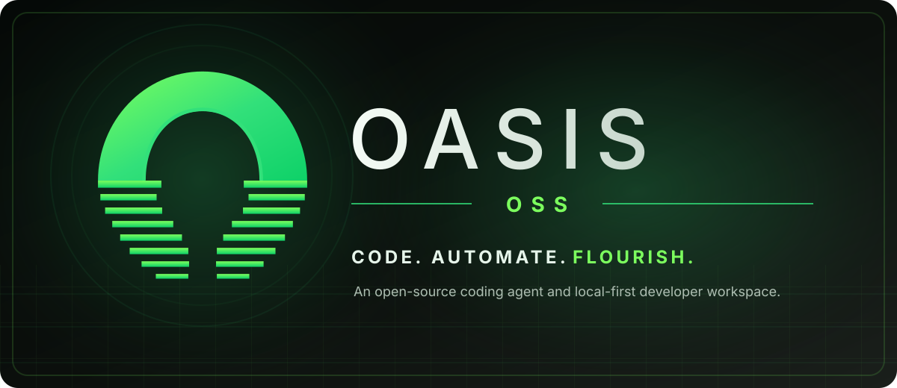
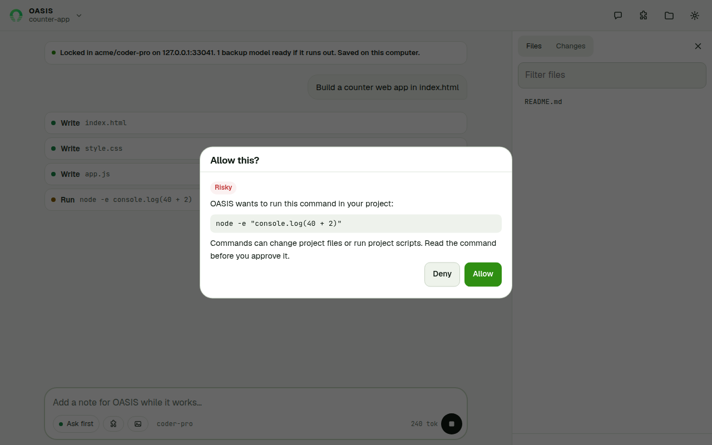
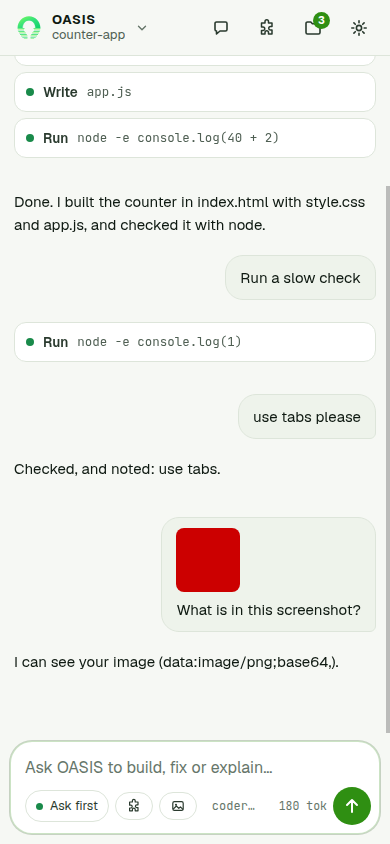
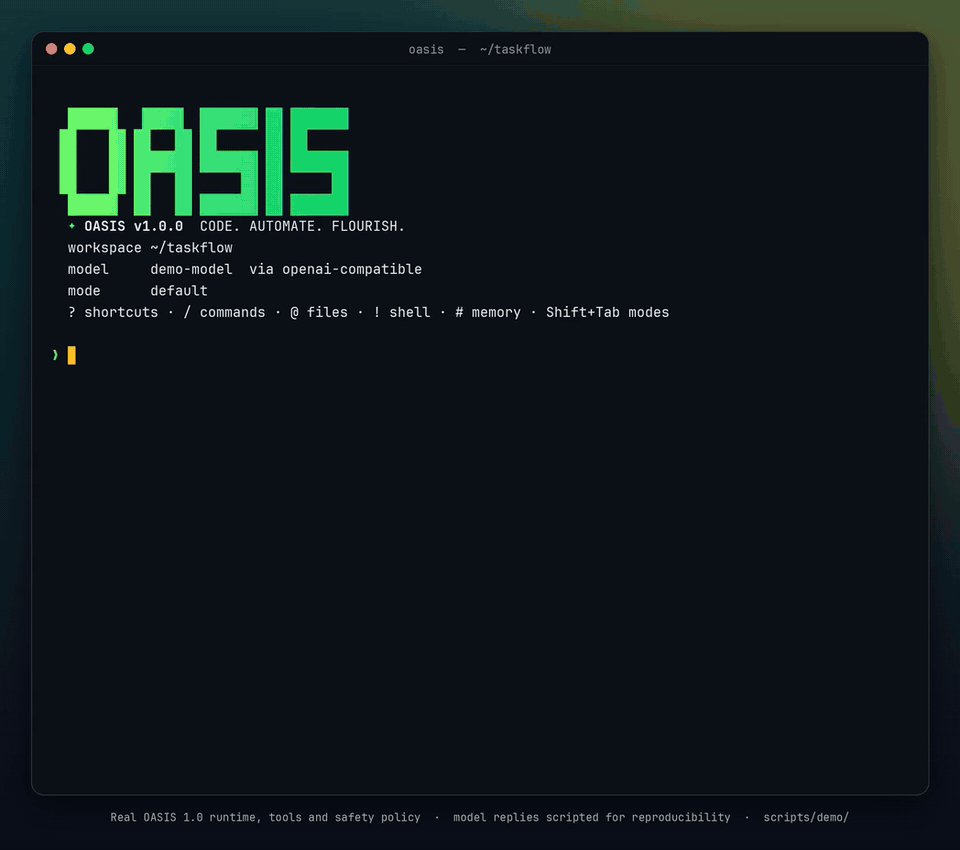
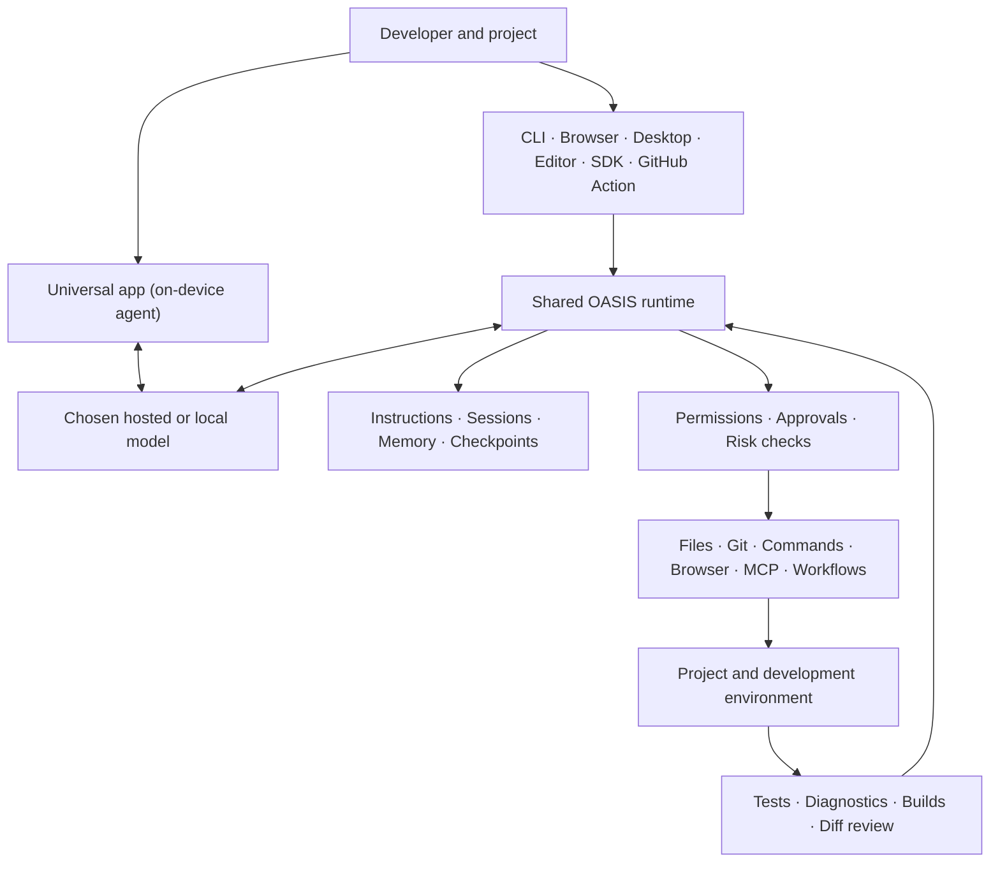

<!-- OASIS product overview. Current lifecycle and release qualification: docs/PROJECT_PLAN.md -->

<p align="center">
  
</p>

<h1 align="center">OASIS</h1>
<p align="center"><strong>One open-source coding agent for your phone, your browser, your desktop and your terminal.</strong><br/>Paste a key and start. Any model, from a 4B model on your laptop to the frontier. Safety and reliability live in the runtime, not the prompt.</p>

<p align="center">
  <a href="https://github.com/FAHTHIZ/oasis/actions/workflows/quality.yml"></a>
  <a href="https://github.com/FAHTHIZ/oasis/releases/latest"></a>
  
  
  
  <a href="LICENSE"></a>
  <a href="https://fahthiz.github.io/oasis/"></a>
</p>

<p align="center">
  <a href="https://github.com/FAHTHIZ/oasis/releases/latest"><strong>Download</strong></a> ·
  <a href="https://fahthiz.github.io/oasis/"><strong>Website</strong></a> ·
  <a href="https://fahthiz.github.io/oasis/app/"><strong>Open the app</strong></a> ·
  <a href="#install"><strong>Install</strong></a> ·
  <a href="#start-in-a-minute">Start</a> ·
  <a href="#measured-not-claimed">Benchmarks</a> ·
  <a href="#terminal">Terminal</a> ·
  <a href="docs/USER_GUIDE_MAP.md">User guide</a> ·
  <a href="docs/INSTALL.md">Install guide</a> ·
  <a href="CHANGELOG.md">Changelog</a>
</p>

## Start in a minute

| Where | Do this |
| --- | --- |
| **Phone, tablet or any browser** | [Open the app](https://fahthiz.github.io/oasis/app/), paste an API key (or a local model address) into the message box, and ask. Add it to your home screen to install it. |
| **Your computer, in a terminal** | Install (below), run `oasis` in your project and paste a key when it asks. |
| **Your computer, in a window** | Run `oasis web --open` in your project, or [download the desktop app](https://github.com/FAHTHIZ/oasis/releases/latest). |

That paste is the whole setup. OASIS works out the provider from the key or address, picks the best model for coding, checks that it can call tools, and keeps the next models as backups that take over if the first one runs out of credit or hits a rate limit. It works with OpenAI, Anthropic, OpenRouter, Gemini, Groq, DeepSeek, Mistral, xAI, Hugging Face and others, any OpenAI-compatible server, and Ollama, LM Studio or llama.cpp on your own machine.

## One app on every device

<p align="center">
  
  
  <br/><sub>The real app and runtime from <code>test/app-runtime-e2e.test.mjs</code>; the model's replies are scripted.</sub>
</p>

The app is the same on a phone, in a browser and in the desktop app. Where it runs decides what it can touch:

- **Opened from your computer** (`oasis web` or the desktop app), it drives the full agent on that computer: your real files, shell, git and MCP tools, with every command shown before it runs and every edit checkpointed so it can be undone.
- **Opened on its own** (a phone, or the web link), the agent runs inside the app. It works on projects from GitHub, a ZIP or a folder, edits with diffs, runs JavaScript in a sandbox, and pushes to a branch or opens a pull request after you approve. It cannot run shell commands; for that, [connect your phone to your computer](docs/MOBILE.md#browser-workspace-from-your-phone) (**File → Connect a phone…** in the desktop app).

Everything else is the same everywhere: type while it works to steer it, paste or drop screenshots, keep several chats per project, pick a built-in plugin with one tap (Debugger, Test writer, Code reviewer, Security audit, Web app studio, API builder, Mobile apps, Docs writer, GitHub), and switch to lite mode on old phones and low-end computers. The installed app works offline, has no OASIS account and no OASIS server, and only talks to the model provider you chose.

## Why OASIS

A coding agent is a model plus a harness. The model decides what to do; the harness decides what actually happens to your repository. Most of what people hate about coding agents is harness failure: tool calls that don't parse, edits that miss by one space, `rm -rf` in auto mode, "done" without running a test, a function replaced by `// ... rest unchanged`, a terminal that looks frozen for two minutes.

OASIS fixes each of those in the runtime, so the fix holds whichever model you connect.

<table>
<tr>
<td width="50%" valign="top">

**Any model, really.** Claude, GPT, Gemini, DeepSeek, OpenRouter, Bedrock, Vertex, Azure Foundry, or a local Ollama, LM Studio, llama.cpp or vLLM server. Small models get a compact prompt, a 13-tool profile and tool-call repair, so even a 4B local model drives the tools; whether its code is right is still up to the model. In our live runs on a 2-CPU cloud machine with no GPU, Qwen3-4B passed two of four hidden-test tasks (`parse-boolean-flag` and `dedupe-names`). `clamp-integer` failed in all three tries. `safe-task-id` passed once in two tries, but that code fails the stricter verifier added afterwards ([field runs](docs/BENCHMARKS.md#small-local-model-field-runs-2026-11-01)).

</td>
<td width="50%" valign="top">

**Safety you don't have to trust the model for.** Every shell line is parsed into commands and scored. Deleting your home folder, force pushes and publishing are refused even with approvals off, including when hidden inside `bash -c`, `eval`, `$(…)`, `ssh host '…'` or inline Python/Node code. `reset --hard` and `clean -fdx` always need a person, even in bypass mode, and the working tree is snapshotted first. Plan mode is enforced by the runtime, not requested in the prompt.

</td>
</tr>
<tr>
<td valign="top">

**"Done" means verified.** The agent can't finish until it has reviewed its own diff and run a relevant check. It is told when it claims a file it never wrote, weakens a test to make it pass, or repeats the same failing fix.

</td>
<td valign="top">

**Your setup moves in with you.** OASIS understands the common agent CLI flags (`-p`, `--output-format stream-json`, `exec`, `--full-auto`, `--sandbox`, `--allowedTools`, `--mcp-config`, `--test-cmd --auto-test` and more), reads `OASIS.md`, `AGENTS.md`, `CLAUDE.md` and the rule folders editors already keep in your repository, and loads existing plugins and skills as they are. `oasis import` brings MCP servers, instructions, commands, rules, skills and memories from the tools you used before, in one command.

</td>
</tr>
</table>

## Terminal

The terminal (`oasis`) is the same agent with the same safety rules, for people who live in a shell, for SSH and for scripts and CI.

<p align="center">
  <a href="assets/demo/oasis-terminal-demo.mp4"></a>
</p>

| | Terminal (`oasis`) | App (phone, browser, desktop) | Editor |
| --- | --- | --- | --- |
| Connect a model | Paste a key at the first run, or `oasis connect` | Paste a key into the message box | Uses the OASIS config |
| Steer while it works | Enter (Tab queues) | Type and send while it works | VS Code chat panel |
| Review changes | `/diff`, inline diffs | Changes tab with per-file diffs | Native diff view, accept or reject |
| Approvals | Inline prompt | A sheet with the exact command or diff | Inline in the panel |
| Images | Ctrl+V pastes a screenshot, or `@screenshot.png` | Paste, drop or attach | Attach button or `@screenshot.png` |
| Undo | `/undo`, `Esc Esc` to rewind | Per-file revert on the device; `/undo` on a computer | Reject in the diff view |
| Low-power devices | Lite or no animation on 2-CPU, SSH, Linux console, CI, screen readers | Lite mode, reduced motion, works offline | Editor theme |

## Install

**Requirements:** Node.js 22 or newer and Git. Or skip both with the [desktop app](https://github.com/FAHTHIZ/oasis/releases/latest).

```bash
curl -fsSL https://raw.githubusercontent.com/FAHTHIZ/oasis/v1.1.0/scripts/install.sh | sh
cd ~/your-project && oasis
```

The script comes from the immutable `v1.1.0` tag. It installs the latest stable release at its exact commit, asks before changing anything, runs `oasis doctor` and opens provider setup. To check its SHA-256 before running it, or to install on Windows, see the [install guide](docs/INSTALL.md#command-line-installation).

With Homebrew, run `brew tap fahthiz/oasis https://github.com/FAHTHIZ/oasis`, then `brew install fahthiz/oasis/oasis-cli` for the CLI (macOS and Linux) or `brew install --cask fahthiz/oasis/oasis` for the Mac desktop app ([details](docs/INSTALL.md#homebrew-macos-and-linux)).

Want the current `main` instead?

```bash
git clone https://github.com/FAHTHIZ/oasis.git && cd oasis && npm install && npm install -g .
oasis connect               # paste an API key, model link or local server address
```

Other ways in:

| Option | How |
| --- | --- |
| **Pinned stable CLI** | The [checksum-verified installer](docs/INSTALL.md#command-line-installation) resolves the latest stable release (`v1.1.0`) to an immutable commit, runs `oasis doctor` and opens setup. |
| **Desktop app** | [Download the latest release](https://github.com/FAHTHIZ/oasis/releases/latest): Windows x64 `.exe`; macOS `.dmg` for Apple silicon and Intel; Linux `.AppImage` or `.deb` for x86_64 and arm64; with `SHA256SUMS`. They are not code-signed, so SmartScreen and Gatekeeper warn on first launch; [verify the checksum](docs/INSTALL.md) first. From v1.1.0 the app tells you when a new stable version is out and installs it after checking its SHA-256 ([updates](docs/INSTALL.md#updates)). |
| **Local model, no API key** | `llama-server -m qwen3-4b-instruct-q4_k_m.gguf --jinja -c 16384 --port 8080`, then `OASIS_BASE_URL=http://127.0.0.1:8080/v1 OASIS_MODEL=qwen3-4b oasis`. OASIS reads the loaded context window and picks the right profile. Ollama and LM Studio work the same way. |
| **Coming from another agent** | `oasis import <tool>` with `codex`, `gemini`, `cursor`, `claude`, `hermes`, `opencode`, `antigravity`, `windsurf` or `cline` (add `--dry-run` to preview). Existing `AGENTS.md` / `CLAUDE.md` files are picked up as they are. |
| **Phone or tablet** | [Open the universal app](https://fahthiz.github.io/oasis/app/) and add it to the home screen: no computer needed. To drive OASIS on your computer from the phone instead, choose **File → Connect a phone…** in the desktop app (or `oasis web --host 0.0.0.0` with a TLS certificate) and scan the QR code. A Telegram/Discord/Slack bot and Termux on Android also work. See [MOBILE.md](docs/MOBILE.md). |
| **Set up for this computer** | `oasis setup --auto` detects CPU, memory, GPU and any running Ollama / LM Studio / llama.cpp server, then saves the best model route that passes a live test. |

## Measured, not claimed

The [model-free harness benchmark](docs/BENCHMARKS.md#model-free-harness-benchmark-2026-11-05) feeds the runtime outputs that real models actually produce and scores what happens. It needs no model or API key and runs in seconds: `npm run bench:harness`.

| What the model sends | No harness layer | OASIS, on held-out cases it was never tuned on |
| --- | --- | --- |
| Malformed or text-only tool calls (fences, comments, Python literals, Hermes, Qwen3-Coder, GLM, Mistral, DeepSeek, gpt-oss formats) | 1 of 33 run | **23 of 33 run**, 0 false runs |
| Edits whose `old_string` drifted (indentation, spacing, quotes, CRLF, BOM, copied line numbers) | 2 of 17 apply | **14 of 17 apply** (15 with a case fix), 0 wrong writes |
| Destructive shell commands with approvals switched off (incl. cloud, cluster, registry, database, PowerShell) | 0 of 85 stopped | **71 of 85 stopped** (72 with a scorer fix), every everyday command still runs |
| Placeholder rewrites, weakened tests, leaked secrets | 0 of 44 caught | **32 of 44 caught**, 0 false alarms |

Every miss above was then fixed and turned into a regression test, so the current runtime scores 100% on all four case sets except one deliberate secret-scanner miss. Those post-fix numbers measure tuning, not generalization, which is why the table shows the untuned ones.

The agent evaluator has **52 tasks**: 33 focused fixtures plus 19 repository-level bug reports and multi-file features, scored by hidden assertions the agent never sees (`oasis eval`). Head-to-head runs against Claude Code, Codex CLI, Gemini CLI, OpenCode and Aider on the same tasks and the same model take one command, [`npm run bench:live`](docs/BENCHMARKS.md#head-to-head-in-one-command). No results have been published yet, so OASIS does not claim to beat them. Live runs with small local models, including the failures, are in [Benchmarks](docs/BENCHMARKS.md).

## What it fixes

| Common frustration with coding agents | What OASIS does |
|---|---|
| "It said it was done, but never ran the tests." | A post-edit verification gate: the agent must review its diff and run a relevant check before it can finish, and any later edit resets that. |
| "Ten patches, and the same error every time." | Fix-thrash detection. On the 3rd identical failure after edits the agent is told to step back and diagnose; on the 5th, to change approach or ask you. |
| "It changed the test to match the broken code." | Weakened-test detection (skips, `.only`, deleted tests, removed assertions, an exact check swapped for `toBeDefined()`). |
| "It replaced my function with `// ... rest unchanged`." | A change guard blocks placeholder edits and flags large, unexplained deletions. |
| "It ran `rm -rf` while I wasn't watching." | Catastrophic commands (home or system folders, raw disk writes, publishing, force pushes) are refused. High-risk ones (`curl \| sh`, `terraform destroy`, `kubectl delete`, `DROP TABLE`) always ask, even in bypass mode. |
| "It ran a destructive git command." | `push --force` is refused. `reset --hard` and `clean -x` always need a person, even in bypass mode (the direct command tool refuses `reset --hard` and `clean -f` outright). Other work-discarding commands need your approval, and the working tree is saved under `refs/oasis/safety/` first. |
| "It edited files in plan mode." | Plan mode is enforced in the runtime: only read-only tools run. |
| "It committed my API key." | Commit secret scanning, including a raw `git commit` typed through the shell. |
| "It looks frozen. Is it doing anything?" | A live status line shows what it is waiting for, elapsed time, context sent and `esc to stop`. Local models get 15 minutes to read a long prompt instead of timing out. |
| "I can't tell what that command did." | Every tool call gets a one-line outcome: `✓ exit 0 · 20 passed, 0 failed`, `10 matches in 4 files`, `2 files changed, +6 -1`. Blocks and failures show in red. |
| "The connection dropped and it ran my tool twice." | Dropped streams restart the reply. Tools run only after a reply completes, so a restart can never run a tool twice. |
| "Tool definitions eat my context." | Rarely used tool schemas and MCP tools load only when needed. `/context` shows where the window goes and `/cost` what it cost. |
| "I have to wait for it to finish before I can correct it." | Type while it works and press Enter: the agent reads the message at its next step, adjusts and keeps going. Nothing you send is dropped. |
| "My local model times out on long prompts." | Requests to llama.cpp, Ollama, LM Studio or vLLM on your machine skip Node's hidden 300-second header timeout, and wait up to 15 minutes for the first token by default. The context window is read from Ollama, LM Studio and llama-server on their default ports, and a request that overflows the window is resized from the server's error instead of failing. |
| "I switched tabs and missed that it was waiting on me." | When a turn that ran 15 s or more finishes or needs approval, OASIS notifies you: a desktop notification in iTerm2, WezTerm, Ghostty, Windows Terminal and kitty, the bell elsewhere, and a tab badge plus optional notification in the browser. `OASIS_NOTIFY=off` turns it off. |
| "I want every change in Git history." | `/auto-commit on` (or `OASIS_AUTO_COMMIT=1`) commits each turn's changed files as `oasis: <your request>`, and only those files; your own staged work stays out. |
| "It forgot my rules after compacting." | Compaction only summarizes the conversation. The system prompt, including `AGENTS.md` / `CLAUDE.md`, stays word for word. `/compact` shows a preview before changing anything, `/compact preserve rule: …` pins other text verbatim into every summary, and `/compact undo` brings the full history back. |
| "I want to undo what it just did." | `/undo` reverts the last turn's file and conversation changes; `Esc Esc` or `/rewind` jumps to any checkpoint. |
| "Animations stutter over SSH and on my old laptop." | Motion adapts: smooth on capable machines, a light pulse on low-power hardware, SSH and the Linux console, none in CI, for screen readers or with `OASIS_REDUCED_MOTION=1`. |

Each row describes implemented, tested runtime behavior.

## A one-minute tour

```bash
oasis                                   # interactive session in this folder
oasis "fix the failing date tests"      # start with a task, then keep talking
oasis plan "add rate limiting"          # read-only plan, nothing is changed
oasis -w feature-x                      # work in a new git worktree on its own branch
oasis -p "summarize this diff" --output-format json < changes.diff   # scripts and CI
oasis --bg "upgrade the test runner"    # background session: oasis bg list | logs | send | attach
oasis web --open                        # local browser workspace, opened and connected for you
oasis doctor --test-provider            # check the setup, including live tool calling
```

| In a session | Does |
| --- | --- |
| `@file` · `!cmd` · `#note` | Mention a file · run a shell command yourself · save a memory |
| `Shift+Tab` | Cycle permission mode: default → accept edits → plan → auto |
| `Esc` · `Esc Esc` · `Ctrl+C` | Stop the current step · rewind · interrupt (twice at an empty prompt to quit) |
| `Enter` · `Tab` while it works | Steer: the agent reads your message at its next step and keeps going · queue it for after the turn |
| `Ctrl+K` · `Ctrl+R` · `Ctrl+G` | Command palette · search prompt history · write a long prompt in your editor |
| `/undo` · `/rewind` · `/diff` | Undo the last turn · pick a checkpoint · review changes |
| `/test` · `/verify` · `/review` | Run the tests and hand failures to the agent · run the app to confirm a change · review the diff |
| `/model` · `/context` · `/cost` | Switch model · see context use · see spend |
| `/init` · `/memory` · `/keys` | Create `OASIS.md` project instructions · manage memory · all shortcuts |

Full reference: [keyboard shortcuts](docs/KEYS.md) and the [user guide](docs/USER_GUIDE_MAP.md).

## Built for small and local models

OASIS assumes the model might be small, quantized, or running on your laptop:

- **Real context windows.** OASIS reads the window actually loaded in Ollama, LM Studio and llama.cpp, and the provider's `/models` listing for hosted and self-hosted models (DeepSeek, OpenRouter, vLLM). If the first request still overflows, it reads the size (and, for llama-server, the server itself) from the error, switches to the compact prompt and small tool set, and retries; that costs one rejected request, not a prompt read.
- **Small-context profile.** At 16K or less: a compact system prompt (about 1.3K tokens), 13 essential tools (about 3.7K tokens for the whole first request, versus about 15K by default, counted with the Qwen3 tokenizer in an empty repository), earlier compaction and trimmed tool results. Everything else stays reachable through `tool_search`.
- **Tool-call repair.** Almost-valid JSON (code fences, comments, unquoted keys, trailing commas, Python literals, missing braces) is repaired, and tool calls written as text (Hermes, Qwen, Llama and XML formats) are executed. Unrepairable calls get an error that explains how to resend them.
- **Forgiving edits.** Matching tolerates indentation, spacing and quote drift while preserving CRLF, BOMs and your formatting. Ambiguous matches are refused, never guessed.
- **Coaching.** When a model describes a change instead of making it, claims a file it never wrote, quits after one error or stops without checking its work, OASIS tells it so and, on small models, runs the review step itself.

See [local models and small context windows](docs/USER_GUIDE.md#local-models-and-small-context-windows) and [tool-call repair](docs/USER_GUIDE.md#tool-call-repair-for-smaller-models).

## It learns from experience—with your approval

OASIS separates durable memory from reusable procedural knowledge. After a non-trivial task is actually verified, the agent can propose a portable skill that captures the repeatable method, required capabilities, permission boundaries, and success criteria. The proposal stays local and inactive until you inspect it and explicitly promote it.

```text
/learning list
/learning show PROPOSAL_ID
/learning approve PROPOSAL_ID
/learning reject PROPOSAL_ID [reason]
```

Project proposals stay with one workspace; user-scope proposals are reserved for workflows that genuinely apply across projects. Promotion refuses to overwrite or shadow an existing skill. It does not fine-tune model weights, prove the agent's evidence, or grant permissions—OASIS's runtime checks remain authoritative. See [Learning from experience](docs/LEARNING.md) for storage, controls, and limitations.

## Everything in the box

| Area | Included |
|---|---|
| **Agent runtime** | Multi-step tool loop, planning, codebase map, edits, verification gate, completion reports, a fallback chain that can cross providers when a model runs out of credit or goes down, budget limits, programmatic tool calling (`execute_code`), API key pools that rotate on rate limits. |
| **Workspace** | File search, read, write and edit; Git tools; snapshots, backups, diffs, checkpoints and rewind; isolated worktrees. |
| **Safety** | Permission modes and rules, shell-risk analysis, protected paths, secret shield, bounded output, process cleanup, optional OS sandbox on Linux and macOS, a Docker/Podman container sandbox on any OS, or remote execution over SSH. |
| **Verification** | Project checks, diagnostics and language servers, diff review, weakened-test and placeholder detection, auto-test, claim checks. |
| **Context** | Saved and resumable sessions, `OASIS.md` / `AGENTS.md` / `CLAUDE.md` instructions, other agents' rule folders with their always/glob/on-request triggers, memory with optional write approval, compaction with must-keep context (also while you are away, with `/compact undo`), rule refresh, cross-session search (`/recall`, `session_search`), separate agent profiles (`--profile`). |
| **Learning** | Verified-work skill proposals, user/project scope, review-before-promotion, secret screening, and collision-safe portable skill creation. |
| **Teams of agents** | Bounded subagents, specialist reviewers, shared task boards, background sessions, tmux teammate panes, workflows, `oasis batch` runs with ShareGPT/OpenAI trajectory export, and `oasis plugin eval` for scoring plugins and skills against a baseline. |
| **Integrations** | MCP (client over stdio, Streamable HTTP and SSE; server mode; OAuth), hooks, Agent Skills with a built-in installer for skills from any Git repository, plugins (existing plugin formats load unchanged), web search, Chrome browser tool, image generation (`generate_image`), text to speech (`text_to_speech`), GitHub Action, VS Code / Cursor / Windsurf bridge, [Telegram, Discord and Slack gateways](docs/USER_GUIDE.md#telegram-gateway-your-agent-from-your-phone) (`oasis gateway telegram`, `discord`, `slack`) that take text, photos, files and voice notes, and an [Agent Client Protocol](docs/USER_GUIDE.md#zed-jetbrains-neovim-and-other-acp-editors) server (`oasis acp`) for Zed, JetBrains, Neovim and Emacs with inline diffs and editor-buffer reads and writes. |
| **Surfaces** | Universal app for phones, tablets and computers (offline, on-device, sandboxed JavaScript, GitHub push), terminal CLI with Markdown, syntax highlighting and Mermaid flowcharts and sequence diagrams drawn in the terminal, headless mode with JSON and stream-JSON, local browser workspace (image paste, dictation, `!` shell commands, steering, live diffs), Electron desktop app, SDK. Soft, optional sound effects for finished turns, approvals, errors and completed steps (`/sounds`). |
| **Accessibility** | Screen-reader mode (`--ax-screen-reader`), reduced motion, `NO_COLOR`, colorblind-friendly and light themes, `--calm` output. |

Capabilities are shared across surfaces but not identical on every OS, provider or editor; check the [support matrix](docs/PROJECT_PLAN.md#support-and-qualification-matrix) before relying on a platform-specific path.

## How it fits together



The model reasons and requests tools. OASIS owns the tool contracts, workspace checks, permission decisions, process execution, state and the evidence returned to you. See [Architecture](docs/ARCHITECTURE.md) and the [source map](src/README.md).

## Status and boundaries

> **Current lifecycle — OASIS 1.1, stable, released.** [`v1.1.0`](https://github.com/FAHTHIZ/oasis/releases/tag/v1.1.0) was published automatically on November 5, 2026 from `main` commit `900c76f`, after Quality Checks (Node 22/24/26 on Windows, macOS and Linux, browser E2E with accessibility checks), installer checks, desktop packaging and public-site validation passed on that same commit. It adds update notifications with checksum-verified installs, hardware-aware setup, phone links with a QR code, and installers for Intel Macs and arm64 Linux ([notes](docs/releases/v1.1.0.md)). [`v1.0.0`](https://github.com/FAHTHIZ/oasis/releases/tag/v1.0.0) was published on November 4, 2026 through the same gates.

What 1.0 does not claim: the desktop installers are unsigned (SHA-256 checksums are provided), clean-machine install, update and uninstall are verified on CI runners rather than by hand on physical machines, and the 50-task evaluator runs on small projects, so it is a regression suite rather than a broad benchmark.

<details>
<summary><strong>Surfaces</strong></summary>

| Surface | Position |
|---|---|
| **CLI** | Primary workflow for repositories and automation; Node.js 22+. |
| **App on a computer** (`oasis web`, desktop) | Local and authenticated with a one-time link token, backed by the shared runtime; not a hosted service. The earlier all-in-one browser workspace is still at `/classic` (terminal pane, run monitor, extensions) while those panels move into the app. |
| **Desktop** | Windows x64; macOS arm64 and Intel; Linux x86_64 and arm64; built and packaged in CI from the release commit. Unsigned, with SHA-256 checksums. |
| **VS Code-family editors** | Supported integration; not every editor extension ecosystem is covered. |
| **ACP editors (Zed, JetBrains, Neovim, Emacs)** | `oasis acp` implements the core Agent Client Protocol, inline edit diffs and editor `fs/*` (unsaved buffers are read, open buffers are updated). With `oasis acp --editor-terminal`, approved commands run in the editor's terminal panel (`terminal/*`); by default they run in OASIS's own process and sandbox. |
| **SDK and GitHub Action** | Programmatic and repository automation; unattended use still needs deliberate permissions and isolation. |
| **Universal app** | Installable web app for Android, iOS, iPadOS, ChromeOS and desktop browsers, one codebase for every platform; runs on the device with no server. No shell commands. Tested in desktop and mobile-emulated Chromium; real-device testing on iOS Safari and older Android browsers is in progress. It is not in an app store; install it from the browser. |
| **Android / Termux** | The full CLI runs in Termux; Android is not a fully qualified CLI platform. |

</details>

<details>
<summary><strong>Security boundaries</strong></summary>

OASIS provides layered controls, not a guarantee that arbitrary model output, repository code, commands, packages, MCP servers, hooks, skills or plugins are safe.

- Approved commands run with the operating-system permissions of the user who launched OASIS.
- Optional Linux/macOS OS sandboxing is off by default and does not isolate filesystem reads. Native Windows OS sandboxing is not implemented. An optional container backend (`"backend": "docker"` or `"podman"`) runs commands in a throwaway container with only the workspace mounted, on any OS including Windows (Docker Desktop); on Linux, CI runs it against a live Docker engine and checks workspace-only mounts, no network, no capabilities, a non-root user and the process limit. Podman and Docker Desktop on Windows are still covered only by argument-level tests. The SSH backend (`"backend": "ssh"`) runs commands on another machine you choose; it protects this machine but does not sandbox the remote host, and it copies the workspace (including files such as `.env`) there.
- Approval prompts and workspace checks are not operating-system isolation.
- Third-party integrations can run code with your permissions. Enable only sources you trust.
- The browser workspace keeps some local data in browser storage, unencrypted by OASIS.
- Keep the runtime on loopback unless TLS, authentication, trusted devices and the threat model have been reviewed.

Read [SECURITY.md](SECURITY.md), [Privacy](docs/PRIVACY.md) and the dated [security and reliability audit](docs/SECURITY_RELIABILITY_AUDIT.md).

</details>

## Documentation

| Need | Reference |
|---|---|
| Install, update, uninstall | [Installation](docs/INSTALL.md) · [Phone and tablet](docs/MOBILE.md) · [Termux](docs/TERMUX.md) |
| Learn by task | [User-guide map](docs/USER_GUIDE_MAP.md) |
| Every command, setting, tool and integration | [Complete user guide](docs/USER_GUIDE.md) · [Keys](docs/KEYS.md) |
| Workflows, skills and plugins | [Workflows and skills](docs/WORKFLOWS_AND_SKILLS.md) |
| What has and hasn't been measured | [Benchmarks](docs/BENCHMARKS.md) · [Competitive analysis](docs/research/COMPETITIVE_ANALYSIS_2026-10-31.md) |
| Scope, support matrix, release gates | [Project plan](docs/PROJECT_PLAN.md) |
| How it works inside | [Architecture](docs/ARCHITECTURE.md) · [Source map](src/README.md) · [Test map](test/README.md) |
| Security and privacy | [Security policy](SECURITY.md) · [Privacy](docs/PRIVACY.md) |
| Maintaining the repository | [Maintenance guide](docs/REPOSITORY_MAINTENANCE.md) |
| Release history | [Changelog](CHANGELOG.md) · [1.1.0 release notes](docs/releases/v1.1.0.md) · [1.0.0 release notes](docs/releases/v1.0.0.md) |

## Contributing

```bash
npm install
npm test               # unit and integration tests
npm run check          # everything CI runs: site checks, tests, harness benchmark, eval validation
```

Use `npm test` rather than bare `node --test`, which also picks up helper servers and archived fixtures. Start with [CONTRIBUTING.md](CONTRIBUTING.md) and the [test map](test/README.md). Bug reports with a failing case are the most useful kind; harness misses become regression tests.

Questions and ideas go to [Discussions](https://github.com/FAHTHIZ/oasis/discussions); [SUPPORT.md](SUPPORT.md) lists every way to get help.

## License

Apache License 2.0 — see [LICENSE](LICENSE).
