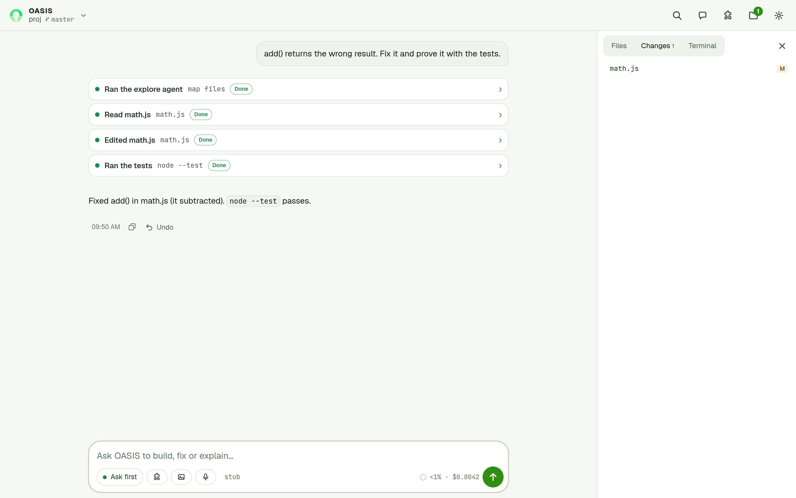
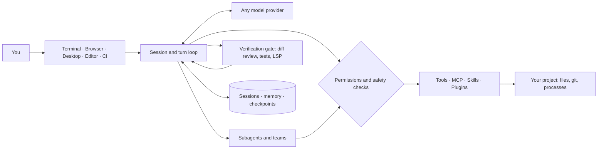

**Downloads:** [Windows (.exe)](https://github.com/FAHTHIZ/oasis/releases/latest) · [macOS (.dmg)](https://github.com/FAHTHIZ/oasis/releases/latest) · [Linux (.AppImage / .deb)](https://github.com/FAHTHIZ/oasis/releases/latest) · [All releases](https://github.com/FAHTHIZ/oasis/releases)

<p align="center">
  
</p>
<h1 align="center">OASIS</h1>
<p align="center">
  <strong>An open-source agent workspace for coding and everything around it.</strong><br>
  Bring any model. OASIS supplies the tools, subagents, permissions and verification, in your terminal, your browser, your editor or a desktop app.
</p>
<p align="center">
  <a href="https://github.com/FAHTHIZ/oasis/actions/workflows/quality.yml"></a>
  <a href="https://github.com/FAHTHIZ/oasis/releases/latest"></a>
  
  <a href="LICENSE"></a>
</p>
<p align="center">
  <a href="#download-and-install">Install</a> ·
  <a href="#quick-start">Quick start</a> ·
  <a href="#what-you-get">Features</a> ·
  <a href="#how-it-compares">Comparison</a> ·
  <a href="docs/USER-GUIDE.md">User guide</a> ·
  <a href="docs/README.md">Docs</a>
</p>

<p align="center"></p>

OASIS is an open-source coding-agent runtime and development workspace. It is the harness and application layer, not a model provider. The model still decides much of the reasoning and code quality, and OASIS does not guarantee that every model will solve every task.

## Why OASIS

- **Any model, no lock-in.** OpenAI, Anthropic, Gemini, OpenRouter, Groq, DeepSeek, Mistral, xAI, Together, Fireworks, Bedrock, Vertex AI, Foundry, any OpenAI-compatible endpoint, or a local server (Ollama, LM Studio, llama.cpp, vLLM). Fallback models and task-aware routing come built in.
- **A real agent system.** Parallel, background and resumable subagents, agent teams with a shared task board, nested delegation and per-agent git worktrees. See [Subagents](docs/SUBAGENTS.md).
- **Your Claude Code setup works as is.** `CLAUDE.md`, `.claude/agents`, skills, commands, settings, hooks, plugins and `.mcp.json` load without conversion.
- **It checks its own work.** A verification gate sends the agent back when it claims success without reviewing its diff or running checks. Every edit is checkpointed, and language-server diagnostics run when a server is installed.
- **Safety you can read.** Permission modes, AST-based shell risk analysis, protected paths, secret scanning, SSRF-guarded network tools and optional OS or container sandboxes.

## Download and install

| Platform | Download |
| --- | --- |
| Windows | [`.exe` installer](https://github.com/FAHTHIZ/oasis/releases/latest) (x64) |
| macOS | [`.dmg`](https://github.com/FAHTHIZ/oasis/releases/latest) (Apple Silicon). Not code-signed yet, so confirm the first launch in Privacy & Security. |
| Linux | [`.AppImage` or `.deb`](https://github.com/FAHTHIZ/oasis/releases/latest) (x64) |

To install the command-line tool on macOS or Linux (Node.js 22.15+ and Git required):

```sh
curl -fsSL https://raw.githubusercontent.com/FAHTHIZ/oasis/main/scripts/install.sh | sh
```

The script installs the latest stable release into `~/.local`, asks before changing anything and runs `oasis doctor`. Other options:

```sh
brew tap fahthiz/oasis https://github.com/FAHTHIZ/oasis && brew install fahthiz/oasis/oasis-cli   # Homebrew
git clone https://github.com/FAHTHIZ/oasis.git && cd oasis && npm install && npm install --global .  # from source
```

Every release ships a SHA256SUMS file; verify your download against it. See [Downloads and releases](docs/RELEASES.md) for ARM builds and checksum verification.

## Quick start

```sh
cd your-project
oasis connect        # paste an API key, a model link or a local server address
oasis                # chat in the terminal
oasis web --open     # or open the browser workspace on this folder
```

Then ask in plain words: "find out why the login test fails and fix it". OASIS reads the code, edits the files, runs the checks and shows you the diff. Edits are checkpointed: `/rewind` (or Esc Esc) undoes them.

For scripts and CI:

```sh
oasis -p "summarize the open TODOs"                              # one-shot, no prompts
oasis exec --output-format stream-json "fix the lint errors" > run.jsonl
oasis -p --permission-mode dont-ask "review this diff"            # never waits on an approval
```

### A real model run

<p align="center">
  <a href="assets/demo/oasis-real-model-demo.mp4"></a>
  <br><sub>Unscripted gpt-oss-20b run in the terminal, recorded on 5 November 2026. Rate-limit waits from the free endpoint were shortened; the model's mistakes and the verification gate's send-back are kept. <a href="assets/demo/oasis-real-model-demo.cast">Raw recording</a>.</sub>
</p>

## What you get

### One runtime, every interface

| Interface | Start it with | Highlights |
| --- | --- | --- |
| **Terminal session** | `oasis` | Streaming diffs with word highlights, inline images, tab progress, `/tasks`, `/rewind`, `/export` to Markdown or HTML |
| **Browser workspace** | `oasis web --open` | Chat with step-by-step activity, Files and Changes panels, an interactive terminal (<kbd>Ctrl</kbd>+<kbd>&#96;</kbd>), plan mode, Undo, cost and context meters, `/` and `@` autocomplete |
| Desktop application | Open OASIS | The browser workspace in a native window, on the folder you choose |
| **Editor integration** | `oasis ide install` | VS Code, Cursor and Windsurf: selection context, diff review, diagnostics |
| **Agent Client Protocol** | `oasis acp` | Zed, JetBrains and other ACP clients |
| **CLI and headless runner** | `oasis -p`, `oasis exec` | Scripts and CI: JSON and stream-JSON output, `--output-schema`, `dont-ask` mode |
| **Node.js SDK** | `src/sdk.mjs` | Embed OASIS sessions in your own app |
| **GitHub Action and messaging gateways** | `action.yml`, `oasis gateway` | Run on pull requests; chat from Telegram, Slack or Discord |

The browser workspace is served by OASIS on your own computer, not a hosted service. To reach it from a phone, follow [Mobile and tablet setup](MOBILE.md) on a trusted network. There is no native Android APK or iOS app.

<p align="center">
  <picture>
    <source media="(prefers-color-scheme: dark)" srcset="assets/screenshots/workspace-dark.png">
    
  </picture>
  <br><sub>The browser workspace after a bug fix: each step the agent took, the reply with Undo, cost and context use, and the Changes panel. Recorded against a scripted test model.</sub>
</p>

### Agents and subagents

| Capability | Details |
| --- | --- |
| Built-in agents | `explore`, `plan`, `general-purpose`, `code-review`, `security-review` |
| Custom agents | Markdown files in `.oasis/agents` or `.claude/agents`, with the full Claude Code front matter (`tools`, `model`, `permissionMode`, `skills`, `memory`, `hooks`, `mcpServers`, `isolation`, `background` and more) |
| Parallel and background | Up to 6 at once and 8 in the background, with `agent_status`, `send_message` and `agent_stop`. A stall monitor stops agents that go silent and keeps their partial report. |
| Resume | `/tasks` lists running and finished agents. `/tasks send ID MESSAGE` steers a running agent or resumes a finished one with its saved conversation, even after a restart. |
| Teams | Shared task board with leases, teammate messages and optional tmux panes |
| Isolation | Each agent can work on its own git worktree and branch |
| Structured results | `output_schema` on a task validates the report, with one correction turn |

### Models and context

- OpenAI Responses, Chat Completions and Anthropic Messages protocols, Gemini thought-signature replay, and Amazon Bedrock, Google Vertex AI and Microsoft Foundry.
- `oasis models` lists what your provider serves, with context window, price and image support.
- Automatic compaction, prompt caching, per-model output and thinking budgets, and spend limits (`--max-budget-usd`).

### Tools and extensions

- File, search (ripgrep, ast-grep), edit, patch, shell, git, LSP, web search and fetch, browser automation, PDF and image tools.
- MCP servers over stdio and HTTP with OAuth, including MCP Tasks: long tool calls run as background tasks and appear in `/tasks`.
- Agent Skills, native plugins, slash commands, output styles and the full lifecycle hook set.

## How it works



The model proposes replies and tool calls. OASIS decides which tools are available, which calls need approval, how results go back to the model and what counts as verified. See [Architecture](docs/ARCHITECTURE.md).

## How it compares

OASIS has close parity with Claude Code's agent features and adds provider freedom, a local browser workspace and a verification gate. It still lags in model-specific tuning, hosted cloud execution and real-world hours.

| | OASIS | Claude Code | Codex | Gemini CLI | OpenCode | Goose |
| --- | --- | --- | --- | --- | --- | --- |
| Open source | Yes | No | Yes | Yes | Yes | Yes |
| Any model | Yes | Anthropic | OpenAI | Google | Yes | Yes |
| Subagents | Parallel, background, resumable, teams | Yes | Agent command center | No | `general` subagent | No |
| Browser workspace | Local | Cloud | Cloud | No | No | No |

The full comparison, with sources and the gaps that remain, is in [docs/COMPARISON.md](docs/COMPARISON.md).

## Security

OASIS can read and change project files, run commands and send context to your model provider. Treat it like any tool that runs with your account's permissions. Approval prompts are not a replacement for operating-system isolation.

- Permission modes range from `plan` (read-only) to `dont-ask` (never waits, denies anything not allowed). The default runs read-only commands freely and asks before other commands, installs, deletions and new websites.
- The OS sandbox (bubblewrap, macOS Seatbelt, or Docker and Podman) is optional. Don't assume it's on unless `oasis doctor` says so.
- Project settings that loosen permissions, run hooks or start MCP servers apply only after you trust the workspace.
- MCP servers, hooks and plugins can run third-party code. Review them before you enable them.

Read the [security policy](SECURITY.md) before using OASIS on sensitive code.

## Development

```sh
npm install
npm test           # about 2,300 tests
npm run check      # browser-app checks, tests, benchmark regressions, eval validation
npm run lint
```

CI also runs platform security regressions, a live Docker sandbox test, native PTY coverage and browser end-to-end checks. A green suite covers the cases it tests. It doesn't prove OASIS beats another tool on your tasks. See [Benchmark methodology](docs/BENCHMARKS.md).

Contributions are welcome. Start with the [Contributing guide](CONTRIBUTING.md).

## Documentation

| Get started | Go deeper | Project |
| --- | --- | --- |
| [User guide](docs/USER-GUIDE.md) | [Architecture](docs/ARCHITECTURE.md) | [Changelog](CHANGELOG.md) |
| [First run](docs/FIRST-RUN.md) | [Configuration](docs/CONFIGURATION.md) | [Contributing](CONTRIBUTING.md) |
| [Interfaces](docs/INTERFACES.md) | [Subagents](docs/SUBAGENTS.md) | [Security](SECURITY.md) |
| [Downloads](docs/RELEASES.md) | [Comparison](docs/COMPARISON.md) | [Support](SUPPORT.md) |
| [Mobile setup](MOBILE.md) | [Benchmarks](docs/BENCHMARKS.md) | [Code of Conduct](CODE_OF_CONDUCT.md) |
| | | [Brand guidelines](BRAND.md) |

All guides are listed in the [documentation index](docs/README.md).

## License

[Apache License 2.0](LICENSE).
