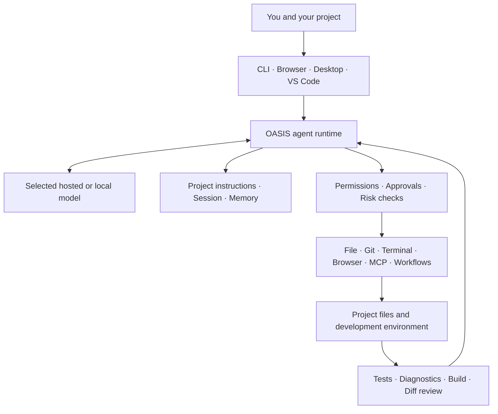

<p align="center">
  
</p>

<h1 align="center">OASIS</h1>
<p align="center"><strong>Code. Automate. Flourish.</strong></p>
<p align="center">An open-source, local-first AI coding agent and developer workspace. OASIS is in Beta.</p>

<p align="center">
  <a href="https://github.com/FAHTHIZ/oasis/actions/workflows/quality.yml"></a>
  
  <a href="LICENSE"></a>
</p>

OASIS connects the model you choose to a real project workspace. It can inspect a codebase, plan work, edit files, run approved commands, use developer tools, coordinate bounded agent tasks, and collect verification evidence—all through one runtime with several ways to work.

It is more than a chat window, but it is not a hosted AI service or a model of its own. **You choose the model and provider; OASIS supplies the coding-agent runtime, workspace tools, controls, integrations, and user interfaces.**

> **Release status:** OASIS is in **Beta**. The repository's source package is version **0.4.0** and its release notes are prepared, but 0.4.0 is not yet tagged or published. The only version tag currently present is `v0.3.0`; there are no published GitHub Release assets available for download.

---

## What OASIS brings together

| Capability area | What it does |
|---|---|
| **Coding agent runtime** | Runs multi-step model/tool conversations to explore repositories, plan changes, make edits, and respond to test or tool results. |
| **Project workspace** | Reads and edits files within configured workspace boundaries, searches code, inspects Git state, reviews diffs, and can use isolated worktrees. |
| **Execution and verification** | Runs approved commands, captures bounded output, supports configured language-server diagnostics and project checks, and distinguishes unavailable evidence from a clean result. |
| **Model choice** | Connects supported hosted providers, compatible API endpoints, local Ollama models, and gateways such as OmniRoute. |
| **Agent coordination** | Provides bounded subagents, specialist read-only reviews, a dependency-aware task board, background task records, and optional worktree isolation. |
| **Memory and continuity** | Saves sessions, loads layered project instructions and memory, estimates context use, compacts older history, and supports checkpoints and rewind. |
| **Automation** | Runs sandboxed JavaScript workflows with structured inputs/results, phases, pipelines, and parallel work. |
| **Integrations** | Connects MCP servers and supports hooks, Agent Skills, selected extension-import formats, local plugin packages, and web-search integrations. |
| **Developer surfaces** | Offers a terminal CLI, authenticated local browser workspace, VS Code-compatible integration, desktop packaging, an SDK, and a GitHub Action. |

These are implemented product areas with subsystem-level tests. Their presence does not mean every provider, integration, operating system, or end-to-end workflow has been certified to the same level. The specific boundaries are documented below and in the [project plan](docs/PROJECT_PLAN.md).

## One runtime, several ways to work

| Surface | Intended use | Current boundary |
|---|---|---|
| **Terminal CLI** | Interactive coding, one-shot tasks, provider setup, commands, diagnostics, and automation. | Requires Node.js 22 or newer. Native PTY support is optional and platform-dependent. |
| **Local browser workspace** | Chat-first interface with project tools, approvals, terminal, changes, and run monitoring. | Connects to a locally running OASIS runtime. It is not a hosted cloud workspace; browser projects/tasks/notes do not fully sync with CLI state. |
| **Desktop app** | Electron application with a project-folder picker and local backend. | Packages are built for Windows, macOS, and Linux, but currently unsigned. Automatic desktop updates are not configured. |
| **VS Code-compatible integration** | Bring the OASIS runtime into a supported editor workflow. | This is not a full IDE suite; JetBrains support is not currently shipped. |
| **SDK and GitHub Action** | Integrate the runtime into scripts and repository automation. | Unattended runs must be configured carefully; approval prompts are not a substitute for isolation. |

The browser workspace and desktop app run locally. When you choose a hosted model or search provider, the relevant prompt, code context, or search query is sent to that provider. Review the [privacy notes](docs/PRIVACY.md) before using OASIS with sensitive work.

## How the pieces fit

OASIS is the orchestration and control layer between your project and the model you select.



The model reasons and proposes tool calls. OASIS handles the local execution loop, tool contracts, permission decisions, workspace boundaries, session state, and the results returned to the model. This separation lets users change model providers without replacing the entire workspace.

## Model and provider choice

OASIS does not bundle an AI model, API subscription, or hosted inference service. You connect a provider or compatible endpoint, or use a model service running on your own computer.

Supported setup paths include OpenAI, Anthropic, Google Gemini, OpenRouter, local Ollama, and compatible gateways such as OmniRoute. The runtime includes OpenAI Responses, OpenAI-compatible Chat Completions, and Anthropic Messages protocol paths, plus documented cloud-provider adapters. Exact provider/model capabilities vary: tool calling, streaming, context size, and pricing depend on the selected model and endpoint.

Optional easy/strong model routing can send simpler and harder tasks to different configured models. Its cost numbers are estimates from configured prices and observed usage; they are not guaranteed savings or proof of equivalent answer quality.

Start with the [model setup guide](docs/INSTALL.md) and consult the [user guide](docs/USER_GUIDE.md) for supported setup paths and configuration.

## Built for control and inspectability

OASIS is designed to make consequential actions visible:

- **Permission modes and rules** control whether tools are allowed, require approval, or are denied.
- **Command-risk checks** add scrutiny to potentially destructive or ambiguous commands.
- **Workspace safeguards** constrain file operations, handle sensitive paths, and support snapshots and worktree isolation.
- **Bounded output and process cleanup** help prevent unbounded tool responses and manage supported child processes.
- **Verification records** distinguish passing checks from missing tools, timeouts, or unavailable diagnostics.
- **Review and recovery** provide diffs, checkpoints, backups, and rewind for supported file changes.
- **Integration controls** keep MCP activation and sensitive setup actions explicit; imported instructions and third-party code should still be treated as untrusted.

### Important security boundaries

OASIS runs approved commands with the operating-system permissions of the user who launched it. Approval prompts and workspace checks are useful controls, but they are **not** an operating-system sandbox.

The optional OS sandbox currently targets Linux and macOS, is disabled by default, and does not provide full filesystem-read isolation. OASIS-native OS sandboxing for Windows is not implemented. MCP servers, hooks, plugins, skills that execute code, and other third-party tools may have access beyond the protections offered by OASIS's file tools. Use trusted projects, review approval prompts, and do not treat Beta software as a security boundary.

See [SECURITY.md](SECURITY.md), the [security and reliability audit](docs/SECURITY_RELIABILITY_AUDIT.md), and [privacy notes](docs/PRIVACY.md).

## Get started

Choose the path that matches how you want to use OASIS:

| Want to… | Start here |
|---|---|
| Check desktop app availability and first-launch instructions | [Desktop app guide](docs/INSTALL.md#desktop-app--no-terminal-required) |
| Install the CLI on macOS, Linux, Windows, or Termux | [CLI installation](docs/INSTALL.md#command-line-installation) |
| Use OASIS on Android through Termux | [Android / Termux guide](docs/TERMUX.md) |
| Learn the commands, tools, integrations, and settings | [User guide](docs/USER_GUIDE.md) |

Desktop installers are built by CI, but public desktop download assets are not currently published. Check the [GitHub releases page](https://github.com/FAHTHIZ/oasis/releases) for availability; until a release with assets is published, use the CLI installation path. The prepared 0.4.0 notes are not a downloadable installer release.

### Your first task

Open a project folder you understand and start with a read-only request:

> Read this repository. Explain its main parts and how they connect. Do not change any files yet.

After reviewing the explanation, try a small, bounded task:

> Find one clear bug. Explain the evidence and a minimal fix, change only the necessary files, and run the relevant tests. Tell me clearly if you cannot verify the result.

Review proposed file changes and commands before approving them.

## Current Beta boundaries

The core runtime and several major product surfaces are implemented, but a number of release-readiness tasks remain. These are not hidden in the fine print:

- **No production certification:** Beta status means the product is still undergoing reliability and release hardening. No claim is made that it is defect-free or safe for every environment.
- **Desktop distribution:** installers are unsigned; automatic updates and publisher signing/provenance are not configured. A CI build is not a substitute for a clean-machine install, first-run, update, and uninstall test.
- **Operating-system isolation:** optional Linux/macOS sandboxing is off by default and is not full filesystem-read isolation. Native Windows OS sandboxing is not implemented.
- **Android:** there is no native Android APK. The CLI can be tried in Termux, but native PTY support and background execution are not guaranteed.
- **Browser and CLI state:** browser projects, tasks, and notes do not fully synchronize with CLI state.
- **Agent recovery:** run history can persist, but a process restart does not resurrect killed workers or pending approvals. Durable pause/resume and complete lease recovery remain open.
- **Plugin compatibility:** OASIS supports specific skill and extension paths; it does not claim universal drop-in compatibility with every plugin manifest, executable hook lifecycle, or marketplace.
- **Benchmark evidence:** the 33-task evaluator is a regression/smoke suite, not a representative repository-scale coding benchmark. No matched live-model head-to-head result or parity, speed, accuracy, or token-savings claim is published.

## The road to production readiness

The next milestone is a production-oriented release, with a working target of the coming weeks. That is a **target, not a promised date**. It depends on passing the release gates: same-commit CI, platform installer checks, clean-machine first-run testing, critical browser workflows, security-boundary validation, and documentation that matches the shipped build.

The remaining work is concentrated around hardening and evidence rather than pretending that every planned surface already exists. Follow progress in the [project plan and release checklist](docs/PROJECT_PLAN.md). The [benchmark guide](docs/BENCHMARKS.md) explains what is measured today and what evidence is still missing.

## Documentation

| Document | What it covers |
|---|---|
| [Project plan and release status](docs/PROJECT_PLAN.md) | Implemented areas, known boundaries, priorities, and release acceptance gates. |
| [Architecture](docs/ARCHITECTURE.md) | Runtime components, data flow, and trust boundaries. |
| [User guide](docs/USER_GUIDE.md) | Detailed usage, commands, settings, integrations, and workflows. |
| [Installation](docs/INSTALL.md) | Desktop packages, CLI installation, updates, and troubleshooting. |
| [Termux guide](docs/TERMUX.md) | Android CLI setup and platform limitations. |
| [Security policy](SECURITY.md) | How to report security vulnerabilities. |
| [Security and reliability audit](docs/SECURITY_RELIABILITY_AUDIT.md) | Source-level findings, fixes, remaining risks, and verification limits. |
| [Privacy notes](docs/PRIVACY.md) | Provider data flows, local storage, API keys, and integrations. |
| [Benchmarks](docs/BENCHMARKS.md) | Evaluation fixtures and reproducible comparison methodology. |
| [Workflows and skills](docs/WORKFLOWS_AND_SKILLS.md) | Automation and reusable instructions. |
| [Keyboard shortcuts](docs/KEYS.md) | Terminal shortcuts and keybinding behavior. |
| [Brand guide](docs/BRAND.md) | Official OASIS identity and interface palette. |
| [Repository maintenance](docs/REPOSITORY_MAINTENANCE.md) | Canonical file ownership, intentional copies, and repo upkeep. |
| [Contributing](CONTRIBUTING.md) | Development setup and contribution practices. |

## Development

Requirements: Node.js 22 or newer.

```bash
git clone https://github.com/FAHTHIZ/oasis.git
cd oasis
npm install
npm run check
```

The check pipeline validates the site and evaluation controls, runs the Node test suite, and validates the evaluation fixtures and negative control. GitHub Actions adds version-matrix, browser, installer, and desktop-package checks. Always read the result for the exact commit being reviewed; a green run from an older commit is historical evidence, not proof for a newer one.

## Contributing

Contributions are welcome. Read [CONTRIBUTING.md](CONTRIBUTING.md) and the [project plan](docs/PROJECT_PLAN.md) before changing behavior. Keep changes focused, add tests for fixes, document what you ran, and state clearly what you could not verify.

## License

Apache License 2.0 — see [LICENSE](LICENSE).
