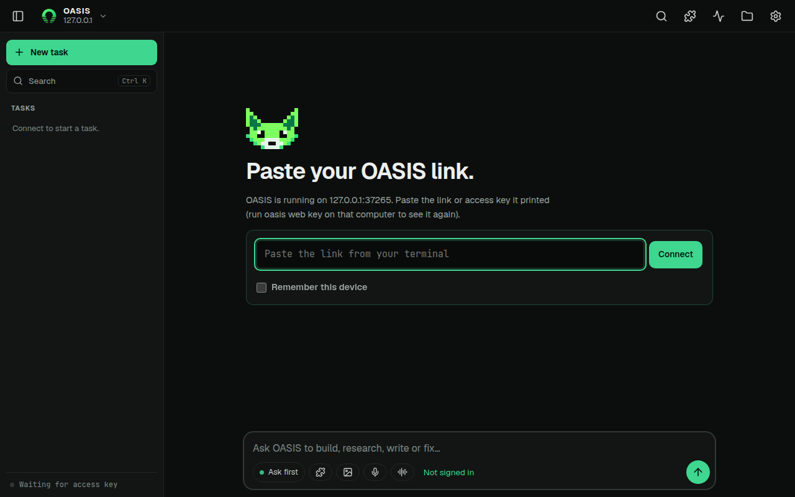
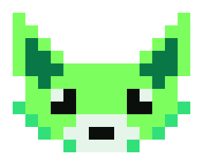

<p align="center">
  <a href="https://github.com/FAHTHIZ/oasis">
    
  </a>
  <br><sub>Illustration, not a recording. The recordings under <a href="#work-where-you-work">Work where you work</a> are real, unscripted runs.</sub>
</p>

<p align="center">
  <b>OASIS is an open-source agent platform and runtime.</b><br>
  Connect any model, hosted or local, and OASIS gives it the planning, tools, collaborating agents and checks<br>
  to do real work: software, research, data analysis, writing, automation and computer use.<br>
  It runs on your own computer or server, and it won't report "tests pass" unless it saw them pass, or cite a page it never opened.
</p>

<p align="center">
  <a href="https://github.com/FAHTHIZ/oasis/actions/workflows/quality.yml"></a>
  <a href="https://github.com/FAHTHIZ/oasis/releases/latest"></a>
  
  <a href="LICENSE"></a>
  <br>
  
  
  <a href="https://github.com/FAHTHIZ/oasis/stargazers"></a>
  <a href="https://github.com/FAHTHIZ/oasis/commits/main"></a>
  <a href="CONTRIBUTING.md"></a>
</p>

<p align="center">
  <a href="#install"><b>Install</b></a> &nbsp;·&nbsp;
  <a href="#what-oasis-does">What it does</a> &nbsp;·&nbsp;
  <a href="#work-where-you-work"><b>Terminal and web</b></a> &nbsp;·&nbsp;
  <a href="#how-a-task-runs">How it works</a> &nbsp;·&nbsp;
  <a href="#models-and-integrations">Models and integrations</a> &nbsp;·&nbsp;
  <a href="#capability-status">Status</a> &nbsp;·&nbsp;
  <a href="docs/README.md">Docs</a>
</p>

<p align="center"><picture><source media="(prefers-color-scheme: dark)" srcset="assets/readme/divider-dark.svg"></picture></p>

## Install

```sh
curl -fsSL https://raw.githubusercontent.com/FAHTHIZ/oasis/main/scripts/install.sh | sh
```

<details>
<summary><b>Windows, Homebrew, from source, or the desktop app</b></summary>

<br>

| Method | Command |
| --- | --- |
| Windows (PowerShell) | `irm https://raw.githubusercontent.com/FAHTHIZ/oasis/main/scripts/install.ps1 \| iex` |
| Homebrew | `brew tap fahthiz/oasis https://github.com/FAHTHIZ/oasis && brew install fahthiz/oasis/oasis-cli` |
| From source | `git clone https://github.com/FAHTHIZ/oasis.git && cd oasis && npm install && npm install --global .` |
| Desktop app | Installers for Windows, macOS and Linux on [GitHub Releases](https://github.com/FAHTHIZ/oasis/releases) (not yet code-signed, see [Desktop](docs/DESKTOP.md)) |

One package gives you the terminal, the web app and every other interface below. It needs Node.js 22.19+ and Git. The install scripts take the latest stable release, ask before changing anything, and finish with `oasis doctor`. Every release ships the npm tarball, the desktop installers and a `SHA256SUMS` file. See [Downloads and releases](docs/RELEASES.md).

</details>

Then, in any folder you want it to work in:

```sh
oasis connect        # 1. paste an API key, a model link or a local server address
oasis                # 2. work in the terminal
oasis web --open     #    …or open the web app on this folder
```

Ask in plain words. A few requests OASIS is built for:

| You ask | OASIS does |
| --- | --- |
| "Compare the three most-used open-source vector databases and cite your sources" | Searches, opens the pages and writes a cited report; a citation of a page it never fetched is flagged |
| "Turn sales.csv into a chart and a one-page summary" | Computes the numbers with code it runs and saves `chart.png` and `summary.md` in the folder |
| "Draft a project update from notes/*.md for a non-technical audience" | Writes the file, lists what it left out, and you can undo the whole turn |
| "Every weekday at 9, summarize new issues and post them to Slack" | Schedules a routine that runs without a terminal open |
| "Find out why the login test fails and fix it" | Runs the tests, edits the code, reruns the tests and shows you the diff |

<p align="center"><picture><source media="(prefers-color-scheme: dark)" srcset="assets/readme/divider-dark.svg"></picture></p>

## What OASIS does

OASIS is not tied to one kind of task or one model vendor. The same runtime plans the work, gives the model tools, splits large jobs across agents and checks the result before it is reported as done.

| Area | What is in the box |
| --- | --- |
| Software | Reads and edits code, runs tests and commands, reviews diffs, works in git worktrees, opens pull requests, and checkpoints every edit so `/rewind` undoes a turn. |
| Research | Federated web search, page fetching and a real Chrome it can drive (`--chrome`). An evidence ledger flags any claim that cites a page the agent never opened. `/deep-research` fans a question out to parallel research agents and cross-checks their claims. |
| Data analysis | CSV and spreadsheet analysis, charts and notebooks, with numbers computed by code it ran rather than mental arithmetic. The optional analysis pack rejects a report whose numbers were not printed by code. |
| Writing and documents | Reads PDFs and images, and saves reports, posts and slides as files in the workspace that you can review, diff and undo. |
| Automation | `oasis schedule add "every 1d" "…"` runs routines on a schedule, cron or webhook; `oasis gateway` answers in Telegram, Slack, Discord and other chat apps; `/goal` keeps going until a condition holds. |
| Browser and computer use | Drives Chrome over CDP, and (experimental) sees the screen and uses the mouse and keyboard on Linux, macOS and Windows with `--computer-use`, optionally inside a virtual desktop. See [Computer use](docs/COMPUTER_USE.md). |
| Media | `generate_image` and `text_to_speech` through any OpenAI-compatible images or speech API, local servers included. |
| Memory | Memory across sessions, full-text recall of past conversations, repeatable work proposed as reviewable skills (`/learning`), and an optional [Honcho](docs/CONFIGURATION.md#honcho-user-modeling) user model. `oasis import` brings settings, memories and skills from other agent tools. |

Each workflow, with the exact commands and what the runtime enforces, is in [Workflows](docs/WORKFLOWS.md).

## Work where you work

The terminal and the web app run on the same runtime, sessions and settings. Start a task in one and pick it up in the other under **Chats → Earlier on this computer**. The two recordings below are real, unscripted runs that show the interfaces at work; they happen to be coding tasks because those are the easiest to check end to end. Research, analysis and writing examples are in [Workflows](docs/WORKFLOWS.md).

<table>
  <tr>
    <th width="50%">Terminal · <code>oasis</code></th>
    <th width="50%">Web app · <code>oasis web --open</code></th>
  </tr>
  <tr>
    <td><a href="assets/demo/oasis-real-model-demo.mp4"></a></td>
    <td><a href="assets/demo/oasis-web-real-model-demo.mp4"></a></td>
  </tr>
  <tr>
    <td valign="top"><sub>Unscripted, OASIS 1.3.0 with the free gpt-oss-20b. It runs the tests, finds the discount bug in <code>cart.mjs</code>, fixes it and proves it with a second run (2 passed). Model waits are shortened.</sub></td>
    <td valign="top"><sub>Unscripted, OASIS 1.3.0 with the free gpt-oss-20b. A note sent mid-task widens the fix, approvals are answered in the waiting step, and 3 tests pass. Frames where nothing changed (model waits) are cut. Recorded with <code>scripts/demo/record-web-real-demo.mjs</code>.</sub></td>
  </tr>
  <tr>
    <td valign="top">A live status line with the running step and clock, streaming diffs with word highlights, type-ahead while it works, colored diffs in approvals, <code>/tasks</code>, <code>/rewind</code> and <code>/export</code>, and <code>oasis -p</code> or <code>oasis exec</code> for scripts.</td>
    <td valign="top">A live timeline with expandable steps and command output, approvals answered inline, a task sidebar, Files and Changes panels, a real terminal (<kbd>Ctrl</kbd>+<kbd>&#96;</kbd>), a sandboxed Preview of your pages, talk mode, plan mode, Undo, cost and context meters, and one-click plugins.</td>
  </tr>
</table>

The web app runs on a computer or server you control, not a hosted service, and opens in any modern browser. An optional [desktop app](docs/DESKTOP.md) shows the same workspace in its own window; there is no separate mobile app.

<details>
<summary><b>More places OASIS runs</b></summary>

<br>

| From | Start it with | What you get |
| --- | --- | --- |
| Desktop | [Desktop app](docs/DESKTOP.md) | The web workspace in its own window, the model key in the OS key store, automatic updates |
| Zed, JetBrains and other ACP editors | `oasis acp` | Agent Client Protocol sessions with Mode and Model pickers, a context meter and real cancel |
| Other agents (ADK, LangGraph, CrewAI, another OASIS) | `oasis a2a serve` | An A2A 1.0/0.3 agent with streaming and approvals; the `remote_agent` tool calls their agents back ([A2A](docs/A2A.md)) |
| VS Code, Cursor, Windsurf | `oasis ide install` | The VS Code-family extension, with inline tab completion from your model |
| Codex App Server clients | `oasis app-server` | Clients built for `codex app-server` drive OASIS with any model: threads, turns, steering, approvals, review, files and commands |
| Cursor Cloud Agents API scripts | `oasis web --persistent-key` | Cursor's REST endpoints served by your own OASIS with any model ([details](docs/INTERFACES.md#cursor-cloud-agents-api)) |
| CI | `action.yml` | A GitHub Action that runs OASIS in a workflow |
| Cloud agents | `oasis cloud run "TASK"` | The task runs on GitHub Actions with your own key; `--pr` opens a pull request, `oasis cloud pull` brings it back |
| Your own code | `src/sdk.mjs` | The Node.js SDK: session, headless, tool and hook APIs |
| Chat | `oasis gateway` | Telegram, WhatsApp, Slack, Discord, Mattermost, Matrix, Signal or email gateways ([Gateways](docs/GATEWAYS.md)) |

Full method lists, transports and auth for each protocol are in [Interfaces](docs/INTERFACES.md).

</details>

<details>
<summary><b>Run the web app on a server</b></summary>

<br>

```sh
oasis web --public-url https://oasis.example.com --trust-proxy   # behind Caddy, nginx, Tailscale Serve or Cloudflare Tunnel
oasis web key                                                    # show the access key; --rotate replaces it
```

The web app is served by OASIS on a computer you control, not a hosted service. Open the address from your workstation, paste the link once and tick **Remember this device**. Tasks run on the server, so a reload or dropped connection reattaches to the running task and asks any open approval again. Recipes and the security model: [Remote access](docs/REMOTE-ACCESS.md).

<table>
  <tr>
    <td width="55%"></td>
    <td width="45%"></td>
  </tr>
  <tr>
    <td><sub>Light theme</sub></td>
    <td><sub>Signing in to a remote OASIS server</sub></td>
  </tr>
</table>

</details>

<details>
<summary><b>Scripts and CI</b></summary>

<br>

```sh
oasis -p "summarize the open TODOs"                                   # one-shot
oasis exec --output-format stream-json "fix the lint errors" > run.jsonl
oasis -p --permission-mode dont-ask "review this diff"                # never waits on an approval
oasis -p --permission-mode auto --goal "npm test passes"              # keeps going until the check says it holds
```

`--output-schema` gives structured JSON, a goal that is never met exits with code 1, and a run stopped part-way is saved so `oasis --resume ID` can continue it.

</details>

<p align="center"><picture><source media="(prefers-color-scheme: dark)" srcset="assets/readme/divider-dark.svg"></picture></p>

## How a task runs

<p align="center">
  <picture><source media="(prefers-color-scheme: dark)" srcset="assets/readme/pipeline-dark.svg"></picture>
</p>

You ask in plain words. OASIS plans the work, acts through tools (files, shell, browser, search, apps), then has to pass a verification gate before it may say it is done. The gate checks the evidence the run actually produced: a diff was reviewed, a command really exited 0, a cited page was really fetched, a number was really printed by code. If something is missing, the agent is sent back to work. Every file change is checkpointed, so <kbd>Esc</kbd> <kbd>Esc</kbd> or `/rewind` undoes a turn.

<p align="center">
  
  <br><sub>The model proposes replies and tool calls. OASIS decides which tools exist, which calls need approval and what counts as verified. See <a href="docs/ARCHITECTURE.md">Architecture</a>.</sub>
</p>

### How agents collaborate

Larger jobs are split across agents that run as one network with a single scheduler ([Agent network](docs/AGENT-NETWORK.md)):

- **Subagents.** Built-in `explore`, `plan`, `general-purpose`, `code-review` and `security-review` agents, plus your own agent files. They run in parallel or in the background, can be resumed, and can each get their own git worktree ([Subagents](docs/SUBAGENTS.md)).
- **Teams.** Agent teams coordinate around a shared task board, with messages between members and leases on claimed tasks.
- **Checked reports.** A subagent's report is checked against its own tool results: a "tests pass" with no passing test run, a cited page it never fetched or a number no code printed is flagged before the parent relies on it.
- **Budgets and cancellation.** Each agent can reserve a budget (tokens, dollars, requests, steps, children) from its parent's, a scheduler limits how many run at once, and stopping an agent stops its whole subtree.
- **Workflows.** `/deep-research` and `/audit` are built-in scripted workflows; the `workflow` tool runs your own. Research and analysis domain packs add specialist agents with narrower tools.
- **Experience.** Each run's outcome is recorded from evidence, so later runs can recall what worked before (`oasis agents experience`).

### Where work runs

By default OASIS works in the folder you start it in, on your machine, with approvals. It can also run commands in a bubblewrap or macOS Seatbelt sandbox, a Docker, Podman or Apptainer container (optionally under gVisor), or on a remote SSH, Daytona or Modal machine. `oasis doctor` tells you which is active. Details: [Execution backends](docs/EXECUTION-BACKENDS.md).

<p align="center"><picture><source media="(prefers-color-scheme: dark)" srcset="assets/readme/divider-dark.svg"></picture></p>

## Models and integrations

**Any model.** OpenAI, Anthropic, Gemini, Bedrock, Vertex AI, Azure AI Foundry, OpenRouter, Groq, DeepSeek, Mistral, xAI, any OpenAI-compatible endpoint, or a local Ollama, LM Studio, llama.cpp or vLLM server. `oasis connect` takes an API key, a model page link or a server address, works out the provider, tests models with a real tool call and saves the first that works plus backups for failover. Prompt caching, automatic compaction, task-aware routing, zero-budget mode and spend limits are built in ([Model providers](docs/CONFIGURATION.md#model-providers), [Inference](docs/INFERENCE.md)). The harness gives small and local models the same tools and checks, but OASIS does not guarantee that every model will solve every task: on a given task the model you connect usually matters more than the harness.

**Apps.** Say "connect GitHub" or type `/connect linear` and a Connect card appears in the conversation. Approve access on the service's own page and its tools are ready in the same turn. 48 apps are built in, and any other remote MCP server works by name from the official MCP Registry or by URL.

**MCP.** Stdio, HTTP and SSE servers, with OAuth, elicitation and MCP Tasks. `oasis mcp serve` exposes OASIS's own tools to other MCP clients.

**Skills and plugins.** Skills, slash commands, hooks, subagents and MCP servers can be packaged as plugins. Existing Claude Code setups (`CLAUDE.md`, `.claude/agents`, skills, hooks, settings, `.mcp.json` and plugins) load without conversion, and Codex plugins and Gemini CLI extensions are converted on install. What loads and what does not is in [Compatibility](docs/COMPATIBILITY.md).

**Free-tier routers.** [OmniRoute](https://github.com/cheaper-inference/OmniRoute) and [FreeLLMAPI](https://github.com/Azhan787/FreeLLMAPI) are built-in gateway providers. Run either on your machine with your own provider accounts and point `oasis connect` at it; zero-budget mode refuses any route it cannot prove is free. Each free tier has its own limits and terms. Setup: [OmniRoute](docs/CONFIGURATION.md#omniroute-gateway), [FreeLLMAPI](docs/CONFIGURATION.md#freellmapi-gateway).

<details>
<summary><b>Model, MCP and plugin commands</b></summary>

<br>

```sh
oasis connect                              # paste a key (kept out of shell history)
oasis connect --from-env gemini            # use GEMINI_API_KEY
oasis connect http://localhost:11434       # Ollama, LM Studio, llama.cpp or vLLM
oasis connect http://127.0.0.1:4000/v1 --model NAME   # try this model first, even if the server lists none

oasis mcp search filesystem                            # the official MCP Registry
oasis mcp add everything -- npx -y @modelcontextprotocol/server-everything
oasis mcp add --transport http docs https://example.com/mcp
oasis mcp connect linear                               # the Connect card flow from a shell

oasis plugin marketplace add anthropics/claude-plugins-official
oasis plugin install superpowers@claude-plugins-official
oasis add BuilderIO/skills            # Codex plugins and Gemini CLI extensions, converted on install
oasis plugin validate ./my-plugin
```

The web app manages servers under **Settings → Tools**, apps under **Settings → Apps** and plugins under **Plugins**. More in [Skills, hooks, MCP and plugins](docs/EXTENDING.md).

</details>

<p align="center"><picture><source media="(prefers-color-scheme: dark)" srcset="assets/readme/divider-dark.svg"></picture></p>

## Security

OASIS can read and change files, run commands, browse and send context to your model provider, with your account's permissions.

- Permission modes go from `plan` (read-only) to `dont-ask` (never waits, denies anything not allowed). The default runs read-only commands freely and asks before other commands, installs, deletions and new websites.
- Shell commands get a risk analysis, protected paths such as `.env` and `.git` are guarded, secrets in tool output are redacted before the model sees them, and commits are scanned for secrets. Project settings that loosen anything wait until you trust the workspace.
- The web app signs browsers in with a 256-bit access key, with DNS-rebinding protection and brute-force lockout ([Remote access](docs/REMOTE-ACCESS.md)).
- Plugins, hooks and MCP servers can run third-party code. Review them before turning them on.
- Approval prompts are not a replacement for operating-system isolation. Use the sandbox, a container or a throwaway machine for untrusted code.

Read the [security policy](SECURITY.md) before using OASIS on sensitive work.

## Capability status

OASIS is a young project. Status labels for every part are in [Capabilities and status](docs/CAPABILITIES.md); in short:

| Status | Areas |
| --- | --- |
| Stable | Terminal and scripted runs, the self-hosted web app, sessions, checkpoints and undo, permission modes, bubblewrap and Docker sandboxes, MCP, Claude Code plugins, OpenAI-compatible, Anthropic, Gemini and local providers |
| Released, lightly tested | Subagents in parallel and in teams, scripted workflows, domain packs, the desktop app (installers not yet code-signed), editor integrations, Codex App Server and Cursor API compatibility, the SDK, GitHub Action and cloud runs, Telegram, Slack and Discord gateways, the Chrome browser tool, app connectors, image and speech tools |
| Unreleased (on `main`, install from source) | Desktop computer use and virtual desktops (experimental), the control room, A2A, agent experience, `mixture_of_agents`, Daytona, Modal, Apptainer and gVisor backends, more chat gateways, Honcho and Home Assistant |
| Not claimed | Production readiness for untrusted code without OS isolation, results with paid frontier models, a hosted service, a published Terminal-Bench or SWE-bench score |

Engineering benchmarks of the harness itself (tool-call repair, edit application, risky-command blocking, secret detection) and every recorded live run are kept for development in [Benchmarks](docs/development/BENCHMARKS.md) and [Real-world runs](docs/development/REAL-WORLD-RUNS.md). They are one-trial samples, not a ranking.

## Documentation

| Get started | Go deeper | Project |
| --- | --- | --- |
| [User guide](docs/USER-GUIDE.md) | [Architecture](docs/ARCHITECTURE.md) | [Capabilities and status](docs/CAPABILITIES.md) |
| [First run](docs/FIRST-RUN.md) | [Agent network](docs/AGENT-NETWORK.md) · [Subagents](docs/SUBAGENTS.md) | [Changelog](CHANGELOG.md) |
| [Workflows](docs/WORKFLOWS.md) | [Configuration](docs/CONFIGURATION.md) | [Contributing](CONTRIBUTING.md) |
| [Terminal guide](docs/TERMINAL.md) | [Skills, hooks, MCP and plugins](docs/EXTENDING.md) | [Security](SECURITY.md) |
| [Interfaces](docs/INTERFACES.md) | [Execution backends](docs/EXECUTION-BACKENDS.md) | [Troubleshooting](docs/TROUBLESHOOTING.md) · [FAQ](docs/FAQ.md) |
| [Desktop app](docs/DESKTOP.md) | [Remote access](docs/REMOTE-ACCESS.md) | [Support](SUPPORT.md) |
| [Downloads and releases](docs/RELEASES.md) | [Compatibility](docs/COMPATIBILITY.md) | [Brand guidelines](docs/BRAND.md) |
| | [Benchmarks](docs/development/BENCHMARKS.md) · [Real-world runs](docs/development/REAL-WORLD-RUNS.md) | [All docs](docs/README.md) |

## Development

```sh
npm install
npm test                          # 3,700+ tests
npm run check                     # tests, benchmark regressions, eval validation
npm run lint
node scripts/readme-art.mjs       # regenerate the animated README art in assets/readme/
```

CI also runs platform security tests, a live Docker sandbox test, native PTY tests and a browser test that drives the web app like a person: approvals, a reload mid-task that must reattach, a second browser, Remember this device, and WCAG contrast checks. Contributions are welcome: start with the [Contributing guide](CONTRIBUTING.md).

<p align="center"><picture><source media="(prefers-color-scheme: dark)" srcset="assets/readme/divider-dark.svg"></picture></p>

## Community

<p align="center">
  <a href="https://star-history.com/#FAHTHIZ/oasis&Date">
    <picture>
      <source media="(prefers-color-scheme: dark)" srcset="https://api.star-history.com/svg?repos=fahthiz/oasis&type=Date&theme=dark">
      
    </picture>
  </a>
</p>

<p align="center">
  <a href="https://github.com/FAHTHIZ/oasis/graphs/contributors"></a>
</p>

<p align="center">
  Questions and ideas go to <a href="https://github.com/FAHTHIZ/oasis/issues">Issues</a>. Code goes through the <a href="CONTRIBUTING.md">Contributing guide</a>. Help is in <a href="SUPPORT.md">Support</a>.
</p>

## Meet Fen



Fen is the OASIS mascot: a fennec fox, the desert animal that always finds the water. Fen greets you when the terminal starts, sits on the web app's welcome screen and blinks at you from the terminal in the artwork above. Set `OASIS_NO_MASCOT=1` to show only the wordmark.

<br clear="left">

## License

[Apache License 2.0](LICENSE). Bundled third-party code, fonts and data keep their own licenses; see [Third-party notices](THIRD-PARTY-NOTICES.md).

<p align="center"><br><sub>Made with care by the OASIS contributors. Fen says hi.</sub></p>
