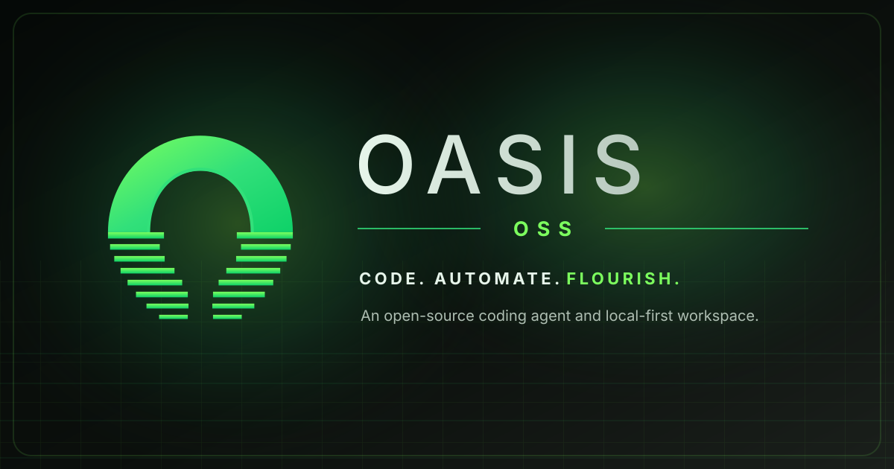

<p align="center">
  
</p>

<p align="center"><a href="docs/INSTALL.md">Install</a> · <a href="docs/QUICKSTART.md">Quick start</a> · <a href="docs/USER_GUIDE.md">User guide</a> · <a href="https://github.com/FAHTHIZ/oasis/releases/latest">Download desktop app ↗</a> · <a href="https://fahthiz.github.io/oasis/">Homepage ↗</a> · <a href="docs/KEYS.md">Keyboard shortcuts</a> · <a href="docs/ARCHITECTURE.md">Architecture</a> · <a href="docs/ROADMAP.md">Roadmap</a> · <a href="docs/SECURITY_RELIABILITY_AUDIT.md">Security &amp; reliability</a></p>

<p align="center">
  <a href="https://github.com/FAHTHIZ/oasis/actions/workflows/quality.yml"></a>
  <a href="https://fahthiz.github.io/oasis/"></a>
  <a href="LICENSE"></a>
  
  <a href="https://nodejs.org/"></a>
</p>

OASIS is an open-source AI coding agent. Bring your own model. OASIS is a local-first developer workspace for multi-step software development: it inspects codebases, plans and applies focused edits, runs approved shell commands and tests, and summarizes what changed. Use the CLI in your terminal or launch the browser workspace with `oasis web`; extend it with supported model providers, Model Context Protocol (MCP) tools, reusable skills, hooks, and bounded subagents.

For the current implementation inventory and explicit limitations, see [Current status](docs/CURRENT_STATUS.md) and [Next milestone](docs/NEXT_MILESTONE.md). For the item-by-item UI/UX and app brief audit, see [UI/UX and app implementation audit](docs/UX_APP_BRIEF_AUDIT.md). For the coding-agent evaluation suite and fair-comparison plan, see the [benchmark audit](docs/BENCHMARK_AUDIT.md). For the prioritized, source-backed remaining-gap register, see the [whole-codebase gap register](docs/WHOLE_CODEBASE_GAP_REGISTER.md).

## Get started

**OASIS is alpha software.** The desktop app is the easiest path for people who do not want a terminal; the CLI is for developers and automation.

**Desktop app (no terminal required)**

1. Open the [latest release](https://github.com/FAHTHIZ/oasis/releases/latest).
2. Download and open the installer for your operating system.
3. Choose a project folder, connect a model provider, and test the connection. The desktop app does not require a separate Node.js or Git installation. Installers are currently unsigned.

**Terminal (for developers)**

Requirements: Node.js 22 or newer. Git is not required for the archive-based install. For native PTY prerequisites and platform caveats, see [the install guide](docs/INSTALL.md).

```bash
npm install --global https://github.com/FAHTHIZ/oasis/archive/refs/heads/main.tar.gz
oasis
```

The first-run setup helps choose a provider. OASIS does not include a model or API subscription; your selected provider must support tool calling. Review [current status and limitations](docs/CURRENT_STATUS.md) before using OASIS on important work.

## Try it

From the project you want OASIS to work on:

```bash
cd /path/to/your/project
oasis "Inspect this project and identify the next useful improvement"
```

For a more direct example:

```bash
oasis "Find the bug in the task filter, fix it, and run the relevant tests"
```

To use the browser interface, run `oasis web` in that project and open the local address printed in the terminal. Check your provider with `oasis doctor --test-provider`.

## What’s included

| Area | What it does |
| --- | --- |
| **Terminal** | A fast interactive editor with history search, Tab completion for commands and `@files`, Shift+Tab permission modes, `!` shell mode, image paste, streaming Markdown and diffs, type-ahead, Esc to interrupt, vim mode, Ctrl+G external editor, Ctrl+S prompt stash, and portable keybinding imports. Interactive agent commands can use persistent PTY sessions with streamed output, input, resize, Ctrl+C and stop controls when the native `node-pty` component is available. Press `?` for shortcuts or `Ctrl+K` to search commands, settings, and recent sessions. |
| **Workflows** | Dynamic JavaScript workflows: the agent writes a JavaScript orchestration script and the `workflow` tool fans it out to many subagents with `agent`/`pipeline`/`parallel`/`phase`, schema-checked results, background runs, resume from saved results, `/workflows`, saved workflows as `/name` commands, the built-in `/deep-research`, and `ultracode` prompts. `/goal` keeps working until a condition is met, `/batch` runs parallel worktree subagents, `/simplify`, `/verify`, `/btw` side questions, `/subtask` forked background agents, `oasis --bg` / `/background` detached sessions (plus `oasis attach|logs|stop|respawn` and `--bg --exec` shell jobs), `--safe-mode` and `--restricted` starts, `oasis purge` local-data cleanup, `/advisor` second-model consults, `oasis import` from Codex/Gemini CLI/Cursor, `/insights` usage reports, a PowerShell tool, a Chrome browser tool (`--chrome`), `/schedule` in-session cron, and the bundled [Ponytail](https://github.com/DietrichGebert/ponytail) lean mode (`/ponytail`). |
| **Coding agent** | Multi-step model/tool loops, workspace file operations, command approvals, file snapshots, checkpoints, rewind, sessions saved by default, and USD cost tracking with budget limits. |
| **Model choice** | OpenAI Responses, Anthropic Messages, compatible endpoints, and supported cloud or local providers such as OpenRouter, Gemini, Ollama, Bedrock, Vertex, Microsoft Foundry, and compatible gateways. |
| **Extensions and agents** | MCP integrations, reviewed capability bundles, portable Agent Skills, hooks, layered memory, custom commands, bounded subagents, and a session-local shared task board with dependencies, expiring claims/renewal, peer messaging, named teams, and bounded `dispatch_ready_tasks` waves in isolated worktrees. Dispatch is model-directed (not an autonomous scheduler), background workers still obey inherited permissions, and branches are not merged automatically. |
| **Browser workspace** | A local projects/tasks/notes dashboard plus authenticated agent chat, persisted task history, approval prompts, a Run monitor for redacted worker/team lifecycle, worktree metadata, available token usage and approval counts, and a guarded **Open saved chat** action for completed/interrupted workspace-mode runs. Opening the parent chat restores conversation context only; it does not resurrect a worker or pending approval. Opt-in isolated Git-worktree runs stay on review branches; OASIS does not auto-merge. |
| **Automation and SDK** | Headless/JSON workflows for scripts and CI, a Node.js SDK, and optional delegation to an existing OpenHands server. |

## Safety and current limits

OASIS uses workspace-bound file tools, secret-file exclusions, snapshots, and approval gates to reduce risk. Commands normally run with your operating-system permissions; the optional OS sandbox is disabled by default and currently targets Linux and macOS. These safeguards are not a guarantee that untrusted code is safe—review operations and use an isolated workspace for unfamiliar projects.

VS Code, Cursor and Windsurf integrate via `oasis ide install` (in-editor chat panel, selection context, diff review, diagnostics). A `monitor` tool watches logs, CI or WebSockets in the background and wakes the agent on each event, and `--channels` lets MCP channel servers (Telegram, Discord, webhooks) push messages into a live session. A plugin and marketplace adapter reads compatible manifests and supports commands, agents, skills, hooks, MCP/LSP servers, monitors, output styles, helper executables, options and themes. Supported plugins can contribute commands, agents, skills, hooks, MCP/LSP servers, monitors, output styles, `bin/` tools, default agents, `userConfig` options and themes; marketplace sources include relative paths, GitHub, git URLs, git subdirectories and npm packages. **Compatibility is feature-by-feature, not a guarantee that every third-party or enterprise plugin behaves unchanged.** Some boundaries are intentional and documented: Windows sandbox/container isolation is not available; the browser now has a PTY-backed xterm.js terminal but cross-platform process cleanup still needs verification; and the browser dashboard’s projects/tasks/notes do not sync with the CLI workspace. The browser’s GitHub connection currently uses the host’s GitHub CLI login.

## Documentation

[**Implementation audit & external capability benchmark**](docs/CLAUDE_CODE_CODE_LEVEL_COMPARISON.md) · [**Benchmark audit**](docs/BENCHMARK_AUDIT.md) · [**Next milestone**](docs/NEXT_MILESTONE.md) · [**Security/reliability audit**](docs/SECURITY_RELIABILITY_AUDIT.md) · [**Detailed user guide**](docs/USER_GUIDE.md) · [Keyboard shortcuts](docs/KEYS.md) · [Install guide](docs/INSTALL.md) · [Architecture](docs/ARCHITECTURE.md) · [Roadmap](docs/ROADMAP.md) · [Product readiness](docs/PRODUCT_READINESS.md) · [Capability gates](docs/CAPABILITY_GATES.md) · [GitHub Action](docs/github-action.md) · [Contributing](CONTRIBUTING.md) · [Security policy](SECURITY.md)

## Web research engine

OASIS includes configurable web search plus a local Claude Code research plugin. It can use Tavily, Brave, Exa, Firecrawl, and a self-hosted SearXNG endpoint; with multiple providers configured it can search in parallel and fuse rankings. The keyless DuckDuckGo fallback remains available when upstream access permits. Search queries go to the configured search provider; prompts and any code/context included in requests go to the model provider you configure. Add your own supported search-provider key to choose a different provider, and avoid sending secrets you do not want those providers to receive. See [Search and deep-research architecture](docs/SEARCH_RESEARCH.md) for provider setup, plugin installation, limits, and a reproducible baseline-vs-candidate search benchmark.

## Development

```bash
git clone https://github.com/FAHTHIZ/oasis.git
cd oasis
npm run check
```

The latest verified implementation snapshot before this documentation refresh, commit 0002f84a534cd1498b83b5e78fede53922aca7e5, passed **685 Node tests with zero failures**, validated **33 evaluation fixtures**, and passed Node.js 22/24/26, clean-environment tests, Linux PTY, authenticated browser E2E, and Ubuntu/macOS/Windows security regressions in [Quality Checks run 40870856114](https://github.com/FAHTHIZ/oasis/actions/runs/40870856114). [Publishing validation run 40870856141](https://github.com/FAHTHIZ/oasis/actions/runs/40870856141) also passed on that SHA. Desktop packaging was still running when this note was written; even a successful build does not establish signed installers or clean-machine first-run readiness. The Ctrl+K palette is covered by a regression test; selecting an item inserts its command for review instead of executing it automatically. The 33 fixtures remain a regression/smoke suite—not a representative repository-level coding benchmark. Recent hardening covers process-tree cancellation, URL/SSRF checks, OAuth DNS pinning, API-key helper isolation, plugin archive/ZIP validation, desktop OS-backed API-key storage, and redaction in approval, browser tool-event, and channel-relay paths. Installers remain unsigned, and these checks are not a full security audit. Phone pairing is not implemented; the design-only threat note is available at [docs/PHONE_CONNECT_SECURITY.md](docs/PHONE_CONNECT_SECURITY.md) and must be read before that feature is implemented. See [Current status](docs/CURRENT_STATUS.md), [Product readiness](docs/PRODUCT_READINESS.md), [Capability gates](docs/CAPABILITY_GATES.md), [the security/reliability audit](docs/SECURITY_RELIABILITY_AUDIT.md), and the [whole-codebase gap register](docs/WHOLE_CODEBASE_GAP_REGISTER.md).

## License

Apache License 2.0 — see [LICENSE](LICENSE).
