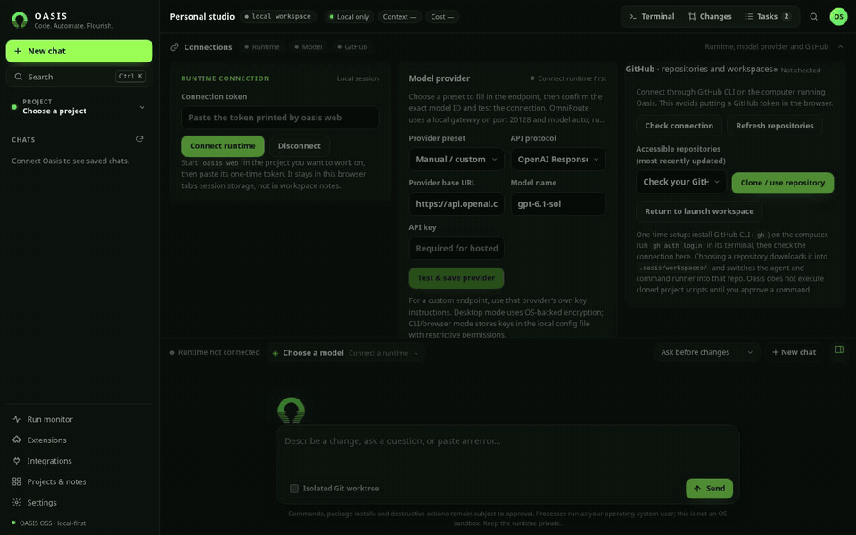
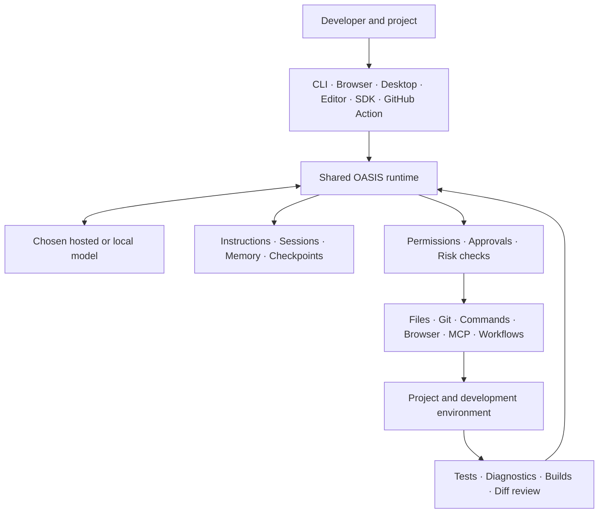

<!-- OASIS product overview. Current lifecycle and release qualification: docs/PROJECT_PLAN.md -->

<p align="center">
  
</p>

<h1 align="center">OASIS</h1>
<p align="center"><strong>Code. Automate. Flourish.</strong></p>
<p align="center">Open-source, model-agnostic, local-first coding agent.</p>

<p align="center">
  <a href="https://github.com/FAHTHIZ/oasis/actions/workflows/quality.yml"></a>
  
  
  <a href="LICENSE"></a>
</p>

**The open-source coding agent that makes any model safer and more capable — from a 4B model on your laptop to the frontier.**

OASIS is a terminal-first agent runtime: point it at Claude, GPT, Gemini, DeepSeek, OpenRouter, Bedrock, Vertex, or a local Ollama / LM Studio / llama.cpp model, and it plans, reads your codebase, edits files, runs commands and checks its own work, with guardrails that live in the runtime rather than in the prompt.

```bash
git clone https://github.com/FAHTHIZ/oasis.git && cd oasis && npm install && npm install -g .
oasis setup      # pick a provider, or a local model
cd ~/your-project && oasis
```

> **Current lifecycle — OASIS 1.0, stable.** The 1.0 release gates in the [project plan](docs/PROJECT_PLAN.md) are met on one commit: full Quality Checks (Node 22/24/26 on Windows, macOS and Linux, browser E2E with accessibility checks), installer checks, desktop packaging and public-site validation. Desktop installers are **unsigned** (each release ships `SHA256SUMS`), and install/update/uninstall is verified on clean CI runners rather than by hand on physical machines.

<p align="center">
  <a href="#quick-start"><strong>Get started</strong></a>
  &nbsp;·&nbsp;
  <a href="#measured-not-claimed">Benchmarks</a>
  &nbsp;·&nbsp;
  <a href="docs/USER_GUIDE_MAP.md">User guide</a>
  &nbsp;·&nbsp;
  <a href="https://github.com/FAHTHIZ/oasis/releases/latest">Downloads</a>
</p>

---

<p align="center">
  
  <br/><sub>Reproducible browser-workspace demo. The model response is a scripted local fixture; the workspace, tools, approval flow, verification gate, and Changes panel are the actual OASIS runtime.</sub>
</p>

## The harness is the product

A coding agent is a model plus a harness. The model decides what to do; the harness decides what actually happens to your repository. Most of the frustration with coding agents comes from the harness: tool calls that fail to parse, edits that miss by one space, `rm -rf` in auto mode, "done" without running a test, a function replaced by `// ... rest unchanged`.

OASIS treats each of those as a runtime problem with a runtime fix, so the fixes hold whichever model you connect. A small local model becomes usable; a frontier model stops wasting turns and stops making the mistakes that cost you an afternoon.

## Measured, not claimed

The [model-free harness benchmark](docs/BENCHMARKS.md#model-free-harness-benchmark-2026-11-01) feeds the runtime the outputs real models actually produce and scores what happens. It needs no model or API key; run it yourself in seconds with `node bench/harness/run.mjs`.

| What the model sends | No harness layer | OASIS, on held-out cases it was never tuned on |
| --- | --- | --- |
| Malformed or text-only tool calls (fences, comments, Python literals, Hermes/Qwen tags) | 1 of 20 run | **18 of 20 run**, 0 false runs |
| Edits whose `old_string` drifted (indentation, spacing, quotes, CRLF, BOM) | 2 of 12 apply | **11 of 12 apply**, 0 wrong writes |
| Destructive shell commands with approvals switched off | 0 of 31 stopped | **22 of 31 stopped** (23 with a scorer fix), every everyday command still runs |
| Placeholder rewrites, weakened tests, leaked secrets | 0 of 23 caught | **16 of 23 caught**, 0 false alarms |

Every miss above was then fixed and turned into a regression test, so the current runtime scores 100% on all three case sets except one deliberate secret-scanner miss. Those post-fix numbers measure tuning, not generalization, which is why the table shows the untuned ones. A same-model, head-to-head task benchmark against Claude Code is supported by the [eval runner](docs/BENCHMARKS.md#run-claude-code-on-the-same-fixtures) but has not been published yet.

## Quick start

**Requirements:** Node.js 22 or newer and Git.

### Install from source

```bash
git clone https://github.com/FAHTHIZ/oasis.git
cd oasis
npm install
npm install -g .

oasis setup
cd ~/your-project
oasis
```

This installs the current `main` source. For a pinned, checksum-verified install of the latest stable release, use the installer below.

### Install the latest stable CLI release

Use the [checksum-verified installer](docs/INSTALL.md#command-line-installation). It resolves the latest stable semantic-version tag (currently `v1.0.0`) to an immutable commit and does not install the moving `main` branch.

### Download the desktop app

The [latest release](https://github.com/FAHTHIZ/oasis/releases/latest) has Windows x64, macOS arm64, and Linux x86_64 installers plus a `SHA256SUMS` file. The installers are not code-signed, so Windows SmartScreen and macOS Gatekeeper will warn on first launch; check the file against `SHA256SUMS` before opening it ([how](docs/INSTALL.md)).

### Run it on a local model

```bash
llama-server -m qwen3-4b-instruct-q4_k_m.gguf --jinja -c 16384 --port 8080
OASIS_BASE_URL=http://127.0.0.1:8080/v1 OASIS_MODEL=qwen3-4b oasis
```

OASIS reads the loaded window from the server and switches to its small-context profile automatically. Ollama (`ollama serve`) and LM Studio work the same way.

## What it fixes

| Common frustration with coding agents | What OASIS does |
|---|---|
| "It said it was done, but never ran the tests." | A post-edit verification gate. The agent must review its diff and run a relevant check before it can finish, and any later edit resets that state. |
| "Ten patches, and the same error every time." | Fix-thrash detection. The agent is told to step back and diagnose on the 3rd identical failure after edits, and to summarize and change approach (or ask you) on the 5th. Unchanged retries stop after 5. |
| "It changed the test to match the broken code." | Weakened-test detection (skips, `.only`, deleted tests, removed assertions, an exact check swapped for `toBeDefined()`), plus reminders never to weaken a test to make it pass. |
| "It replaced my function with `// ... rest unchanged`." | A change guard blocks placeholder edits and flags large, unexplained deletions. |
| "It ran `rm -rf` while I wasn't watching." | Every shell line is parsed into its commands. Catastrophic ones (deleting home or system folders, raw disk writes, publishing, force pushes) are refused; high-risk ones (`curl \| sh`, `terraform destroy`, `kubectl delete`, `DROP TABLE`, `git branch -D`) always ask, even in bypass mode. |
| "It ran a destructive git command." | Force-push, `reset --hard` and `clean -f` are blocked by default. Other commands that throw away work (`checkout .`, `restore`, `stash drop`, `rm`) need your explicit approval, and the working tree is saved under `refs/oasis/safety/` before they run. |
| "It edited files in plan mode." | Plan mode is enforced in the runtime: only read-only tools run. |
| "It committed my API key." | Commit secret scanning, including raw `git commit` typed through the shell. |
| "The connection dropped and it ran my tool twice." | Dropped streams restart the reply. Tools run only after a reply completes, so a restart can never run a tool twice. |
| "Cancelling erased the conversation." | Cancelling keeps your request and the partial reply in history. |
| "CI killed the job, but the command kept running and the job passed." | Headless mode stops running commands on SIGTERM, SIGINT or SIGHUP and exits with `128 + signal`. |
| "Tool definitions eat my context." | Lean tool loading defers rarely used tool schemas and MCP tools until they are needed. |
| "It switched to English halfway through." | When you set a reply language, a short reminder follows each tool batch to keep replies in that language. |

Each row describes implemented, tested runtime behavior. See [Benchmarks](docs/BENCHMARKS.md) for what has and has not been measured.

## Built for small and local models

OASIS assumes the model might be small, quantized, or running on your laptop:

- **Real context windows.** OASIS reads the window that is actually loaded from Ollama, LM Studio and llama.cpp `llama-server`, and for unknown hosted or self-hosted models it reads the provider's `/models` listing (DeepSeek, OpenRouter, vLLM). If the first request still overflows, it reads the size from the server's error, drops to the small-context profile and retries.
- **Small-context profile.** At 16K or less, OASIS uses a compact system prompt (about 1.6K tokens), sends 13 essential tools (about 3.7K tokens for the whole first request, versus about 15K by default), starts compaction earlier, and trims long tool results to fit. Everything else stays reachable through `tool_search`.
- **Tool-call repair.** Almost-valid JSON (code fences, comments, unquoted keys, trailing commas, Python literals, missing braces) is repaired, and tool calls written as text (Hermes, Qwen, Llama and XML-wrapper formats) are executed. Unrepairable calls return an error that explains how to resend them, instead of ending the turn.
- **Forgiving edits.** Edit matching tolerates indentation, spacing and quote drift while preserving CRLF line endings, BOMs, curly quotes and your formatting. Ambiguous or absent matches are refused rather than guessed.
- **Small-model coaching.** When a model describes a change instead of making it, claims a file it never wrote, quits after one error or stops without checking its work, OASIS tells it so and, on small models, runs the review step itself.

See [local context windows](docs/USER_GUIDE.md#local-models-and-small-context-windows) and [tool-call repair](docs/USER_GUIDE.md#tool-call-repair-for-smaller-models) in the user guide.

## What OASIS provides

| Capability area | What is included |
|---|---|
| **Agent runtime** | Multi-step model/tool orchestration, planning, codebase exploration, edits, tool-result handling, and task completion reporting. |
| **Workspace operations** | File search/read/write/edit/delete, Git inspection, scoped work, snapshots, diffs, and optional isolated worktrees. |
| **Execution policy** | Permission modes, command-risk checks, approval rules, protected paths, bounded output, process cleanup, and optional OS sandbox integration. |
| **Verification** | Project checks, diagnostics, language-server integration where configured, diff review, weakened-test detection, automatic test runs, and claim checks. |
| **Context and continuity** | Saved sessions, project instructions, memory, context estimates, compaction, checkpoints, rewind, and recovery records. |
| **Agent coordination** | Bounded subagents, specialist reviews, task boards, dependency-aware dispatch, monitoring, and workflow automation. |
| **Integrations** | MCP, hooks, Agent Skills, local plugins, extension import/export, search integrations, GitHub automation, and editor bridges. |
| **Developer surfaces** | Terminal CLI, authenticated local browser workspace, Electron desktop shell, VS Code-family integration, SDK, and GitHub Action. |
| **Local-first operation** | Local runtime and workspace; connect hosted or local models under the provider and endpoint policies you choose. |

Capabilities are shared across the product but are not identical on every operating system, provider, editor, or integration. Read the [support and qualification matrix](docs/PROJECT_PLAN.md#support-and-qualification-matrix) before relying on a platform-specific path.

## Product architecture

OASIS separates the user-facing surfaces from the shared runtime and the model provider:



The model reasons and requests tools. OASIS owns tool contracts, workspace checks, permission decisions, process execution, state handling, and the evidence returned to the model and user.

See [Architecture](docs/ARCHITECTURE.md) and the [runtime source map](src/README.md).

## Supported surfaces and boundaries

| Surface | Current position |
|---|---|
| **CLI** | Primary supported developer workflow; Node.js 22+. |
| **Local browser workspace** | Local authenticated interface backed by the shared runtime. It is not a hosted cloud service. Some browser-side project/task/note state remains separate from CLI state. |
| **Desktop** | Installers for Windows x64, macOS arm64, and Linux x86_64, built and packaged in CI from the release commit. Unsigned, with SHA-256 checksums; install/update/uninstall is checked on clean CI runners, not by hand on physical machines. |
| **VS Code-family integration** | Supported integration path; compatibility is not universal across every editor extension ecosystem. |
| **SDK and GitHub Action** | Programmatic and repository-automation surfaces; unattended use still requires deliberate permissions and isolation. |
| **Android / Termux** | CLI can be tried in Termux, but Android is not a fully qualified platform. There is no native Android APK and native PTY/background behavior is not guaranteed. |

## Security and operating boundaries

OASIS provides layered controls, not a guarantee that arbitrary model output, repository code, commands, packages, MCP servers, hooks, skills, or plugins are safe.

- Approved commands execute with the operating-system permissions of the user who launched OASIS.
- Optional Linux/macOS sandboxing is disabled by default and does not provide full filesystem-read isolation. Native Windows OS sandboxing is not implemented.
- Approval prompts and workspace checks are not equivalent to operating-system isolation.
- Third-party integrations can execute code with the user's permissions. Enable only sources you trust.
- The browser workspace stores some local data in browser storage; that content is not encrypted by OASIS.
- The runtime should remain loopback-only unless TLS, authentication, trusted-device controls, and the deployment threat model have been deliberately reviewed.

Read [SECURITY.md](SECURITY.md), [Privacy](docs/PRIVACY.md), and the dated [security/reliability audit](docs/SECURITY_RELIABILITY_AUDIT.md).

## Release status

OASIS 1.0 is the first stable release, published as [`v1.0.0`](https://github.com/FAHTHIZ/oasis/releases/tag/v1.0.0). Its gates (same-commit CI across all platforms, browser E2E with accessibility checks, installer and packaging checks, public-site validation, a refreshed security review, and matching version, tag, notes and checksums) are listed in the [project plan](docs/PROJECT_PLAN.md), with the evidence for each.

What 1.0 does not claim: the installers are unsigned (a documented decision for 1.0; SHA-256 checksums are provided), clean-machine journeys are covered by CI runners rather than manual testing on physical machines, and the 33-task evaluator is a regression suite, not a broad benchmark. See [Benchmarks](docs/BENCHMARKS.md) for what has and has not been measured, including live runs with small local models.

## Documentation

| Need | Reference |
|---|---|
| Product scope, maturity, support matrix, and release gates | [Project and qualification plan](docs/PROJECT_PLAN.md) |
| System boundaries, execution flow, and data ownership | [Architecture](docs/ARCHITECTURE.md) |
| Installation, downloads, update, and uninstall | [Installation](docs/INSTALL.md) |
| Android / Termux | [Termux guide](docs/TERMUX.md) |
| Task-oriented usage navigation | [User-guide map](docs/USER_GUIDE_MAP.md) |
| Full commands, settings, tools, integrations, and workflows | [Complete user guide](docs/USER_GUIDE.md) |
| Security, privacy, and evaluation | [Security policy](SECURITY.md) · [Privacy](docs/PRIVACY.md) · [Benchmarks](docs/BENCHMARKS.md) |
| Workflows, skills, plugins, and shortcuts | [Workflows and skills](docs/WORKFLOWS_AND_SKILLS.md) · [Keys](docs/KEYS.md) |
| Runtime module map and extraction policy | [src/README.md](src/README.md) |
| Test domains and runner conventions | [test/README.md](test/README.md) |
| Repository ownership and maintenance | [Maintenance guide](docs/REPOSITORY_MAINTENANCE.md) |
| Release history | [Changelog](CHANGELOG.md) · [1.0.0 release notes](docs/releases/v1.0.0.md) · [v0.4.0 notes](docs/releases/v0.4.0.md) |

## Development

```bash
npm install
npm test
npm run check
```

Use the explicit `npm test` command; bare `node --test` can discover helper servers and archived fixtures. See [CONTRIBUTING.md](CONTRIBUTING.md) and the [test map](test/README.md).

## License

Apache License 2.0 — see [LICENSE](LICENSE).
