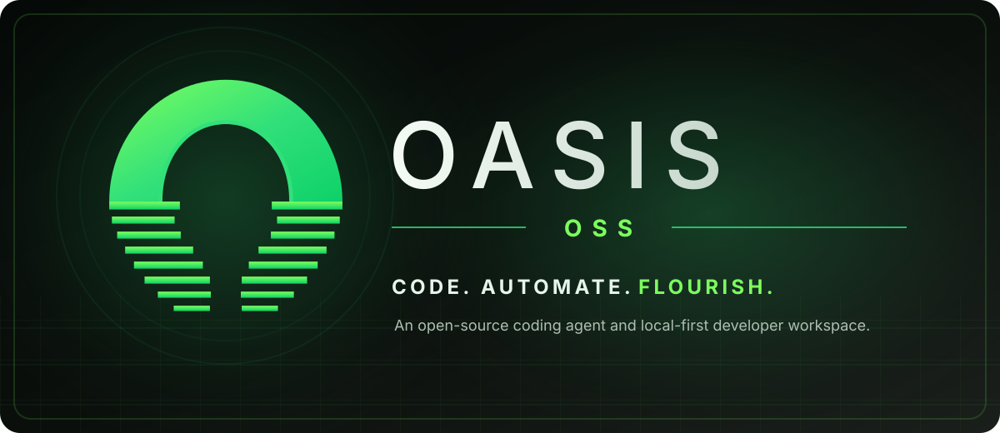

<p align="center">
  
</p>

<p align="center"><strong>Code. Automate. Flourish.</strong> An open-source coding agent and local-first developer workspace. Your projects. Your choice of model.</p>

<p align="center">
  <a href="https://github.com/FAHTHIZ/oasis/actions/workflows/quality.yml"></a>
  
  <a href="LICENSE"></a>
</p>

## Two ways to start

### Install from the terminal — macOS, Linux, or Android/Termux

**Easy install:** open your terminal and paste this one command:

```sh
sh -c 'f=$(mktemp) || exit; url=https://raw.githubusercontent.com/FAHTHIZ/oasis/main/scripts/install.sh; if command -v curl >/dev/null 2>&1; then curl -fsSL "$url" -o "$f"; elif command -v wget >/dev/null 2>&1; then wget -qO "$f" "$url"; else echo "Install curl or wget first, then retry." >&2; rm -f "$f"; exit 1; fi && sh "$f"; r=$?; rm -f "$f"; exit "$r"'
```

The guided installer checks for Node.js 22 or newer. On Termux, it can offer to install Node.js through `pkg`; on a Mac with Homebrew, it can offer Homebrew installation. It downloads the latest stable GitHub release of OASIS, resolves it to an exact commit, installs into your user folder, checks the environment, and opens provider setup. It does not need Git or administrator access. Review the prompts before approving changes.

This quick command runs the installer fetched from the official OASIS repository over HTTPS. For an additional SHA-256 check before running the installer, use the verified version below.

<details>
<summary>Use the checksum-verified shell installer</summary>

```sh
sh -c 'set -eu; f=$(mktemp "${TMPDIR:-/tmp}/oasis-install.XXXXXX"); cleanup() { rm -f "$f"; }; trap cleanup EXIT; trap "exit 1" HUP INT TERM; url=https://raw.githubusercontent.com/FAHTHIZ/oasis/main/scripts/install.sh; if command -v curl >/dev/null 2>&1; then curl -fsSL "$url" -o "$f"; elif command -v wget >/dev/null 2>&1; then wget -qO "$f" "$url"; else echo "Install curl or wget first, then retry." >&2; exit 1; fi; expected=8544a1f9f0f11206eba2b30adae007c9e54cc35f3b3cf9dec18459a767a9cbb7; if command -v sha256sum >/dev/null 2>&1; then actual=$(sha256sum "$f"); actual=${actual%% *}; elif command -v shasum >/dev/null 2>&1; then actual=$(shasum -a 256 "$f"); actual=${actual%% *}; elif command -v openssl >/dev/null 2>&1; then actual=$(openssl dgst -sha256 "$f"); actual=${actual##*= }; else echo "No SHA-256 tool found; see docs/INSTALL.md"; rm -f "$f"; exit 1; fi; if [ "$actual" != "$expected" ]; then echo "Installer checksum mismatch. Do not run it."; rm -f "$f"; exit 1; fi; if sh "$f"; then code=0; else code=$?; fi; rm -f "$f"; exit "$code"'
```

**Published installer SHA-256:** `8544a1f9f0f11206eba2b30adae007c9e54cc35f3b3cf9dec18459a767a9cbb7`

</details>

For **Windows PowerShell**, paste this one line. It checks the downloaded script's hash before running it:

```powershell
$d=Join-Path $env:TEMP ('oasis-install-' + [guid]::NewGuid().ToString('N')); New-Item -ItemType Directory -Force -Path $d | Out-Null; $p=Join-Path $d 'install.ps1'; $h=Join-Path $d 'release-resolution.ps1'; try { Invoke-WebRequest -Uri 'https://raw.githubusercontent.com/FAHTHIZ/oasis/main/scripts/install.ps1' -OutFile $p; Invoke-WebRequest -Uri 'https://raw.githubusercontent.com/FAHTHIZ/oasis/main/scripts/release-resolution.ps1' -OutFile $h; $expected='90f6c8ae5119d3a0cc20afd958565391f4239bf6f26a1807cc2fa8b1e6da03c4'; $actual=(Get-FileHash $p -Algorithm SHA256).Hash.ToLowerInvariant(); $helperExpected='0d5fb319ecd19a479924d808595730f89226f43d874208ee9e30de9947665ff5'; $helperActual=(Get-FileHash $h -Algorithm SHA256).Hash.ToLowerInvariant(); if($actual -ne $expected -or $helperActual -ne $helperExpected){throw 'Installer checksum mismatch. Do not run either file.'}; & $p; $code=$LASTEXITCODE } finally { Remove-Item $d -Recurse -Force -ErrorAction SilentlyContinue }; if ($null -ne $code) { exit $code }
```

**Published Windows installer SHA-256:** `90f6c8ae5119d3a0cc20afd958565391f4239bf6f26a1807cc2fa8b1e6da03c4`
**Published Windows resolver helper SHA-256:** `0d5fb319ecd19a479924d808595730f89226f43d874208ee9e30de9947665ff5`

If the checksum does not match, stop and do not run the downloaded script. Read the [installation guide](docs/INSTALL.md) or the [Android/Termux guide](docs/TERMUX.md).

### Download the app — no terminal needed

1. Open the [OASIS releases page](https://github.com/FAHTHIZ/oasis/releases/latest).
2. Download the file for your computer:
   - **Windows (x64):** `.exe` installer
   - **macOS (Apple Silicon / arm64):** `.dmg` disk image
   - **Linux (x86_64):** `.AppImage` or `.deb`
3. Open it, choose a project folder, and follow the model setup.

The installers are currently unsigned. Your operating system may show a warning. Before continuing, confirm the download came from the official OASIS release page. Signing and automatic updates are not yet configured. Android does not have a native APK release yet; use the Termux install command above.

## What is OASIS?

OASIS is an open-source, local-first AI coding agent. It helps inspect a codebase, plan focused edits, make approved changes, run checks, and explain what changed. Bring a supported model/provider of your choice; OASIS does not include a model or paid subscription.

## License

OASIS is released under the **Apache-2.0 license**. Apache License 2.0 — see [LICENSE](LICENSE).

## Why OASIS

- **Model choice:** supported cloud providers, compatible endpoints, OmniRoute, and local Ollama setups.
- **Review before action:** approval prompts, file snapshots, and verification commands help you inspect changes rather than blindly trusting a completion message.
- **Extensible:** MCP tools, skills, hooks, plugins, and bounded subagents add capabilities.
- **Open source:** Apache-2.0 licence.

We do not publish token-savings claims: there is no current, representative measurement that supports a number.

## Limits to know

OASIS is in beta, with known platform, reliability, and release-readiness gaps remaining. Commands normally run with your user permissions. The optional OS sandbox is disabled by default and currently targets Linux and macOS; Windows isolation is not available. `node-pty` is optional, and its native terminal behavior is not guaranteed on Android/Termux. The desktop installers are unsigned, automatic desktop updates are not implemented, and the browser workspace does not sync projects/tasks/notes with the CLI. Approval prompts reduce risk; they are not a substitute for isolation. See [current status and limitations](docs/CURRENT_STATUS.md) and the [security audit](docs/SECURITY_RELIABILITY_AUDIT.md).

## A real demo is still needed

The banner above is branding artwork, not a screen recording. A genuine 10–20 second recording of OASIS finding a bug, applying a fix, and running a verification command has not been captured yet. We will add it only after recording the real application.

## How it was built

This paragraph is intentionally left for the project owner to write in their own words. It should state which parts Fahim wrote, what AI tools helped with, and how the result was reviewed. We should not guess or invent authorship details.

## Explore the project

- [5-minute quickstart](docs/QUICKSTART.md)
- [Installation guide](docs/INSTALL.md)
- [Android/Termux guide](docs/TERMUX.md)
- [Detailed user guide](docs/USER_GUIDE.md)
- [Current status](docs/CURRENT_STATUS.md)
- [Architecture](docs/ARCHITECTURE.md)
- [Security and reliability audit](docs/SECURITY_RELIABILITY_AUDIT.md)
- [Whole-codebase gap register](docs/WHOLE_CODEBASE_GAP_REGISTER.md)
- [Benchmark suite and results](bench/README.md)
- [Roadmap](docs/ROADMAP.md)
- [Contributing](CONTRIBUTING.md)
- [Security policy](SECURITY.md)

## Development

Use Node.js 22 or newer:

```sh
git clone https://github.com/FAHTHIZ/oasis.git
cd oasis
npm install
npm run check
```

The quality workflow tests Node.js 22, 24, and 26; runs portable security regressions on Ubuntu, macOS, and Windows; exercises a clean environment and the Linux PTY path; and runs browser end-to-end smoke checks. The new installer workflow exercises the pinned CLI installer on fresh Windows, macOS, and Linux runners. These checks are useful evidence, not a full security audit or a claim of complete platform parity.

## Licence

Apache License 2.0. See [LICENSE](LICENSE).
