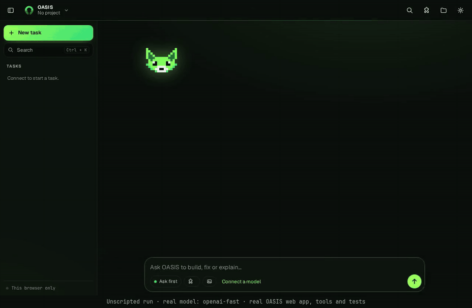
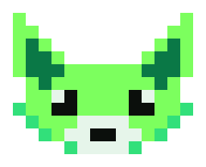

<p align="center">
  <a href="https://github.com/FAHTHIZ/oasis">
    
  </a>
  <br><sub>Illustration. The recordings under <a href="#work-where-you-work">Work where you work</a> are real, unscripted runs.</sub>
</p>

<p align="center">
  Bring any model, keep your Claude Code setup, and get work that is actually checked.<br>
  OASIS runs on your own computer or server. It won't say "tests pass" unless it saw them pass.
</p>

<p align="center">
  <a href="https://github.com/FAHTHIZ/oasis/actions/workflows/quality.yml"></a>
  <a href="https://github.com/FAHTHIZ/oasis/releases/latest"></a>
  
  
  <a href="LICENSE"></a>
  <a href="https://github.com/FAHTHIZ/oasis/stargazers"></a>
</p>

<p align="center">
  <a href="#install"><b>Install</b></a> ·
  <a href="#work-where-you-work"><b>Terminal and web</b></a> ·
  <a href="#why-oasis">Why OASIS</a> ·
  <a href="#plugins-mcp-and-models">Plugins and models</a> ·
  <a href="#how-it-compares">Comparison</a> ·
  <a href="docs/README.md">Docs</a>
</p>

<br>

## Install

```sh
curl -fsSL https://raw.githubusercontent.com/FAHTHIZ/oasis/main/scripts/install.sh | sh
```

<details>
<summary><b>Windows, Homebrew, from source, or the desktop app</b></summary>

<br>

| Method | Command |
| --- | --- |
| Windows (PowerShell) | `irm https://raw.githubusercontent.com/FAHTHIZ/oasis/main/scripts/install.ps1 \| iex` |
| Homebrew | `brew tap fahthiz/oasis https://github.com/FAHTHIZ/oasis && brew install fahthiz/oasis/oasis-cli` |
| From source | `git clone https://github.com/FAHTHIZ/oasis.git && cd oasis && npm install && npm install --global .` |
| Desktop app | Installers for Windows, macOS and Linux on [GitHub Releases](https://github.com/FAHTHIZ/oasis/releases) (not yet code-signed, see [Desktop](docs/DESKTOP.md)) |

One package gives you the terminal agent and the web app. It needs Node.js 22.19+ and Git. The install scripts take the latest stable release, ask before changing anything, and finish with `oasis doctor`. Every release ships the npm tarball, the desktop installers and a `SHA256SUMS` file. See [Downloads and releases](docs/RELEASES.md).

</details>

Then, in your project:

```sh
oasis connect        # 1. paste an API key, a model link or a local server address
oasis                # 2. work in the terminal
oasis web --open     #    …or open the web app on this folder
```

Ask in plain words: "find out why the login test fails and fix it". OASIS reads the code, edits the files, runs the checks and shows you the diff. <kbd>Esc</kbd> <kbd>Esc</kbd> (or `/rewind`) undoes a turn.

## Work where you work

The terminal and the web app run on the same runtime, sessions and settings. Start a task in one and pick it up in the other under **Chats → Earlier on this computer**.

<table>
  <tr>
    <th width="50%">Terminal · <code>oasis</code></th>
    <th width="50%">Web app · <code>oasis web --open</code></th>
  </tr>
  <tr>
    <td><a href="assets/demo/oasis-real-model-demo.mp4"></a></td>
    <td><a href="assets/demo/oasis-web-real-model-demo.mp4"></a></td>
  </tr>
  <tr>
    <td valign="top"><sub>Unscripted, OASIS 1.3.0 with the free gpt-oss-20b. It runs the tests, finds the discount bug in <code>cart.mjs</code>, fixes it and proves it with a second run (2 passed). Model waits are shortened.</sub></td>
    <td valign="top"><sub>Unscripted, OASIS 1.3.0 with the free gpt-oss-20b. A note sent mid-task widens the fix, approvals are answered in the waiting step, and 3 tests pass. Frames where nothing changed (model waits) are cut. Recorded with <code>scripts/demo/record-web-real-demo.mjs</code>.</sub></td>
  </tr>
  <tr>
    <td valign="top">A live status line with the running step and clock, streaming diffs with word highlights, type-ahead while it works, colored diffs in approvals, <code>/tasks</code>, <code>/rewind</code> and <code>/export</code>, and <code>oasis -p</code> or <code>oasis exec</code> for scripts.</td>
    <td valign="top">A live timeline with expandable steps and command output, approvals answered inline, a task sidebar, Files and Changes panels, a real terminal (<kbd>Ctrl</kbd>+<kbd>&#96;</kbd>), a sandboxed Preview of your pages, talk mode, plan mode, Undo, cost and context meters, and one-click Claude Code plugins.</td>
  </tr>
</table>

The web app runs on a computer or server you control, not a hosted service, and opens in any modern browser. An optional [desktop app](docs/DESKTOP.md) shows the same workspace in its own window; there is no separate mobile app.

<details>
<summary><b>More places OASIS runs</b></summary>

<br>

| From | Start it with | What you get |
| --- | --- | --- |
| Desktop | [Desktop app](docs/DESKTOP.md) | The web workspace in its own window, the model key in the OS key store, automatic updates |
| Zed, JetBrains and other ACP editors | `oasis acp` | Agent Client Protocol sessions with Mode and Model pickers, a context meter and real cancel |
| VS Code, Cursor, Windsurf | `oasis ide install` | The VS Code-family extension, with inline tab completion from your model |
| Codex App Server clients | `oasis app-server` | Clients built for `codex app-server` drive OASIS with any model: threads, turns, steering, approvals, review, files and commands |
| Cursor Cloud Agents API scripts | `oasis web --persistent-key` | Cursor's REST endpoints served by your own OASIS with any model ([details](docs/INTERFACES.md#cursor-cloud-agents-api)) |
| CI | `action.yml` | A GitHub Action that runs OASIS in a workflow |
| Cloud agents | `oasis cloud run "TASK"` | The task runs on GitHub Actions with your own key; `--pr` opens a pull request, `oasis cloud pull` brings it back |
| Your own code | `src/sdk.mjs` | The Node.js SDK: session, headless, tool and hook APIs |
| Chat | `oasis gateway` | Telegram, Slack or Discord gateways |

Full method lists, transports and auth for each protocol are in [Interfaces](docs/INTERFACES.md).

</details>

<details>
<summary><b>Run the web app on a server</b></summary>

<br>

```sh
oasis web --public-url https://oasis.example.com --trust-proxy   # behind Caddy, nginx, Tailscale Serve or Cloudflare Tunnel
oasis web key                                                    # show the access key; --rotate replaces it
```

The web app is served by OASIS on a computer you control, not a hosted service. Open the address from your workstation, paste the link once and tick **Remember this device**. Tasks run on the server, so a reload or dropped connection reattaches to the running task and asks any open approval again. Recipes and the security model: [Remote access](docs/REMOTE-ACCESS.md).

<table>
  <tr>
    <td width="55%"></td>
    <td width="45%"></td>
  </tr>
  <tr>
    <td><sub>Light theme</sub></td>
    <td><sub>Signing in to a remote OASIS server</sub></td>
  </tr>
</table>

</details>

<details>
<summary><b>Scripts and CI</b></summary>

<br>

```sh
oasis -p "summarize the open TODOs"                                   # one-shot
oasis exec --output-format stream-json "fix the lint errors" > run.jsonl
oasis -p --permission-mode dont-ask "review this diff"                # never waits on an approval
oasis -p --permission-mode auto --goal "npm test passes"              # keeps going until the check says it holds
```

`--output-schema` gives structured JSON, a goal that is never met exits with code 1, and a run stopped part-way is saved so `oasis --resume ID` can continue it.

</details>

## Why OASIS

<table>
  <tr>
    <td width="33%" valign="top">
      <h4>Any model, no lock-in</h4>
      OpenAI, Anthropic, Gemini, Bedrock, Vertex AI, OpenRouter, Groq, DeepSeek, Mistral, xAI, any OpenAI-compatible endpoint, or a local Ollama, LM Studio, llama.cpp or vLLM. <code>oasis connect</code> finds a model that can call tools and keeps backups for failover.
    </td>
    <td width="33%" valign="top">
      <h4>Your Claude Code setup, as is</h4>
      <code>CLAUDE.md</code>, <code>.claude/agents</code>, skills, slash commands, hooks, settings, <code>.mcp.json</code> and Claude Code plugins load without conversion. Codex plugins and Gemini CLI extensions are converted on install.
    </td>
    <td width="33%" valign="top">
      <h4>It checks its own work</h4>
      A verification gate sends the agent back if it skipped the diff review or the checks, or claimed "tests pass" with nothing to back it. Every edit is checkpointed, so any turn can be undone.
    </td>
  </tr>
  <tr>
    <td valign="top">
      <h4>Self-hosted, remote-ready</h4>
      Files, shell and model keys stay on your machine or server. Browsers sign in with a 256-bit access key, behind DNS-rebinding protection and brute-force lockout. Close the tab mid-task and it picks up where it was.
    </td>
    <td valign="top">
      <h4>A real agent system</h4>
      Parallel, background and resumable subagents, agent teams with a shared task board, a git worktree per agent, <code>/goal</code> to keep going until a condition holds, scheduled routines, and memory across sessions.
    </td>
    <td valign="top">
      <h4>Safety you can read</h4>
      Clear permission modes, shell-command risk analysis, protected paths, secret scanning and optional OS or container sandboxes. Project settings that loosen anything wait until you trust the workspace.
    </td>
  </tr>
</table>

<p align="center">
  
  <br><sub>The model proposes replies and tool calls. OASIS decides which tools exist, which calls need approval and what counts as verified. See <a href="docs/ARCHITECTURE.md">Architecture</a>.</sub>
</p>

## Plugins, MCP and models

**Claude Code plugins.** Open **Plugins** in the web app and install with one click, or use the terminal. Commands, agents, skills, hooks, MCP servers and language servers load the way they do in Claude Code. [Plugins checked in OASIS](docs/REAL-WORLD-RUNS.md#plugins-checked-in-oasis).

```sh
oasis plugin marketplace add anthropics/claude-plugins-official
oasis plugin install superpowers@claude-plugins-official
oasis add BuilderIO/skills            # Codex plugins and Gemini CLI extensions, converted on install
oasis plugin validate ./my-plugin     # Claude Code or OASIS plugin; list, update and uninstall cover both
```

**Apps in one step.** Say "connect GitHub" or type `/connect linear` and a Connect card appears in the conversation. Approve access on the service's own page and its tools are ready in the same turn. 48 apps are built in, and any other remote MCP server works by name from the official MCP Registry or by URL.

**MCP servers.** Stdio, HTTP and SSE, with OAuth, elicitation and MCP Tasks. `oasis mcp serve` exposes OASIS's own tools to other MCP clients.

**Models.** `oasis connect` takes an API key, a model page link or a server address, works out the provider, tests the best models with a real tool call and saves the first that works plus backups. Prompt caching, automatic compaction and spend limits are built in. See [Model providers](docs/CONFIGURATION.md#model-providers).

**Free-tier routers.** [OmniRoute](https://github.com/cheaper-inference/OmniRoute) and [FreeLLMAPI](https://github.com/Azhan787/FreeLLMAPI) are built-in gateway providers: run either on your machine, add your own free provider accounts there, and `oasis connect http://127.0.0.1:20128/v1` (OmniRoute) or `http://127.0.0.1:3001/v1` (FreeLLMAPI). OASIS treats a model behind them as a cloud model (timeouts, context window from `GET /models`, list-price cost estimates) and zero-budget mode refuses any route it cannot prove is free. Each free tier has its own limits and terms; aggregate "free token" numbers are not a guarantee. Setup: [OmniRoute](docs/CONFIGURATION.md#omniroute-gateway), [FreeLLMAPI](docs/CONFIGURATION.md#freellmapi-gateway).

<details>
<summary><b>MCP and model commands</b></summary>

<br>

```sh
oasis mcp search filesystem                            # the official MCP Registry
oasis mcp add everything -- npx -y @modelcontextprotocol/server-everything
oasis mcp add --transport http docs https://example.com/mcp
oasis mcp connect linear                               # the Connect card flow from a shell

oasis connect                              # paste a key (kept out of shell history)
oasis connect --from-env gemini            # use GEMINI_API_KEY
oasis connect http://localhost:11434       # Ollama, LM Studio, llama.cpp or vLLM
oasis connect http://127.0.0.1:20128/v1    # an OpenAI-compatible gateway such as OmniRoute
```

GitHub uses your existing `gh` sign-in, or runs `gh auth login --web` and shows the one-time code on the card. The web app manages servers under **Settings → Tools** and apps under **Settings → Apps**.

</details>

## Tested like a real user

OASIS is checked the way a person uses it: real providers, no scripted model, approvals clicked by hand. A few of the runs from 5–12 November 2026:

| What we asked | Where | Result |
| --- | --- | --- |
| Find and fix the bug that makes `npm test` fail | Terminal, OASIS 1.3.0, gpt-oss-20b | Fixed, 2 of 2 passing, 3 m 04 s ([video](assets/demo/oasis-real-model-demo.mp4)) |
| Fix `wordCount()` with a note sent mid-task, add a regression test | Web app, OASIS 1.3.0, gpt-oss-20b | Fixed, note followed, 3 of 3 passing, 6 m 47 s ([video](assets/demo/oasis-web-real-model-demo.mp4)) |
| Fix `slugify()`, add a test, run the tests | Terminal, gpt-oss-20b | Fixed and passing after the model corrected its own import twice |
| Build a to-do web app saved in localStorage | Web app, gpt-oss-20b | Working app, existing tests still passing, 231 s |
| Read an uploaded PDF | Web app, gpt-oss-20b | Passed in 49 s |
| Install 16 Claude Code plugins and use them | Web app and terminal | All installed; hooks, skills and MCP servers ran |

Every run, plugin check and rough edge is in [Real-world runs](docs/REAL-WORLD-RUNS.md). The model-free harness recovers 26/26 malformed tool calls (3/26 without OASIS), applies 14/14 edits (4/14), stops 49/49 risky commands under auto-approve and catches 10/10 secrets before commit: see [Benchmarks](docs/BENCHMARKS.md#latest-results-12-november-2026). Head-to-head runs against Claude Code, Codex, OpenCode, Aider and Gemini CLI, all on the same free model through one recording relay, are in [Benchmarks](docs/BENCHMARKS.md#recorded-same-model-gateway-14-november-2026). They are small samples on free tiers, so read them as evidence, not a ranking. OASIS does not guarantee that every model will solve every task: on a given task the model matters more than the harness.

## How it compares

Harness features from public documentation, not results.

| | OASIS | Claude Code | Codex | Gemini CLI | OpenCode | Goose |
| --- | --- | --- | --- | --- | --- | --- |
| License | Apache-2.0 | Proprietary | Apache-2.0 | Apache-2.0 | Open source | Apache-2.0 |
| Models | Any provider or local server | Anthropic | ChatGPT plan or API key | Gemini | Many providers | 15+ providers |
| Web interface | Self-hosted, remote-ready | Cloud sessions | Codex Web (cloud) | No | Local | No |
| Desktop app | Yes (not yet code-signed) | Yes | Yes | No | Beta | Yes |
| Claude Code plugins | Yes, plus Codex plugins and Gemini extensions | Yes | No (own format) | No (own extensions) | No (own plugins) | No |
| Subagents | Parallel, background, resumable, teams, worktrees | Yes | Agent command center | Yes | `general` subagent | No |

OASIS trails in model-specific tuning, a hosted zero-setup cloud, community size and real-world hours. The full comparison, with sources and dates, is in [Comparison](docs/COMPARISON.md).

## Security

OASIS can read and change files, run commands and send context to your model provider, with your account's permissions.

- Permission modes go from `plan` (read-only) to `dont-ask` (never waits, denies anything not allowed). The default runs read-only commands freely and asks before other commands, installs, deletions and new websites.
- The OS sandbox (bubblewrap, macOS Seatbelt, Docker or Podman) is optional. `oasis doctor` tells you whether it's on.
- Plugins, hooks and MCP servers can run third-party code. Review them before turning them on.
- Approval prompts are not a replacement for operating-system isolation. Use the sandbox, a container or a throwaway machine for untrusted code.

Read the [security policy](SECURITY.md) before using OASIS on sensitive code.

## Project status

What is verified and what is not, kept current in the [completion checklist](docs/COMPLETION-CHECKLIST.md):

| Status | Areas |
| --- | --- |
| Verified on Linux by tests and live runs | Terminal agent and `-p`/`exec`, the web app (browser-driven tests), sessions, checkpoints and undo, permission modes, the bubblewrap and Docker sandboxes (including the host Unix-socket block), MCP, Claude Code plugins, OpenAI-compatible providers and the OmniRoute and FreeLLMAPI gateways |
| Tested in CI on Windows and macOS, not by hand | Security and runtime regression tests, installer scripts; the macOS Seatbelt profile is unit-tested only |
| Implemented, lightly tested | Desktop app (installers are built, not code-signed), editor integrations (ACP, VS Code family), chat gateways, cloud runs |
| Not claimed | Production readiness for untrusted code without the OS sandbox or a container; results with paid frontier models (none were run) |

## Development

```sh
npm install
npm test           # 3,200+ tests
npm run check      # tests, benchmark regressions, eval validation
npm run lint
```

CI also runs platform security tests, a live Docker sandbox test, native PTY tests and a browser test that drives the web app like a person: approvals, a reload mid-task that must reattach, a second browser, Remember this device, and WCAG contrast checks. Contributions are welcome: start with the [Contributing guide](CONTRIBUTING.md).

## Documentation

| Get started | Go deeper | Project |
| --- | --- | --- |
| [User guide](docs/USER-GUIDE.md) | [Architecture](docs/ARCHITECTURE.md) | [Changelog](CHANGELOG.md) |
| [First run](docs/FIRST-RUN.md) | [Configuration](docs/CONFIGURATION.md) | [Contributing](CONTRIBUTING.md) |
| [Interfaces](docs/INTERFACES.md) | [Subagents](docs/SUBAGENTS.md) | [Security](SECURITY.md) |
| [Desktop app](docs/DESKTOP.md) | [Remote access](docs/REMOTE-ACCESS.md) | [Support](SUPPORT.md) |
| [Downloads and releases](docs/RELEASES.md) | [Real-world runs](docs/REAL-WORLD-RUNS.md) | [Brand guidelines](BRAND.md) |
| | [Benchmarks](docs/BENCHMARKS.md) · [Comparison](docs/COMPARISON.md) | |

## Meet Fen



Fen is the OASIS mascot: a fennec fox, the desert animal that always finds the water. Fen greets you when the terminal starts, sits on the web app's welcome screen and peeks over the terminal in the artwork above. Set `OASIS_NO_MASCOT=1` to show only the wordmark.

<br clear="left">

## License

[Apache License 2.0](LICENSE).
