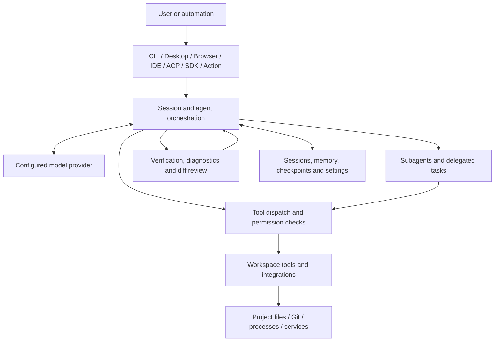

# OASIS architecture

OASIS is a model-agnostic coding-agent runtime. Its interfaces present the experience; the runtime coordinates model requests, tool execution, permissions, agent work and verification.

This document describes the current source layout at a component level. It is an orientation guide, not a guarantee that every interface exposes every capability.

## Runtime overview

The model proposes responses and tool calls. OASIS owns the runtime decisions around which tools are available, how calls are routed, which actions require approval, how results are returned, and what verification evidence is recorded.

## Main components

| Area | Main source locations | Responsibility |
|---|---|---|
| Agent orchestration | `src/agent.mjs` | Creates sessions, coordinates streamed turns, dispatches tool calls, handles retries and context recovery. |
| Provider request adapters | `src/provider-requests.mjs` | Builds OpenAI Chat Completions, OpenAI Responses and Anthropic request bodies; normalizes endpoints and tool schemas. |
| Provider streaming | `src/provider-stream.mjs` | Parses provider SSE streams, normalizes streamed events and tool-call deltas, preserves provider usage metadata, and assembles the completed streamed response. |
| Tool input validation | `src/tool-schema-validation.mjs` | Validates model-supplied arguments against the advertised JSON Schema before permission checks or execution; caches compiled validators. |
| Tool scheduling | `src/tool-batch-scheduler.mjs` | Groups adjacent read-only, specialist-review and subagent calls without crossing side-effect ordering barriers. |
| Provider adapters | `src/provider-registry.mjs`, `app/core/providers.mjs`, `src/config.mjs`, `src/fallback-chain.mjs`, `src/model-catalog.mjs` | The native runtime registry supplies built-in and user-configured providers. The connected browser workspace uses a browser-compatible catalogue and adapter surface; protocol and feature parity with the native runtime must not be assumed. |
| Workspace tools | `src/tools.mjs`, `src/workspace-files.mjs` | File access, search, edits, patches, command execution and workspace-scoped operations. |
| Permissions | `src/permissions.mjs`, `src/permission-modes.mjs`, `src/settings.mjs` | Tool rules, permission modes, workspace trust and layered settings. |
| Command and sandbox controls | `src/shell-risk.mjs`, `src/sandbox.mjs`, `src/sandbox-runtime.mjs` | Command-risk analysis and optional operating-system or container isolation. |
| Secret and path protection | `src/secret-shield.mjs`, `src/protected-paths.mjs` | Secret handling, protected paths and redaction safeguards. |
| Agent coordination | `src/subagents.mjs`, `src/agent-tasks.mjs`, `src/shared-tasks.mjs`, `src/worktrees.mjs` | Delegated agents, shared task state and isolated Git worktrees. |
| Extensions | `src/mcp.mjs`, `src/plugins.mjs`, `src/hooks.mjs`, `src/skill-install.mjs`, `skills/` | MCP connections, plugins, lifecycle hooks and Agent Skills. |
| Persistence and recovery | `src/sessions.mjs`, `src/checkpoints.mjs`, `src/memory.mjs`, `src/backups.mjs` | Session history, memory, checkpoints and recovery data. |
| Verification | `src/claim-check.mjs`, `src/diagnostics.mjs`, `src/test-tamper.mjs`, `src/change-guard.mjs` | Records check evidence, diagnoses problems and guards against unsafe or misleading edits. |

## A typical agent turn

1. An interface creates or resumes a project-scoped session.
2. OASIS loads provider configuration, applicable settings, permission rules and available tools.
3. The model receives the conversation context and tool definitions supported by the selected provider protocol.
4. A returned tool call is normalized and passed through the runtime's permission and safety checks.
5. Approved tools operate on the configured workspace or invoke an enabled integration.
6. Tool results are returned to the model, which may continue working or produce a final response.
7. Verification state, usage and session data are updated as the turn progresses.

The exact sequence varies by tool, provider protocol and interface. A model response saying that work is complete is not itself verification evidence.

## Settings and workspace trust

OASIS supports user-level and project-level settings. Project settings can contain rules that tighten policy and settings that loosen it. The implementation treats those differently: restrictive rules can apply without trusting the repository, while settings that grant additional permissions or run commands require workspace trust.

Review project configuration before trusting a repository. A repository is untrusted input until the user chooses otherwise.

## Execution and isolation boundaries

OASIS includes permission checks and optional sandbox integrations, but these are separate controls.

- Without an active OS/container sandbox, commands can execute with the permissions of the OASIS process.
- Linux can use bubblewrap when available.
- macOS can use the platform sandbox profile when available.
- Docker or Podman can provide a container backend when configured and available.
- Domain-filtered execution is an additional optional layer on supported platforms.
- If a sandbox backend is unavailable, OASIS reports that limitation and relies on the configured permission behaviour; it must not be described as sandboxed.

No single option should be treated as a universal security boundary. See [SECURITY.md](../SECURITY.md) for the user-facing security policy.

## Interface boundaries

The CLI, desktop application and connected browser workspace use the host-connected runtime. The browser is an untrusted client: it requests work from the host and does not receive arbitrary shell access to the device.

Editor and ACP integrations communicate with the runtime through their respective interfaces. The SDK exposes selected runtime functions for Node.js applications. GitHub Actions and messaging gateways are automation entry points with their own credentials and execution environment.

See [Interfaces and deployment](INTERFACES.md) for the practical differences.

## Continuous improvement and replacement programme

The system-wide inventory, ranked replacement candidates, upstream comparisons and acceptance gates are maintained in the [whole-system replacement roadmap](REPLACEMENT-ROADMAP.md). The roadmap distinguishes components to retain from candidates that need proof before replacement; it is not a claim that every proposed integration is already implemented.
