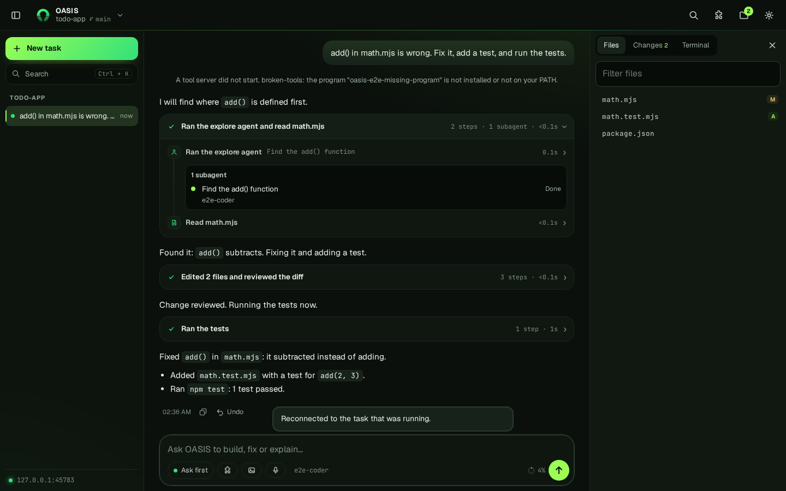
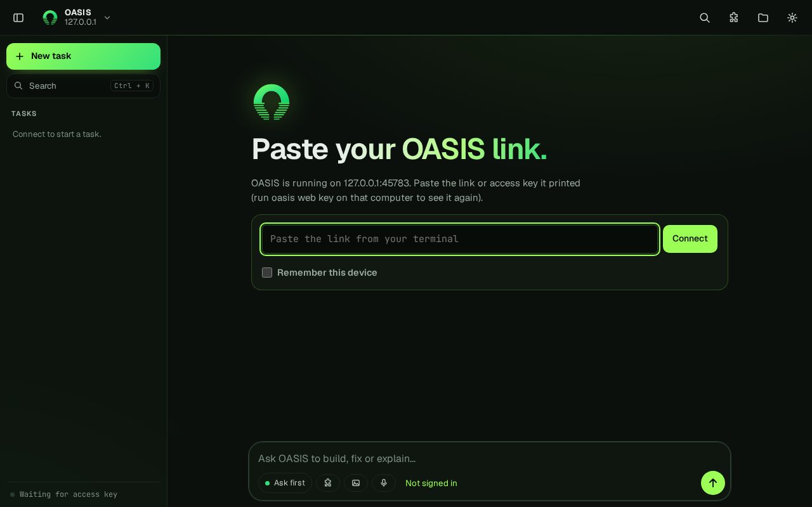
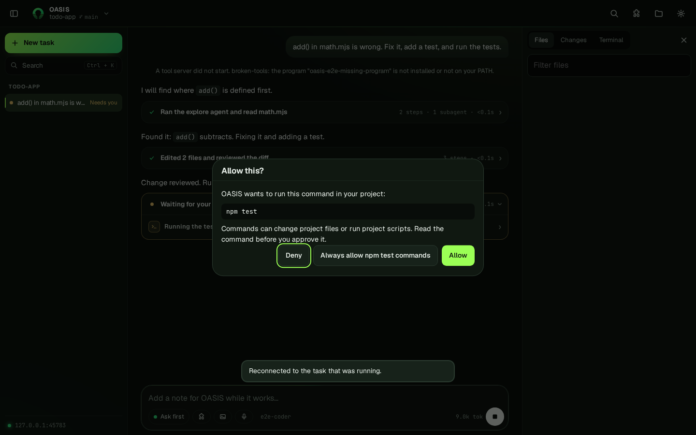

# OASIS user guide

OASIS is an open-source coding agent you run on a computer or server you control and use from any modern browser. The runtime owns the project, the shell and your model keys; the browser is only the screen. This guide walks through installing it, signing in, connecting a model, running a task and reviewing the result.

<p align="center"></p>

## 1. Choose an interface

OASIS has two interfaces that share one runtime, one session store and one set of settings.

| If you want to… | Use | Start it with |
|---|---|---|
| Work in a browser, on this computer or from anywhere | **Web app** | `oasis web --open` |
| Work directly in a terminal | **Terminal session** | `oasis` |

Integrations (editor extension, Agent Client Protocol, Node.js SDK, GitHub Action, messaging gateways) connect OASIS to other tools; see [Interfaces and deployment](INTERFACES.md). A phone, tablet or laptop opens the same web app in its browser. The optional [desktop app](DESKTOP.md) shows it in its own window on Windows, macOS and Linux; there is no separate mobile app.

## 2. Install OASIS

Requirements: Node.js 22.15 or newer and Git.

```sh
git clone https://github.com/FAHTHIZ/oasis.git
cd oasis
npm install
npm install --global .
oasis doctor
```

`oasis --help` lists every command. Release tarballs with `SHA256SUMS` are on [GitHub Releases](https://github.com/FAHTHIZ/oasis/releases/latest); see [Downloads and releases](RELEASES.md).

## 3. Connect a model provider

OASIS is a runtime, not an inference service. Bring a key or a local model server you are allowed to use. Paste it into the web app's connect box (or run `oasis connect` in a terminal): OASIS recognises the provider from the key or address, lists its models, picks a strong default and saves it on the computer running OASIS. Keys are stored there, never sent back to the browser, and never written into the project.

| Provider | Where to get a key | Notes |
|---|---|---|
| OpenRouter | [openrouter.ai/keys](https://openrouter.ai/keys) | One key for hundreds of models. Free models are limited to 20 requests a minute and 50 a day (1,000 a day after buying $10 of credits), per [OpenRouter's limits](https://openrouter.ai/docs/api_reference/limits). |
| NVIDIA NIM | [build.nvidia.com](https://build.nvidia.com/) | Keys start with `nvapi-`. OpenAI-compatible endpoint `https://integrate.api.nvidia.com/v1`, with a free prototyping tier. |
| OmniRoute | [Self-hosted gateway](https://github.com/cheaper-inference/omniroute) | Runs on `http://localhost:20128/v1` and routes one endpoint to many providers. Paste the address. |
| Anthropic, OpenAI, Gemini, Groq, DeepSeek, xAI, Mistral, Hugging Face | The provider's console | Paste the key; the provider is detected from its prefix. |
| Ollama, LM Studio, llama.cpp | Your own machine | Started servers on their default ports are found automatically. |

Before entering a credential:

- Check that prompts and project context may be sent to that provider.
- Never commit keys, paste them into issues, or show them in screenshots.
- Provider setup over the network is accepted only over HTTPS, so keys are encrypted in transit.

See the [configuration reference](CONFIGURATION.md) for fallback models, task-aware routing and environment variables.

## 4. Terminal session

```sh
cd /path/to/your/project
oasis
```

`oasis` starts the interactive session. `oasis -p "…"` and `oasis exec` run one task for scripts and CI. `oasis models` lists the models your provider serves, and `oasis update` updates a script-installed copy.

### Keep going until a goal holds

`/goal npm test passes` keeps OASIS working, turn after turn, until a strict check of the latest turns says the condition is met and verified (up to 20 turns). `/goal` shows the status and the last check, `/goal pause` and `/goal resume` stop and continue it, `/goal edit CONDITION` changes it and `/goal clear` drops it. Ctrl+C pauses the goal instead of discarding it, and a paused goal is saved with the session.

In scripts and CI use `oasis -p --permission-mode auto --goal "npm test passes"` (add `--goal-turns N`, default 10). A goal that is never met ends with exit code 1 and `subtype: "error_goal_not_met"` in JSON output, and `--output-format stream-json` emits a `goal_check` event after each turn.

By default a `-p` run whose changes OASIS could not verify still exits 0 and ends its reply with a "Not verified" note. Add `--require-verified` (or set `OASIS_REQUIRE_VERIFIED=1`) to make that exit 1 with `subtype: "error_not_verified"`, so a pipeline does not treat an unchecked change as a pass.

Subagents you or OASIS start show up in `/tasks`: running ones first, finished ones under **Earlier in this session**, even after a restart. `/tasks ID` shows a report, `/tasks send ID MESSAGE` steers or resumes one, and `/tasks stop ID` stops it.

### Cloud agents on GitHub Actions

Run a task on a GitHub runner while your computer is off, then pick it up locally. It uses your GitHub CLI sign-in and your own model key:

```sh
oasis cloud setup                  # adds .github/workflows/oasis-cloud.yml; commit and push it
gh secret set OASIS_API_KEY        # once per repository (OASIS_PROTOCOL, OASIS_BASE_URL, OASIS_MODEL as variables)
oasis cloud run "Add tests for the date parser"
oasis cloud run --here "Finish this refactor"   # hand off this branch, uncommitted work included
oasis cloud list                   # state of recent cloud tasks
oasis cloud pull ID                # check out the agent's branch here and keep going
```

Each task works on its own branch, `oasis/cloud-ID`, or on your branch with `--here`. The handoff pushes your uncommitted work as a commit on that branch without changing your working tree or staging area. Add `--pr` to have the agent open a pull request when it finishes; otherwise it only pushes the branch. Task records stay in the `.git` folder, so they are never committed.

### Routines that run on a schedule

`/schedule` jobs live only as long as their session. For work that should happen whether or not a terminal is open, create a routine:

```sh
oasis schedule add "0 9 * * 1-5" "Summarize yesterday's CI failures and open PRs" --name standup --workdir . --tz Asia/Dhaka --deliver telegram:123456
oasis schedule add "every 6h" "df -h /" --script --deliver webhook:https://example.com/hook
oasis schedule add "DTSTART;TZID=Asia/Dhaka:20261127T170000 RRULE:FREQ=MONTHLY;BYDAY=-1FR" "Draft the monthly status report" --name monthly
oasis schedule daemon        # keep this running (or run `oasis schedule tick` from crontab)
```

Schedules can be plain phrases (`weekdays at 9am`, `every monday at 14:00`), 5-field cron, `every 2h`, `in 30m`, an ISO date, or an RFC 5545 rule: one `DTSTART` (with `TZID=`, a trailing `Z`, or neither to use `--tz`) and one `RRULE` with FREQ=DAILY, WEEKLY, MONTHLY or YEARLY plus INTERVAL, COUNT, UNTIL, BYDAY (`1MO`, `-1FR`), BYMONTHDAY, BYMONTH, BYHOUR, BYMINUTE and WKST. A rule with COUNT or UNTIL marks the routine completed after its last run. Local times are kept across daylight-saving changes; a time that is skipped moves forward, and a repeated one runs once.

Each run is a fresh background session (`oasis bg list` shows it) with the routine's folder, model, permission mode and skills. `oasis schedule show NAME` lists recent runs and where their output was saved; `pause`, `resume`, `run`, `cancel`, `edit` and `remove` manage it. A run that starts its answer with `[SILENT]` is saved but not delivered. A routine with no usable model credentials is marked `blocked_config` once and spends no tokens. Background runs never wait for approval: only tools your permission rules allow will run, so pick `--permission-mode` deliberately.

To run a routine when something happens instead of on a clock, use `webhook` as the schedule: `oasis schedule add webhook "Triage the new issue in the payload" --name triage --workdir .`. `oasis schedule show triage` prints the URL path and the secret. Add `--event pull_request.opened` (repeatable) to run only for those events. Point a GitHub webhook (or anything that signs with HMAC-SHA256) at `https://YOUR-OASIS/hooks/routines/ID` with that secret. Requests must reach `oasis web`, so use `--public-url` with a tunnel or proxy for outside services.

`oasis web` and `oasis gateway` also run routines while they are open (one scheduler per config folder; `OASIS_ROUTINES=off` turns this off), and Settings → Routines in the browser lists and manages them.

To keep a conversation's context, add `--from-session ID` (from `oasis sessions list`). Every run starts from a copy of that conversation and the original stays as it is. Add `--chain` and each run continues from the last one, so the routine remembers what it found before. In a chat, ask for a routine that "continues this conversation".

You can also ask in a session, for example "check CI every weekday at 9 and send the summary to Telegram". The agent uses its `routine_manage` tool and shows you the exact routine before saving it; you approve every create, edit, resume, extra run or removal, even with `--yes`.

### Built-in browser and recordings

`oasis --chrome` (or `/chrome on`) gives the agent a real Chrome through the DevTools Protocol: it opens pages, reads them, clicks, types, takes screenshots and checks the console and network. While it works, OASIS keeps a small screenshot after each step that changes the page, with a caption. Typed text is never written into captions, only its length. Ask for a recording (the `recording` browser action), or just close the browser or end the session, and the steps are saved as one self-contained HTML player in `.oasis/recordings/`. Open it in any browser to step through or play back what the agent saw. `OASIS_BROWSER_RECORD=0` turns recording off.

## 5. Browser workspace

### Start it

```sh
cd /path/to/your/project
oasis web --open
```

The terminal prints a private link such as `http://127.0.0.1:3917/app/#token=…`. The access key in the link moves out of the address bar into the tab as soon as the page opens. By default OASIS listens only on this computer and makes a new key on every start.

### Use it from another device

Keep OASIS on loopback and put HTTPS in front of it, for example with Tailscale Serve, Cloudflare Tunnel, Caddy or nginx:

```sh
oasis web --public-url https://oasis.example.com --trust-proxy
```

`--public-url` keeps the same access key across restarts. Open the address on the other device and paste the link or key. `oasis web key` shows the key again, and `oasis web key --rotate` replaces it. [Remote access](REMOTE-ACCESS.md) has copy-paste recipes and the full security model.

<p align="center"></p>

Tick **Remember this device** on a phone or laptop you own to reconnect without the link. Otherwise the key lives only in that browser tab. Ctrl+K → **Sign out of this browser** forgets it. A key that no longer works (for example after `--rotate`) is dropped, and the sign-in screen says so.

### Follow the work

OASIS narrates as it goes. Short updates in plain words alternate with **execution groups**: each group folds the steps between two updates (files read, edits, commands, searches, subagents) into one line with a step count and duration. Select a group to see each step, and select a step to inspect its exact input and output. Subagents appear inside their group with their task, model and status.

<p align="center"></p>

In **Ask first** mode, commands and risky actions wait for you in an approval sheet. The step behind it shows **Waiting**, not **Working**. Close the tab, lose Wi-Fi or reload the page, and the web app reattaches to the running task when it comes back: the timeline is replayed from the server and an open approval is asked again. Answered approvals are not asked twice.

The sidebar (on wide screens) lists this project's tasks with a dot for those still running or waiting on you. Ctrl+B (Cmd+B on macOS) hides or shows it.

### Working in the browser workspace

| Action | How |
| --- | --- |
| Run a command or skill | Type `/` in the message box. Suggestions list built-in commands, your custom commands and skills. Arrow keys move, Tab or Enter accepts, Escape closes. |
| Point at a file | Type `@` and part of a file name, then Tab or Enter to insert the path. The file is attached to the message. |
| Attach a screenshot | Use the image button or paste an image. Text-only models get the message without the image; pick a vision model to use images. |
| Add documents to the project | Open the project menu, choose **Files or zip**, and pick files (PDF, text, images; up to 10 MB each). Protected paths such as `.env` and `.git` are refused, and replacing a file asks first. |
| Switch permission mode | Use the mode chip, or press Shift+Tab in the message box: Ask first, Auto edit, Full auto and Plan. |
| Undo a turn | After a turn that changed files, select **Undo** under the reply. It runs `/undo`, which restores the files and rewinds the conversation. |
| Copy or reuse a message | Hover a message for **Copy** (the original Markdown) and, on your own messages, **Edit**. Code blocks have their own Copy button. |
| Watch the context window | The ring beside the Send button shows how full the context window is. It turns amber at 70% and red at 90%. |
| Know when it's done | In a background tab the page title shows a badge when a task finishes or needs approval. Turn on browser notifications and optional sounds under **Settings**. |
| Work on several tasks | Choose **New task** or another task in the sidebar while one runs. The running task keeps going and shows Working or Needs you; open it again to follow it or answer its approval. Tasks from other browsers or from `oasis` in a terminal are listed under **Other devices and terminal**. On wide screens the approval card sits above the message box, so the sidebar stays usable. One task runs per project at a time. |
| Use a terminal | Press Ctrl+` and choose **Start terminal** for your own shell in the workspace beside the chat. The agent cannot see it, and reloading the page reconnects to it. |
| Download a chat | Ctrl+K → **Download this chat** saves one HTML page with every tool step, no scripts, credentials redacted. |
| Open everything else | Ctrl+K (Cmd+K on macOS) opens the command palette. Ctrl+/ lists every shortcut. |
| Preview what you build | Open the side panel's **Preview** tab. It shows `index.html` (or the first HTML page) and reloads after every turn. Type another file, or a dev server port such as `5173`, in its address bar; the arrow button opens the page in its own tab. Recent browser recordings appear as chips above the page. The page runs sandboxed in its own origin behind a separate preview key, so it cannot read the app, your access key or protected files such as `.env`. |
| Talk with OASIS | Select the waveform button beside the microphone for a hands-free conversation. OASIS listens, sends what you said when you stop talking, works on it, reads the reply aloud (without code blocks or links) and listens again. Say "stop talking", press **End** or Escape to finish; **Skip** stops a reply being read. Replies use your speech model when OASIS has one (`OPENAI_API_KEY` or `OASIS_TTS_BASE_URL`), otherwise the browser's own voice. Where the browser has no speech recognition, OASIS records and transcribes with your transcription endpoint. |
| Connect an app | Type `connect github` or `/connect linear` in the message box, or open **Settings → Apps**. See [Connect apps](#connect-apps). |

The interface follows your system's light or dark theme and honours reduced-motion settings: the particle background, jitter and sweep animations switch off.

### Connect apps

Apps (GitHub, Linear, Notion, Sentry, Stripe, Vercel, Supabase, PostHog, GitLab, Dropbox, Todoist and about 40 more) give the agent their tools through remote MCP servers. You never edit a config file:

1. Ask for it: "connect to GitHub", `/connect notion`, or a server URL such as `/connect https://mcp.example.com/mcp`. The agent can also ask by itself when a task needs an app.
2. A **Connect** card appears in the chat with the app's logo, what it gives access to and why it is being asked. Click **Connect**; **Not now** skips it.
3. Approve access in the page that opens. GitHub uses your GitHub CLI (`gh`) sign-in when it has one, or takes a pasted token. Apps like DeepWiki, Exa and Context7 need no sign-in.
4. The card turns green and the app's tools are ready in the same chat.

If a sign-in expires or is revoked, or an app needs more access for one action, the card comes back with the reason and OASIS retries the action once you connect. **Settings → Apps** lists every app (search it, connected ones first) with Connect and Disconnect; `/disconnect NAME` does the same in the terminal. Tokens stay in the OASIS config folder on the computer running OASIS, never in the project or the browser.

In a terminal, `/connect` lists apps (Tab completes names) and `oasis mcp connect NAME` works outside a session.

## 6. Review every task

Pick a bounded first task with a visible outcome, such as explaining a function, fixing a reproducible bug or adding a focused test.

1. State the outcome you want and any constraints.
2. Read commands and permission requests before approving them.
3. Open **Changes** to inspect every file OASIS touched and its diff.
4. Check the tests OASIS ran, their exit status and output.
5. Commit only after you understand and accept the diff.

`/export review.html` writes a standalone review page; `/export notes.md` writes Markdown. A model saying "done" is not a test result; see [Benchmark methodology](BENCHMARKS.md).

## 7. Security boundaries

- Approval prompts are not a replacement for operating-system isolation.
- Without an active sandbox backend, commands run with the permissions of the OASIS process.
- Linux, macOS and container sandbox backends have platform-specific prerequisites.
- MCP servers, plugins, hooks and imported skills can run third-party code. Review them before enabling.
- Hosted providers may receive prompts, project context and tool output.
- Anyone with the access key controls the workspace. Share it like a password and rotate it if it leaks.

Read [SECURITY.md](../SECURITY.md) before connecting sensitive workspaces.

## Troubleshooting

| Problem | What to check |
|---|---|
| "Paste your OASIS link" on every visit | Tick **Remember this device**, or start with `--public-url` / `--persistent-key` so the key survives restarts. |
| "The saved access key no longer works" | The key was rotated or OASIS restarted without `--persistent-key`. Run `oasis web key` on the server. |
| `421 Misdirected Request` | The host name is not allowed. Pass `--public-url` or `--allow-host`. |
| Provider setup refused from another device | Use HTTPS; keys are accepted only from the same computer or over HTTPS. |
| Provider connection fails | Check the endpoint, model name, network access and credentials. Never paste API keys into an issue. |
| Free model stops answering | Free tiers have rate and daily limits. OASIS moves to a backup model when one runs out; add credits or another key for more. |
| Sandbox unavailable | Do not assume isolation is active; check `oasis doctor`. |
| The result is incorrect | Inspect the diff, ask for a narrow correction and rerun the relevant test. |

## Further reading

- [Remote access](REMOTE-ACCESS.md)
- [Interfaces and deployment](INTERFACES.md)
- [Downloads and releases](RELEASES.md)
- [Configuration](CONFIGURATION.md)
- [Architecture](ARCHITECTURE.md)
- [Security policy](../SECURITY.md)
- [Support](../SUPPORT.md)
